<h1 align="center">
  <picture>
    <source media="(prefers-color-scheme: dark)" srcset="docs/images/logo/logo-dark.svg">
    <source media="(prefers-color-scheme: light)" srcset="docs/images/logo/logo-light.svg">
    " width="560">
  </picture>
</h1>

**Nova Homeverse macht dein Home Assistant schön und einfach.** Du bekommst 24 Karten für dein Dashboard, alle im selben Look, vom
Licht über den Saugroboter bis zum Rezeptbuch. Gedacht ist Nova Homeverse für alle, die ein aufgeräumtes Zuhause-Dashboard wollen,
ohne YAML zu schreiben: Alles lässt sich im grafischen Editor einstellen, und Theme, Notizen, Einkaufsliste und Rezepte
sind auf jedem Gerät gleich.

<b><a href="docs/README.md">📖 Zum Handbuch</a></b> · <a href="docs/de/02-installation.md">Installation</a> · <a href="docs/de/karten/README.md">Alle Karten</a>

## Vier Themes, ein Klick

Alle Nova Cards wechseln gemeinsam die Farben, auf allen Geräten.

<table>
<tr>
<td align="center" width="25%">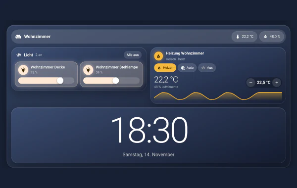 Nova Blau</td>
<td align="center" width="25%">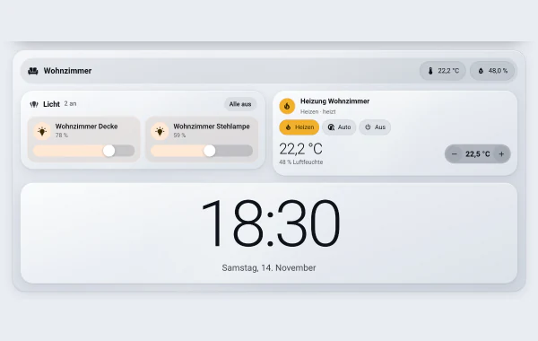 Nova Hell</td>
<td align="center" width="25%">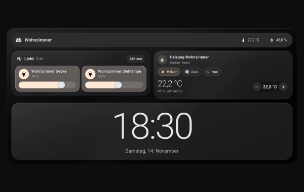 Nova Midnight</td>
<td align="center" width="25%">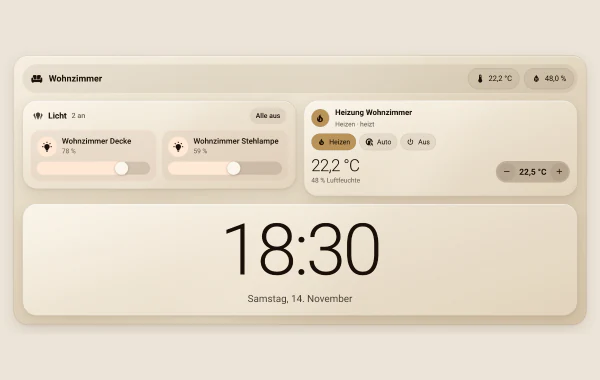 Nova Velvet</td>
</tr>
</table>

## Galerie

Ein Klick auf eine Karte öffnet ihre Anleitung.

### Räume & Navigation

<table>
<tr><td align="center" width="33%"><a href="docs/de/karten/raum.md">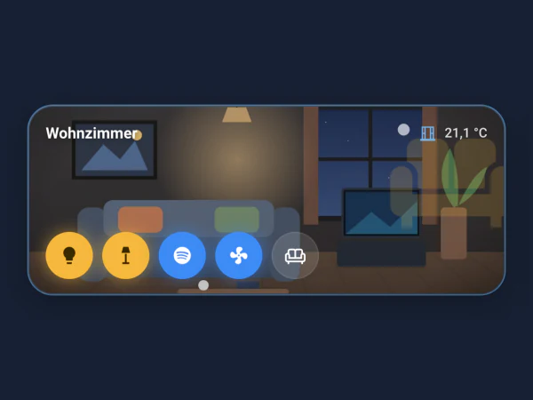</a> <b>Raum</b></td><td align="center" width="33%"><a href="docs/de/karten/bereich.md">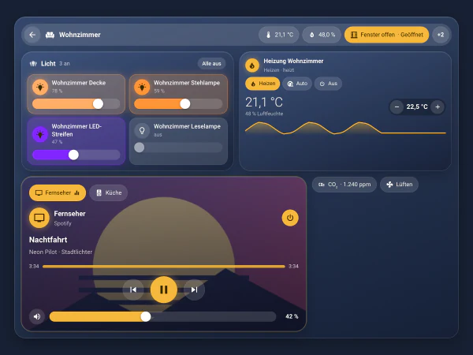</a> <b>Bereich</b></td><td align="center" width="33%"><a href="docs/de/karten/popup.md">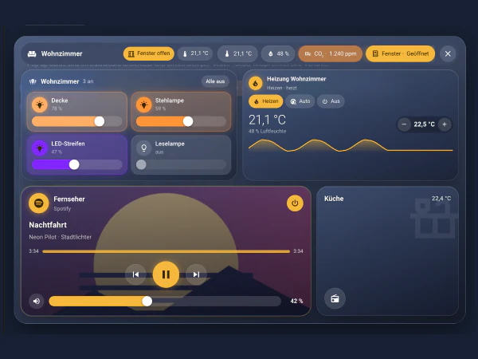</a> <b>Pop-up</b></td></tr>
<tr><td align="center" width="33%"><a href="docs/de/karten/navi.md">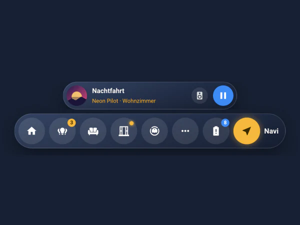</a> <b>Navi</b></td><td align="center" width="33%"><a href="docs/de/karten/swipe.md">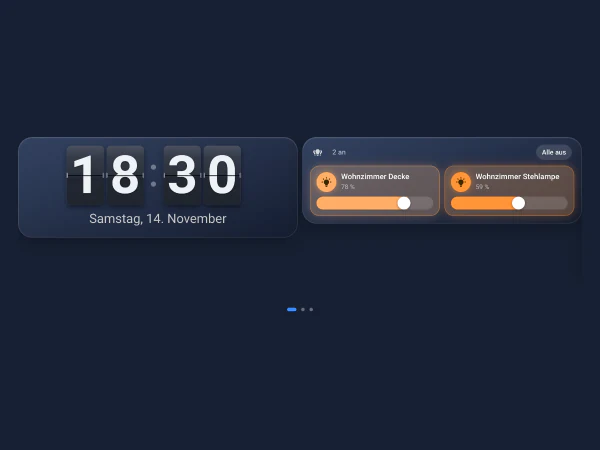</a> <b>Swipe</b></td><td align="center" width="33%"><a href="docs/de/karten/chips.md">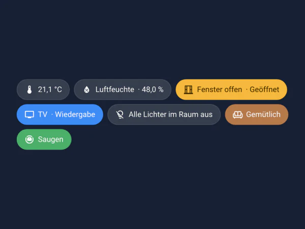</a> <b>Chips</b></td></tr>
</table>

### Licht & Klima

<table>
<tr><td align="center" width="33%"><a href="docs/de/karten/licht.md">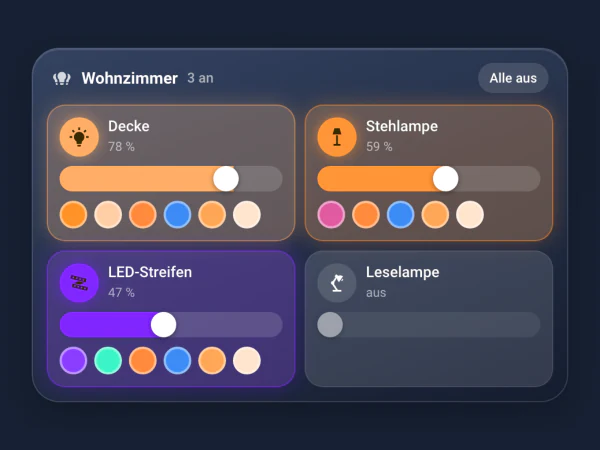</a> <b>Licht</b></td><td align="center" width="33%"><a href="docs/de/karten/thermostat.md">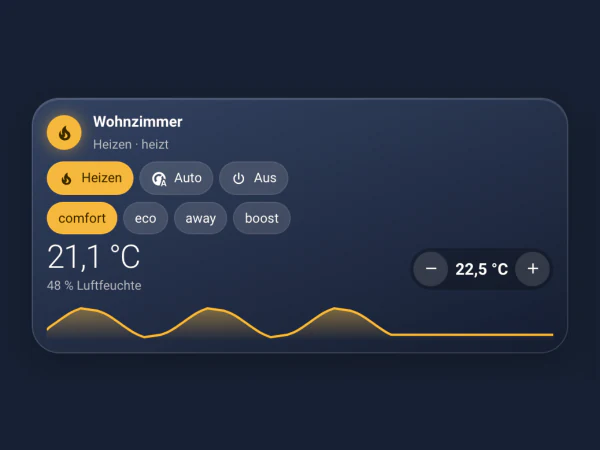</a> <b>Thermostat</b></td><td align="center" width="33%"><a href="docs/de/karten/wetter.md">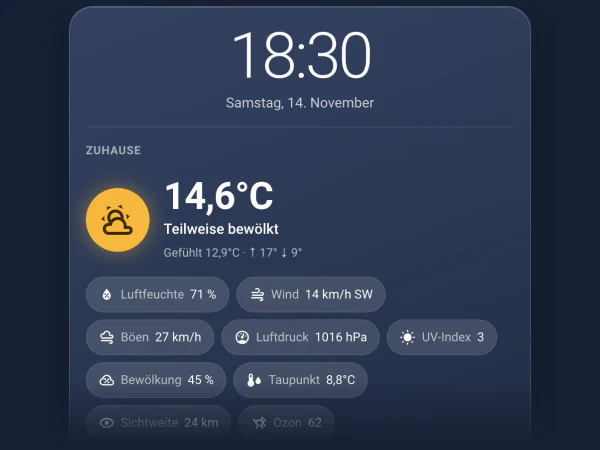</a> <b>Wetter</b></td></tr>
</table>

### Geräte

<table>
<tr><td align="center" width="33%"><a href="docs/de/karten/geraet.md">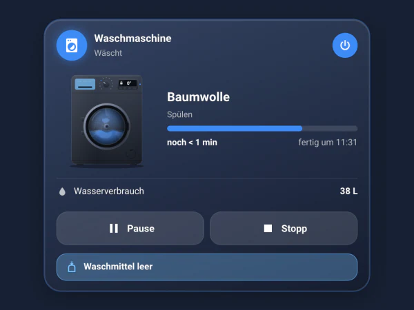</a> <b>Gerät</b></td><td align="center" width="33%"><a href="docs/de/karten/saugroboter.md">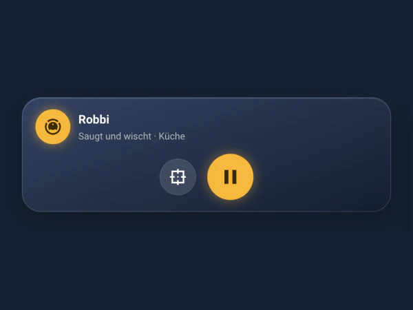</a> <b>Saugroboter</b></td><td align="center" width="33%"><a href="docs/de/karten/drucker.md">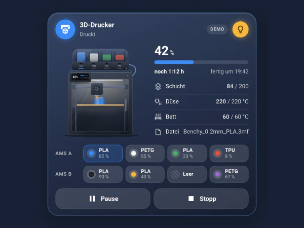</a> <b>3D-Drucker</b></td></tr>
<tr><td align="center" width="33%"><a href="docs/de/karten/modular.md">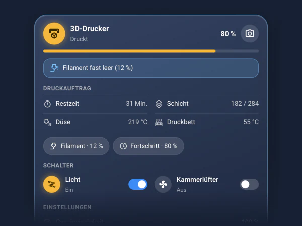</a> <b>Modular</b></td><td width="33%"></td><td width="33%"></td></tr>
</table>

### Medien

<table>
<tr><td align="center" width="33%"><a href="docs/de/karten/media.md">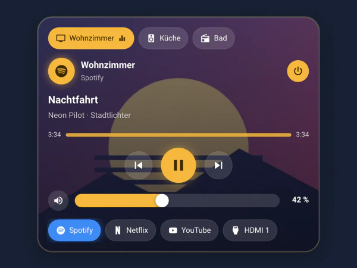</a> <b>Media</b></td><td align="center" width="33%"><a href="docs/de/karten/fernbedienung.md">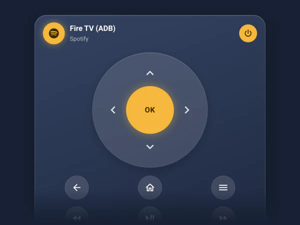</a> <b>Fernbedienung</b></td><td align="center" width="33%"><a href="docs/de/karten/kamera.md">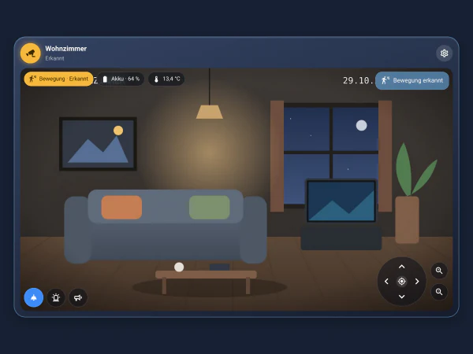</a> <b>Kamera</b></td></tr>
</table>

### Alltag

<table>
<tr><td align="center" width="33%"><a href="docs/de/karten/uhr.md">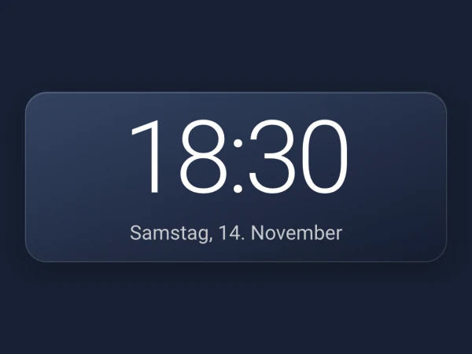</a> <b>Uhr</b></td><td align="center" width="33%"><a href="docs/de/karten/timer.md">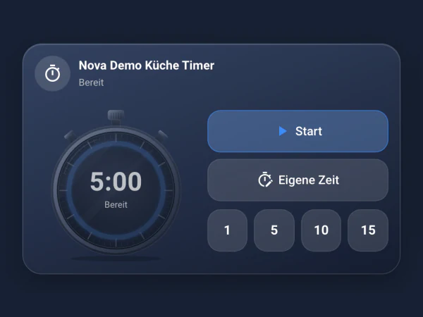</a> <b>Timer</b></td><td align="center" width="33%"><a href="docs/de/karten/muellkalender.md">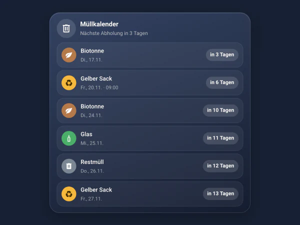</a> <b>Müllkalender</b></td></tr>
<tr><td align="center" width="33%"><a href="docs/de/karten/notiz.md">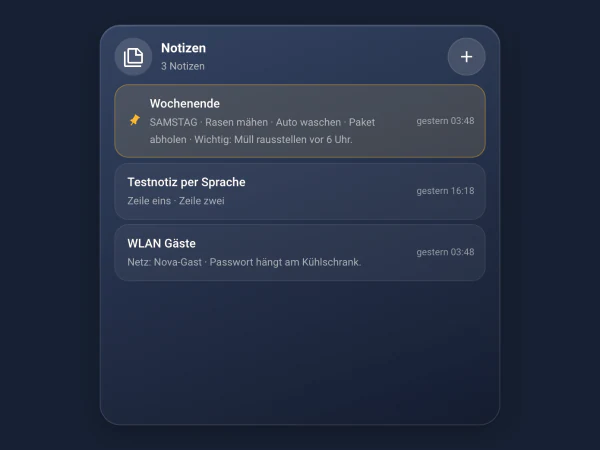</a> <b>Notiz</b></td><td align="center" width="33%"><a href="docs/de/karten/themes-schalter.md">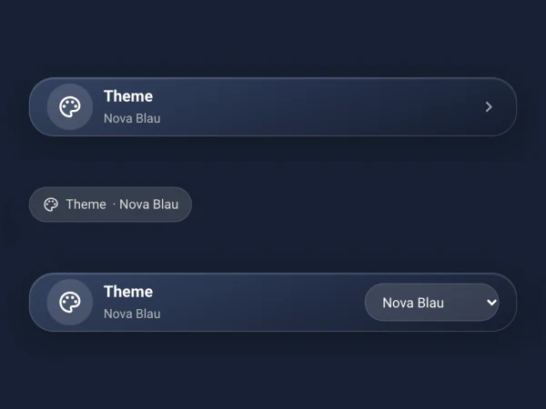</a> <b>Themes Schalter</b></td><td width="33%"></td></tr>
</table>

### Küche

<table>
<tr><td align="center" width="33%"><a href="docs/de/karten/einkauf.md">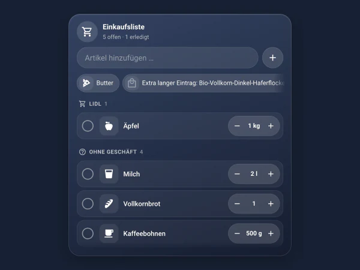</a> <b>Einkauf</b></td><td align="center" width="33%"><a href="docs/de/karten/rezeptliste.md">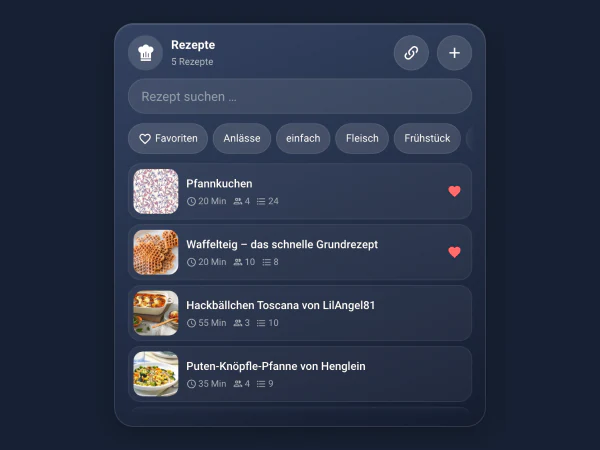</a> <b>Rezeptliste</b></td><td align="center" width="33%"><a href="docs/de/karten/rezeptbuch.md">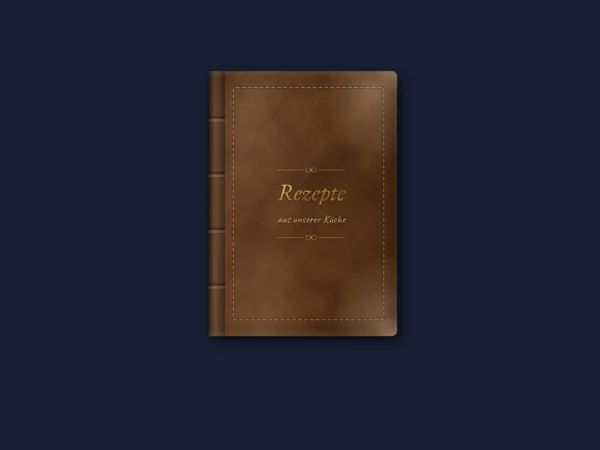</a> <b>Rezeptbuch</b></td></tr>
</table>

## Installation in vier Schritten

1. **Einstellungen → Marketplace → Über Link hinzufügen** und `https://github.com/Blackstar9119/nova-integration` eintragen.
2. **Nova Homeverse** suchen und **Herunterladen**.
3. Home Assistant **neu starten**.
4. **Einstellungen → Geräte & Dienste → Integration hinzufügen → Nova Homeverse.**

Fertig. Die Nova Cards sind jetzt in jedem Dashboard verfügbar. Jeden Klick mit Bild findest du in
[Kapitel 2 des Handbuchs](docs/de/02-installation.md).

> **Schon „Nova“ installiert?** Nova heißt jetzt Nova Homeverse. Wie du in fünf Minuten umsteigst, ohne Daten zu verlieren,
> steht im [Handbuch, Kapitel 7](docs/de/07-hilfe.md#von-nova-auf-nova-homeverse-umsteigen).

<b><a href="docs/README.md">📖 Zum Handbuch</a></b>

## Lizenz

Nova Homeverse steht unter der [MIT-Lizenz](LICENSE).
