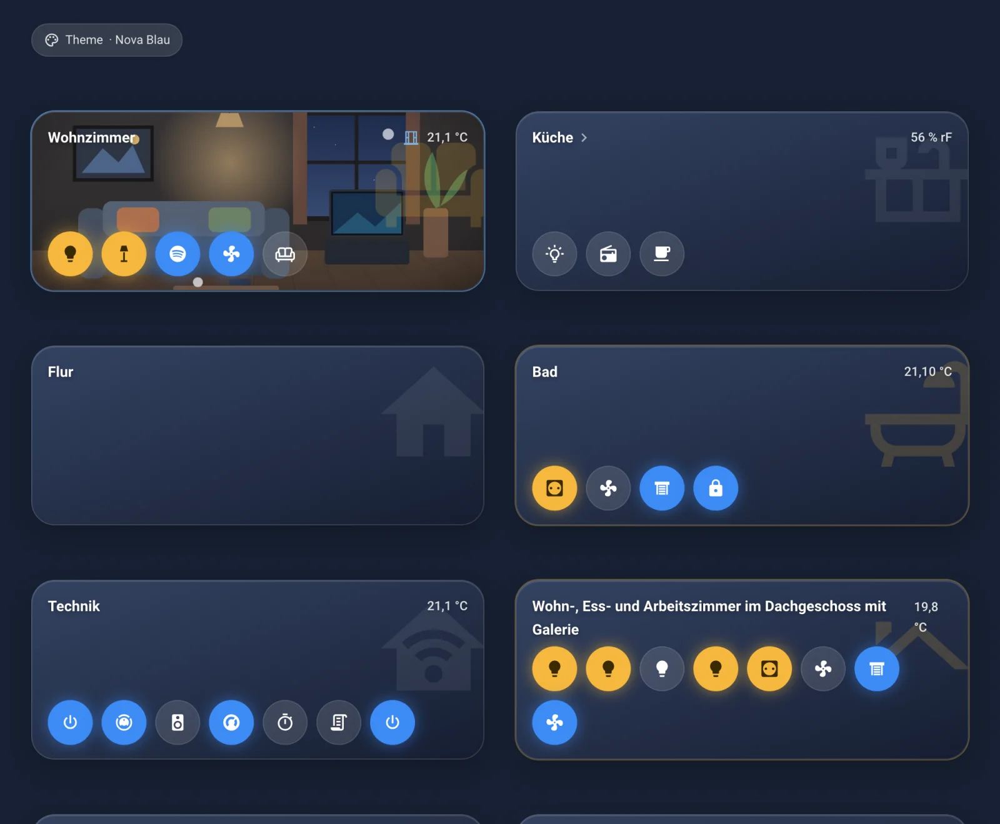

# Nova-Handbuch

**Deutsch** · English (coming soon, see [docs/en](en/README.md))

Willkommen im Handbuch zu Nova Homeverse. Es führt dich Schritt für Schritt von der Installation bis zu deinem eigenen Dashboard.
Vorwissen brauchst du keins.

## Inhaltsverzeichnis

1. **[Willkommen](de/01-willkommen.md)**
   Was Nova Homeverse ist, was du brauchst und wie du dieses Handbuch liest.
2. **[Installation Schritt für Schritt](de/02-installation.md)**
   [Marketplace öffnen](de/02-installation.md#schritt-1-marketplace-öffnen) ·
   [Nova Homeverse hinzufügen](de/02-installation.md#schritt-2-nova-homeverse-hinzufügen) ·
   [Herunterladen](de/02-installation.md#schritt-3-nova-homeverse-suchen-und-herunterladen) ·
   [Neu starten](de/02-installation.md#schritt-4-home-assistant-neu-starten) ·
   [Integration hinzufügen](de/02-installation.md#schritt-5-integration-nova-homeverse-hinzufügen)
3. **[Erste Schritte](de/03-erste-schritte.md)**
   [Nova-Panel](de/03-erste-schritte.md#1-das-nova-panel) ·
   [Theme wählen](de/03-erste-schritte.md#2-theme-wählen) ·
   [Erstes Dashboard](de/03-erste-schritte.md#3-erstes-dashboard-anlegen) ·
   [Erste Karte](de/03-erste-schritte.md#4-erste-karte-hinzufügen)
4. **[Grundbegriffe](de/04-grundbegriffe.md)**
   Dashboard, Ansicht, Karte, Entität, Bereich, Editor.
5. **[Die Karten](de/karten/README.md)**
   - Räume und Navigation: [Raum](de/karten/raum.md) · [Bereich](de/karten/bereich.md) · [Pop-up](de/karten/popup.md) ·
     [Navi](de/karten/navi.md) · [Swipe](de/karten/swipe.md) · [Chips](de/karten/chips.md)
   - Licht und Klima: [Licht](de/karten/licht.md) · [Thermostat](de/karten/thermostat.md)
   - Geräte: [Gerät](de/karten/geraet.md) · [Saugroboter](de/karten/saugroboter.md) · [3D-Drucker](de/karten/drucker.md) ·
     [Modular](de/karten/modular.md)
   - Medien und Kamera: [Media](de/karten/media.md) · [Fernbedienung](de/karten/fernbedienung.md) · [Kamera](de/karten/kamera.md)
   - Alltag: [Uhr](de/karten/uhr.md) · [Wetter](de/karten/wetter.md) · [Timer](de/karten/timer.md) ·
     [Müllkalender](de/karten/muellkalender.md) · [Einkauf](de/karten/einkauf.md) · [Notiz](de/karten/notiz.md) ·
     [Rezeptliste](de/karten/rezeptliste.md) · [Rezeptbuch](de/karten/rezeptbuch.md)
   - Aussehen: [Themes Schalter](de/karten/themes-schalter.md)
6. **[Rezepte für ganze Dashboards](de/06-dashboard-rezepte.md)**
   Wohnzimmer-Tablet, Nachttisch-Display, Handy-Ansicht.
7. **[Hilfe bei Problemen](de/07-hilfe.md)**
   Karte grau oder leer, Entität fehlt, Cache leeren, Update, Fehler melden.
8. **[Glossar](de/08-glossar.md)**
   Alle Begriffe von A bis Z.

## Über die Bilder

Alle Bilder in diesem Handbuch sind echte Bildschirmfotos aus einem laufenden Home Assistant mit Nova Homeverse. Ein roter Rahmen
zeigt dir, wohin du klicken sollst.

[← Zurück zur Startseite](../README.md)
