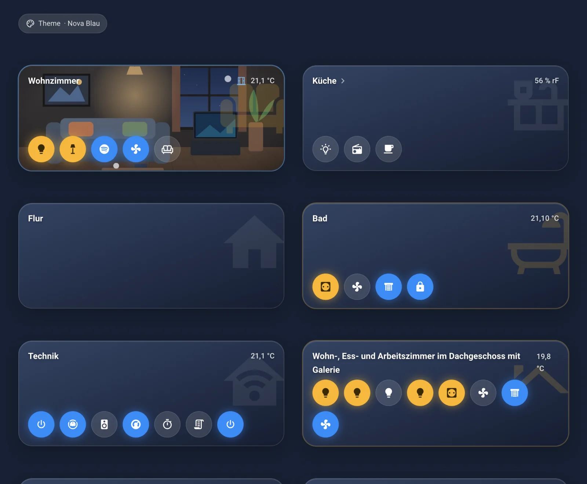
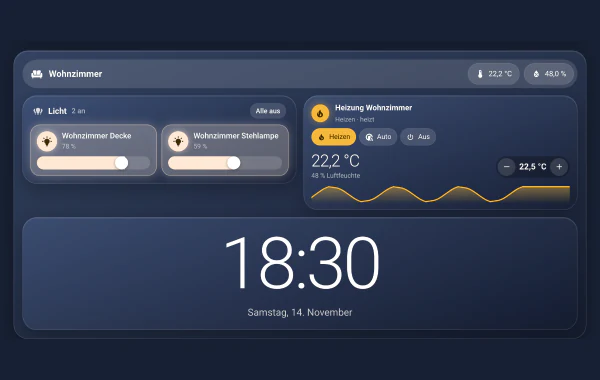
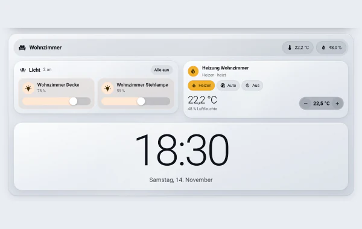
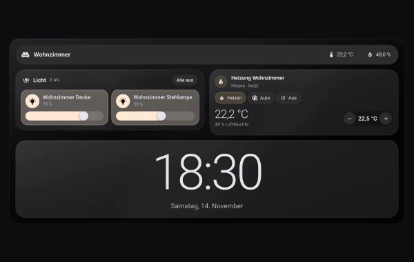
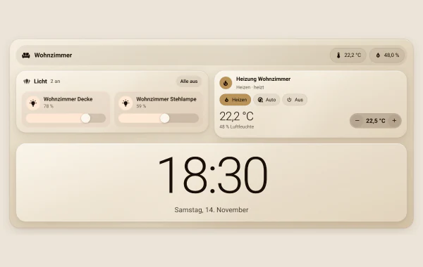

# Kapitel 1 – Willkommen

[← Inhaltsverzeichnis](../README.md)

Schön, dass du da bist! Dieses Handbuch bringt dich von „Ich habe Home Assistant seit einer Stunde“ zu deinem ersten
schönen Dashboard mit Nova. Du brauchst kein Vorwissen. Jeder Fachbegriff wird erklärt, wenn er zum ersten Mal auftaucht.

## Was ist Nova?

Nova ist eine Erweiterung für Home Assistant. In der Fachsprache heißt so eine Erweiterung **Integration**: ein Baustein,
der Home Assistant neue Fähigkeiten gibt. Nova bringt zwei Dinge mit:

- **Nova Cards:** 24 Karten für dein Dashboard. Eine **Karte** ist ein Kästchen auf dem Bildschirm, das etwas anzeigt oder
  bedient, zum Beispiel eine Lampe, das Wetter oder deine Einkaufsliste. Ein **Dashboard** ist die Seite, auf der deine
  Karten liegen.
- **Ein gemeinsamer Speicher:** Theme, Notizen, Einkaufsliste und Rezepte liegen in Home Assistant selbst. Darum sehen
  Handy, Tablet und PC immer dasselbe.

Alle Nova Cards haben denselben Look und wechseln gemeinsam die Farben. Dafür gibt es vier **Themes** (Farbschemata):
Nova Blau, Nova Hell, Nova Midnight und Nova Velvet.

<table>
<tr>
<td align="center" width="25%"> Nova Blau</td>
<td align="center" width="25%"> Nova Hell</td>
<td align="center" width="25%"> Nova Midnight</td>
<td align="center" width="25%"> Nova Velvet</td>
</tr>
</table>

## Was du brauchst

- Home Assistant ab Version 2025.1. Die Bilder in diesem Handbuch stammen aus Home Assistant 2026.11.
- Ein Benutzerkonto mit **Administrator**-Rechten. Das ist das Konto, das du beim Einrichten von Home Assistant angelegt hast.
- Etwa 15 Minuten Zeit.

## So liest du dieses Handbuch

Lies die Kapitel 2 und 3 einmal von vorne nach hinten. Danach ist Nova installiert und deine erste Karte steht.
Alles andere kannst du nachschlagen, wenn du es brauchst.

| Kapitel | Darum geht es |
|---|---|
| [2 – Installation](02-installation.md) | Nova installieren, jeder Klick mit Bild |
| [3 – Erste Schritte](03-erste-schritte.md) | Theme wählen, erstes Dashboard, erste Karte |
| [4 – Grundbegriffe](04-grundbegriffe.md) | Dashboard, Ansicht, Karte, Entität, Bereich, Editor |
| [5 – Die Karten](karten/README.md) | Jede Karte auf einer eigenen Seite |
| [6 – Rezepte für ganze Dashboards](06-dashboard-rezepte.md) | Wohnzimmer-Tablet, Nachttisch, Handy |
| [7 – Hilfe bei Problemen](07-hilfe.md) | Wenn etwas nicht klappt |
| [8 – Glossar](08-glossar.md) | Alle Begriffe von A bis Z |

> **Ein Tipp vorab:** Auf den Bildern markiert ein **roter Rahmen** die Stelle, auf die du klicken sollst.

---

[← Inhaltsverzeichnis](../README.md) · [Kapitel 2: Installation →](02-installation.md)
