# Kapitel 2 – Installation Schritt für Schritt

[← Inhaltsverzeichnis](../README.md)

In diesem Kapitel installierst du Nova. Das dauert etwa zehn Minuten. Du brauchst dafür ein Konto mit
Administrator-Rechten.

Der Weg in Kurzform:

1. Marketplace öffnen
2. Nova hinzufügen und herunterladen
3. Home Assistant neu starten
4. Integration „Nova“ hinzufügen

> Der **Marketplace** ist der Laden in Home Assistant. Dort findest du Erweiterungen, die von der Community gebaut wurden,
> also von Leuten wie dir und mir. Nova ist eine davon.

## Schritt 1: Marketplace öffnen

Klicke links in der Seitenleiste ganz unten auf **Einstellungen**. Dort findest du den Eintrag **Marketplace**.

<p align="center">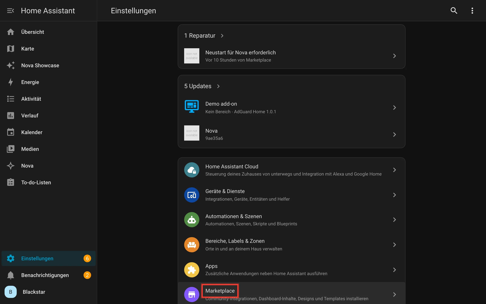</p>

## Schritt 2: Nova hinzufügen

Nova steht noch nicht in der allgemeinen Liste des Marketplace. Du fügst es deshalb einmal über seinen GitHub-Link hinzu.
**GitHub** ist die Webseite, auf der Nova gespeichert ist.

Klicke oben rechts auf **Über Link hinzufügen**.

<p align="center">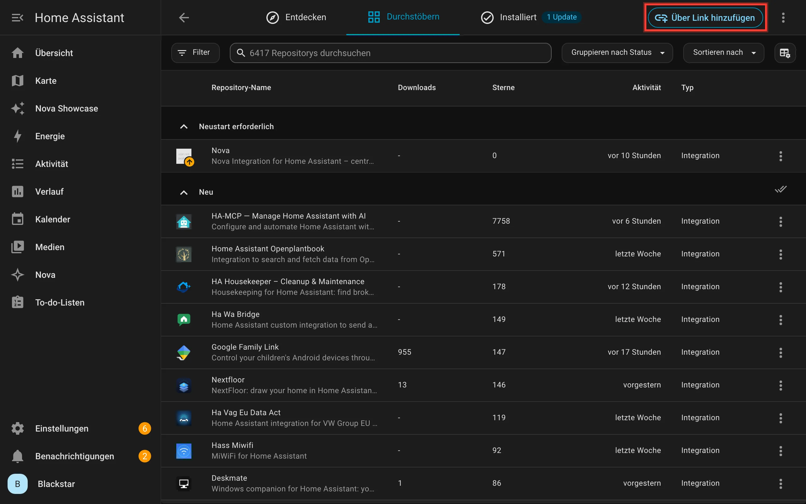</p>

Ins Feld **GitHub-Link** kopierst du diese Adresse:

```
https://github.com/Blackstar9119/nova-integration
```

Dann klickst du auf **Hinzufügen**.

<p align="center">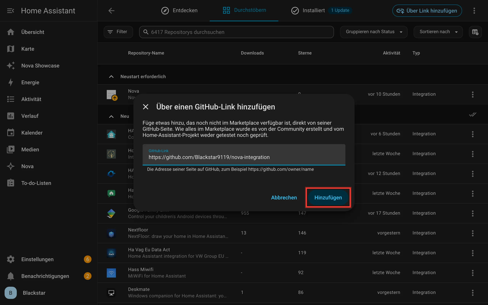</p>

> **Gut zu wissen:** Der Hinweis im Dialog stimmt. Was im Marketplace liegt, hat die Community gebaut und nicht das
> Home-Assistant-Team geprüft. Nova ist quelloffen, du kannst dir also jede Zeile ansehen.

## Schritt 3: Nova suchen und herunterladen

Tippe ins Suchfeld oben **Nova** ein. In der Liste erscheint der Eintrag **Nova** mit dem Text „Nova Integration for
Home Assistant“. Klicke ihn an.

<p align="center">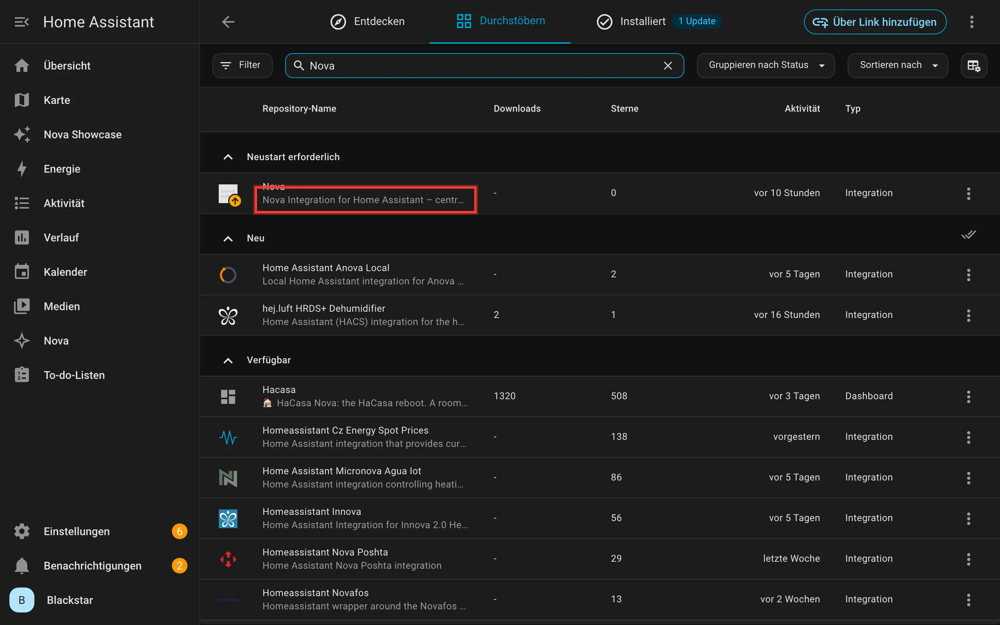</p>

Jetzt siehst du die Seite von Nova. Klicke rechts auf **Herunterladen** und bestätige.

<p align="center">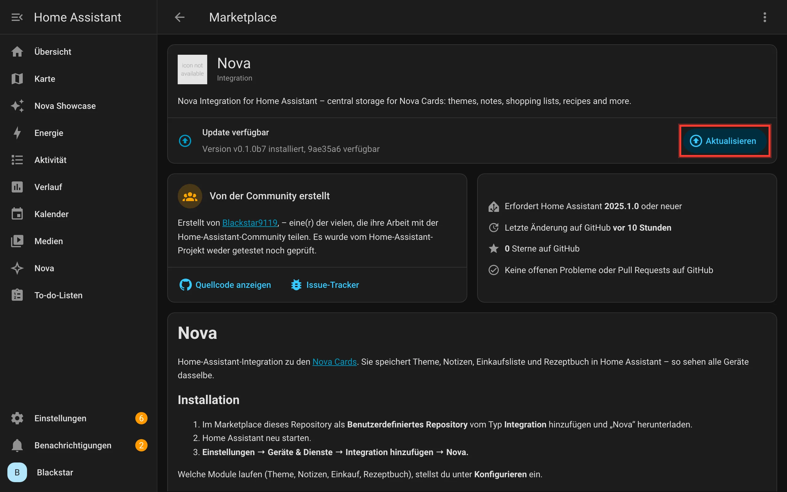</p>

> Auf dem Bild steht **Aktualisieren** statt **Herunterladen**, weil Nova auf unserem Testsystem schon installiert ist.
> Bei dir steht an derselben Stelle **Herunterladen**.

## Schritt 4: Home Assistant neu starten

Nach dem Herunterladen braucht Home Assistant einen **Neustart**. Erst dann lädt es neue Integrationen. Unter
**Einstellungen** erscheint dafür oben eine **Reparatur**: „Neustart für Nova erforderlich“. Klicke sie an.

<p align="center">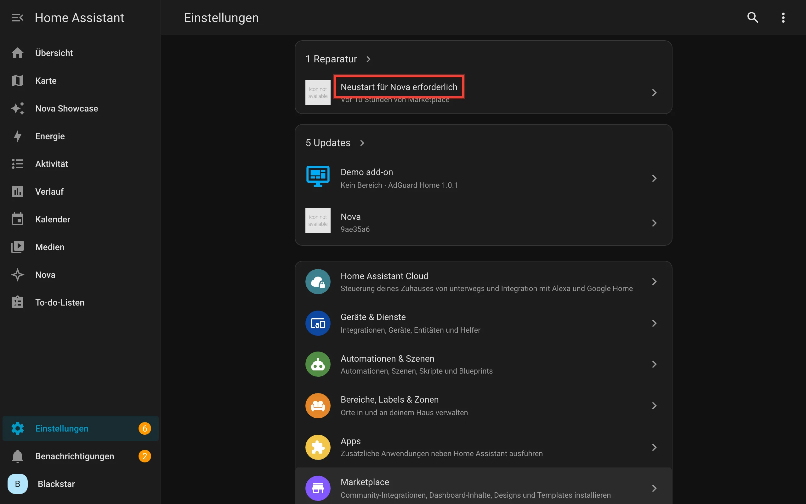</p>

Klicke auf **Neu starten**. Home Assistant ist jetzt ein bis zwei Minuten weg und kommt dann von selbst wieder.

<p align="center">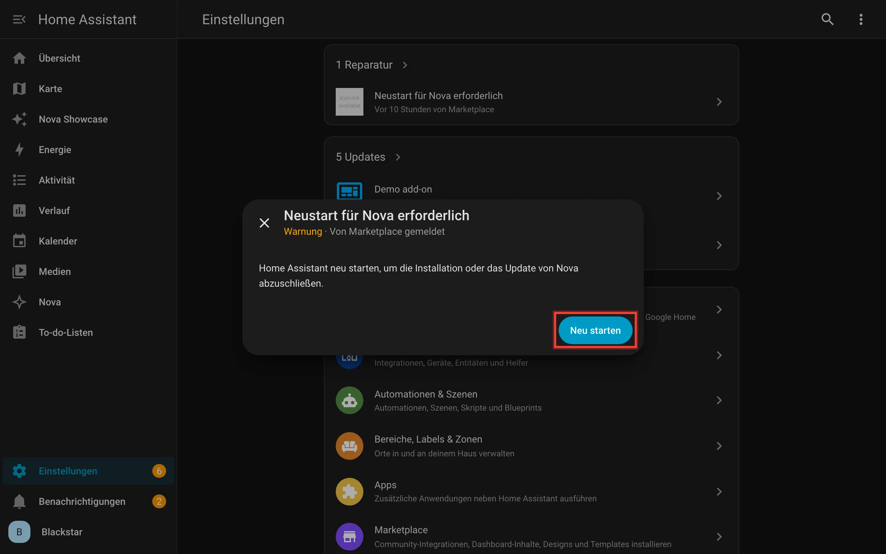</p>

## Schritt 5: Integration „Nova“ hinzufügen

Heruntergeladen heißt noch nicht eingerichtet. Das machst du jetzt. Gehe zu **Einstellungen → Geräte & Dienste** und
klicke unten rechts auf **Integration hinzufügen**.

<p align="center">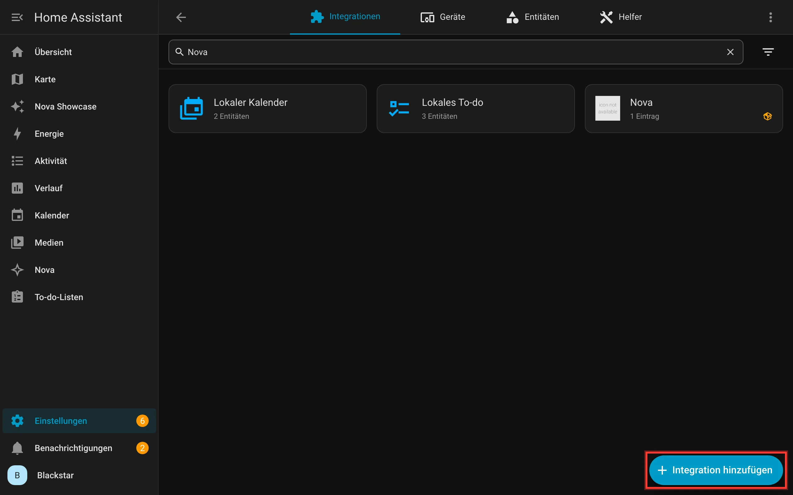</p>

Tippe **Nova** ins Suchfeld und klicke auf den Eintrag **Nova** mit dem kleinen Paket-Symbol. Das Symbol zeigt, dass die
Integration aus dem Marketplace kommt.

<p align="center">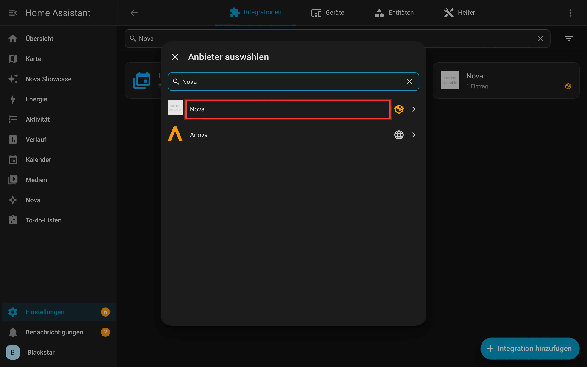</p>

Es öffnet sich ein kurzes Fenster: „Speicher für Nova Cards: Theme, Notizen, Einkauf und Rezeptbuch.“ Du musst nichts
eingeben. Klicke auf **Senden**. Fertig!

> Steht dort „Nova ist schon eingerichtet“? Dann hast du Nova früher schon hinzugefügt und musst nichts mehr tun.

## Schritt 6 (optional): Module wählen

Nova besteht aus vier **Modulen**: Theme, Notizen, Einkauf und Rezeptbuch. Ein Modul ist ein Teil von Nova, den du
einzeln an- und ausschalten kannst. Am Anfang sind alle an. Das passt für die meisten.

Willst du etwas abschalten? Dann klicke unter **Einstellungen → Geräte & Dienste → Nova** auf das **Zahnrad**.

<p align="center">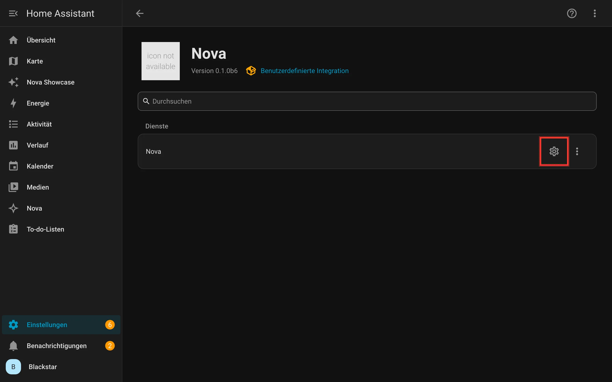</p>

Setze oder entferne die Haken und klicke auf **OK**. Die Änderung wirkt sofort. Abgeschaltete Module behalten ihre Daten.

<p align="center">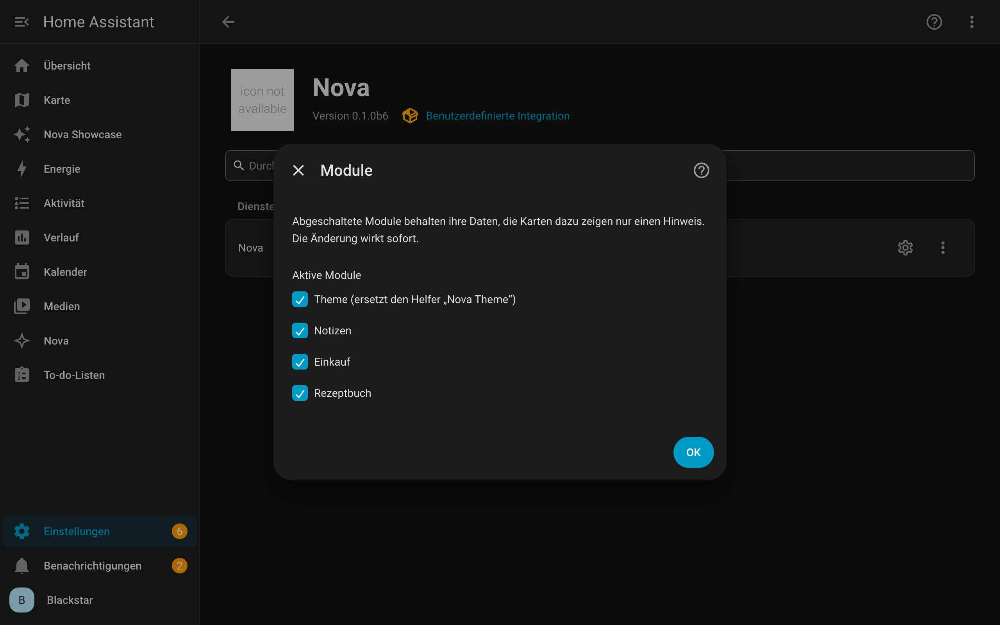</p>

## Geschafft

Nova ist installiert. Die Nova Cards sind ab jetzt in jedem Dashboard verfügbar. Du musst dafür nichts weiter einrichten.

Und links in der Seitenleiste gibt es jetzt den Eintrag **Nova**. Was du dort machst, zeigt dir das nächste Kapitel.

---

[← Kapitel 1: Willkommen](01-willkommen.md) · [Kapitel 3: Erste Schritte →](03-erste-schritte.md)
