# Kapitel 3 – Erste Schritte

[← Inhaltsverzeichnis](../README.md)

Nova ist installiert. Jetzt wird es bunt: Du wählst ein Theme, legst dein erstes Dashboard an und setzt deine erste
Nova Card darauf.

## 1. Das Nova-Panel

Links in der Seitenleiste steht jetzt **Nova**. Das ist das **Nova-Panel**, die Einstellungsseite von Nova. Ein **Panel**
ist in Home Assistant einfach eine eigene Seite in der Seitenleiste. Das Nova-Panel sehen nur Administratoren.

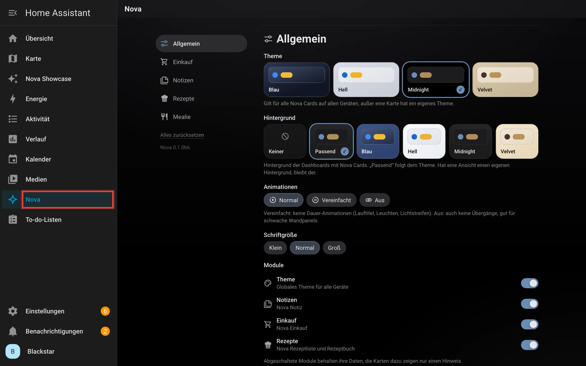

Unter **Allgemein** stellst du ein:

- **Theme:** die Farben aller Nova Cards.
- **Hintergrund:** die Farbe hinter den Karten. „Passend“ folgt dem Theme.
- **Animationen:** „Vereinfacht“ oder „Aus“ sind gut für schwache Wandtablets.
- **Schriftgröße:** Klein, Normal oder Groß.
- **Module:** dieselben Schalter wie in Kapitel 2, Schritt 6.

Links findest du außerdem Einstellungen für **Einkauf**, **Notizen** und **Rezepte**. Die brauchst du am Anfang nicht.

## 2. Theme wählen

Klicke unter **Theme** auf das Theme, das dir gefällt. Hier wählen wir **Blau**.

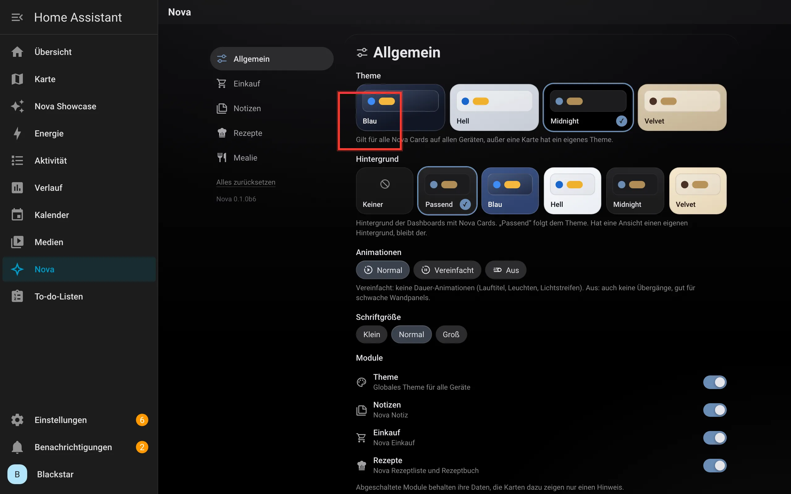

Die Änderung gilt sofort, auf allen Geräten. Speichern musst du nichts.

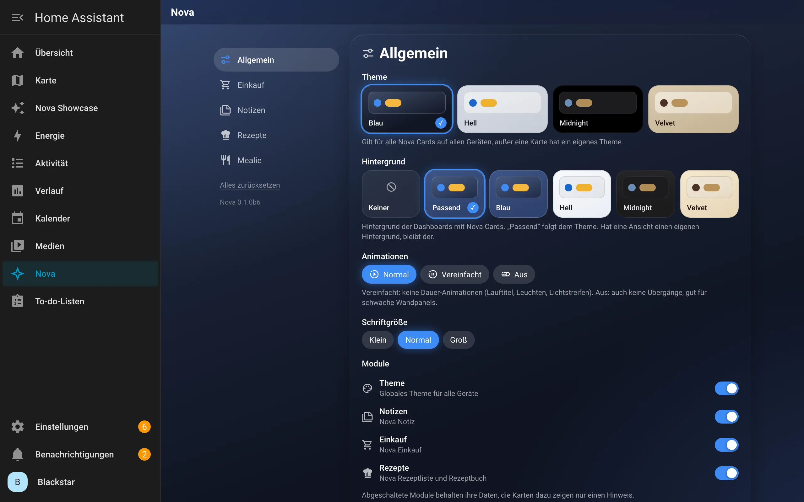

> Das Theme kannst du jederzeit wieder ändern. Wenn du es öfter wechselst, ist der
> [Nova Themes Schalter](karten/themes-schalter.md) bequemer: Den legst du als Karte direkt ins Dashboard.

## 3. Erstes Dashboard anlegen

Ein **Dashboard** ist eine Seite mit Karten. Home Assistant hat schon eins, die „Übersicht“. Die baut Home Assistant aber
selbst. Für Nova legst du dir ein eigenes an, das dir ganz allein gehört.

Gehe zu **Einstellungen → Dashboards** und klicke unten rechts auf **Dashboard hinzufügen**.

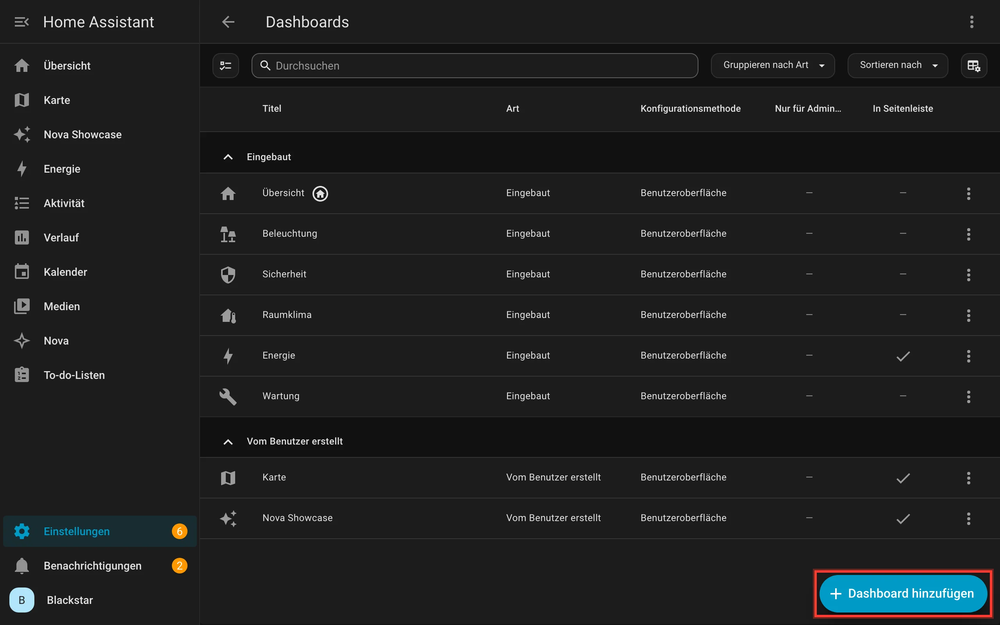

Wähle **Neues Dashboard von Grund auf**.

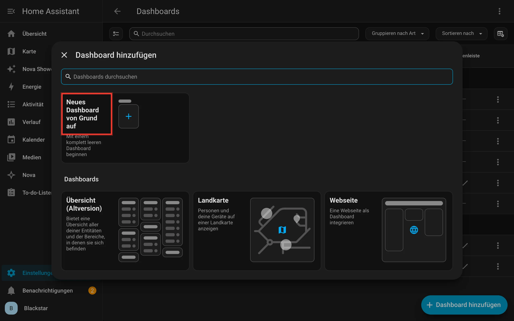

Gib einen **Titel** ein, zum Beispiel „Mein Zuhause“. Beim **Seitenleistensymbol** suchst du dir ein Icon aus, zum Beispiel
`mdi:home-heart`. Die **URL** füllt Home Assistant selbst aus. Klicke auf **Erstellen**.

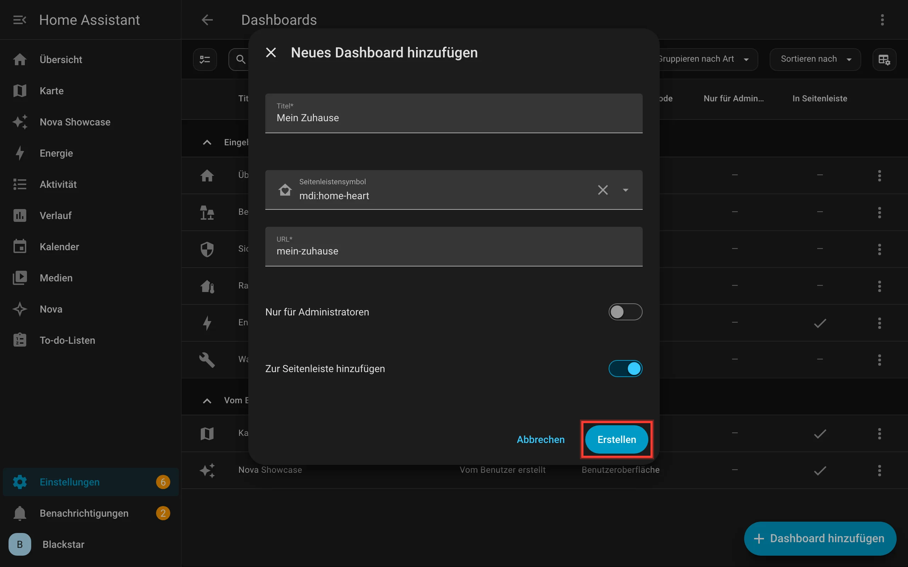

Dein Dashboard steht jetzt in der Liste und links in der Seitenleiste.

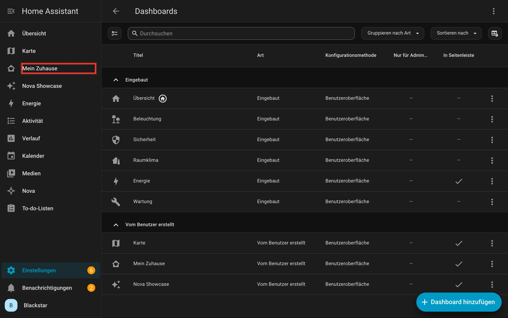

## 4. Erste Karte hinzufügen

Klicke links auf **Mein Zuhause**. Das Dashboard ist noch leer. Klicke oben rechts auf den **Stift**. Damit schaltest du
den **Bearbeitungsmodus** ein.

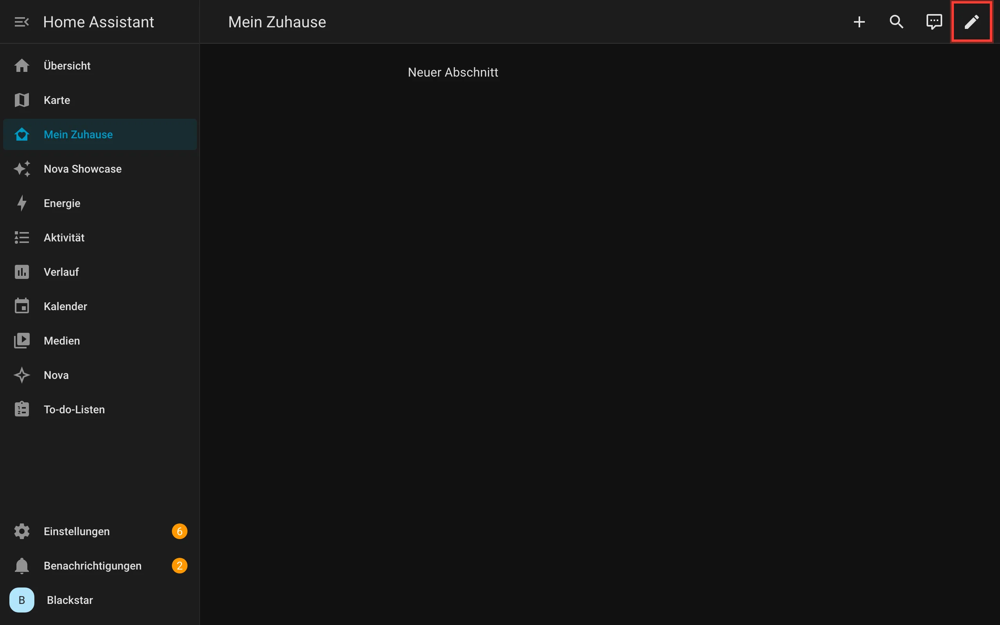

Jetzt siehst du gestrichelte Rahmen. Jeder Rahmen ist ein **Abschnitt**, eine Gruppe von Karten. Klicke im Abschnitt
„Neuer Abschnitt“ auf das **+**.

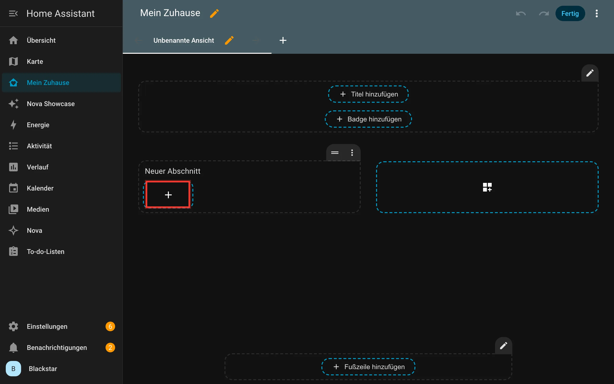

Es öffnet sich die Kartenauswahl. Wechsle oben auf den Reiter **Nach Karte** und tippe **Nova** ins Suchfeld. Jetzt siehst du
alle Nova Cards mit einer kleinen Vorschau.

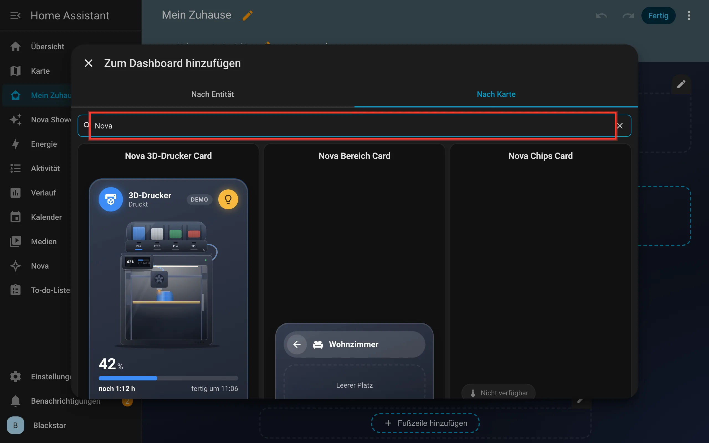

Für den Anfang nimmst du die **Nova Raum Card**. Tippe dafür „Nova Raum“ ins Suchfeld und klicke auf die Karte.

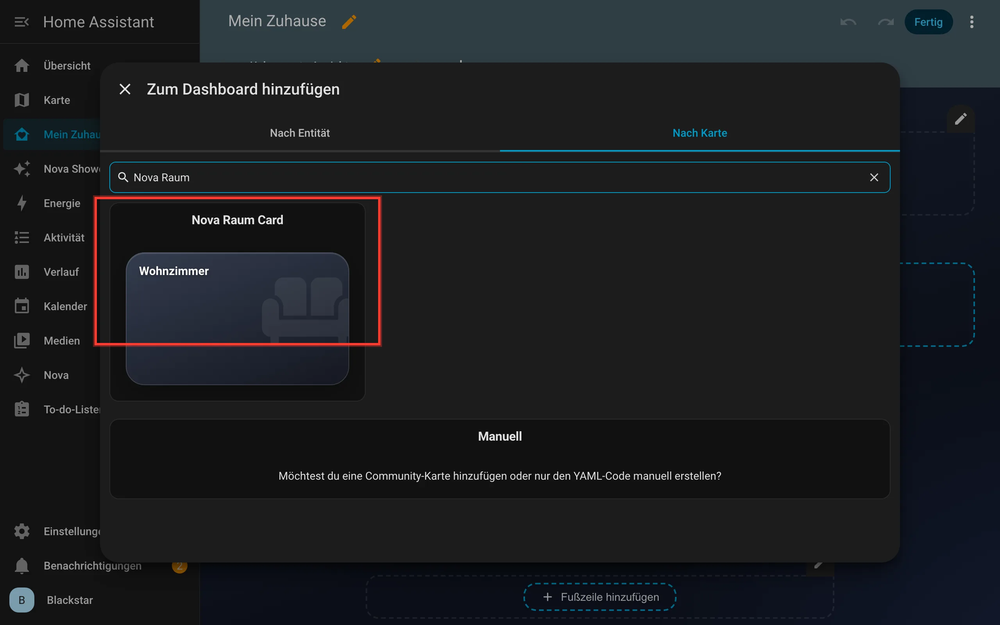

Jetzt öffnet sich der **Editor**. Links stellst du alles ein, rechts siehst du sofort das Ergebnis. Gib unter
**Allgemein** einen Namen ein und klappe die anderen Bereiche auf, wenn du magst. Was in jedem Bereich steckt, steht auf
der Seite der [Raum Card](karten/raum.md). Klicke auf **Speichern**.

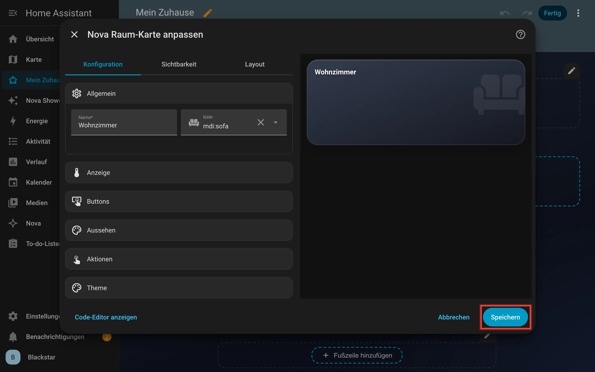

Die Karte liegt jetzt im Abschnitt. Klicke oben rechts auf **Fertig**, um den Bearbeitungsmodus zu verlassen.

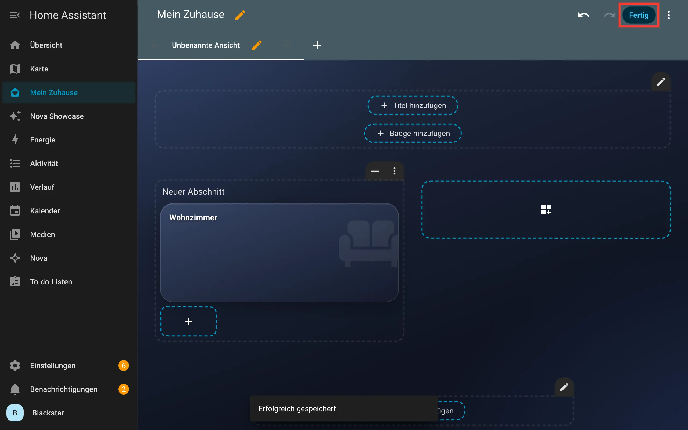

Geschafft! Deine erste Nova Card ist da.

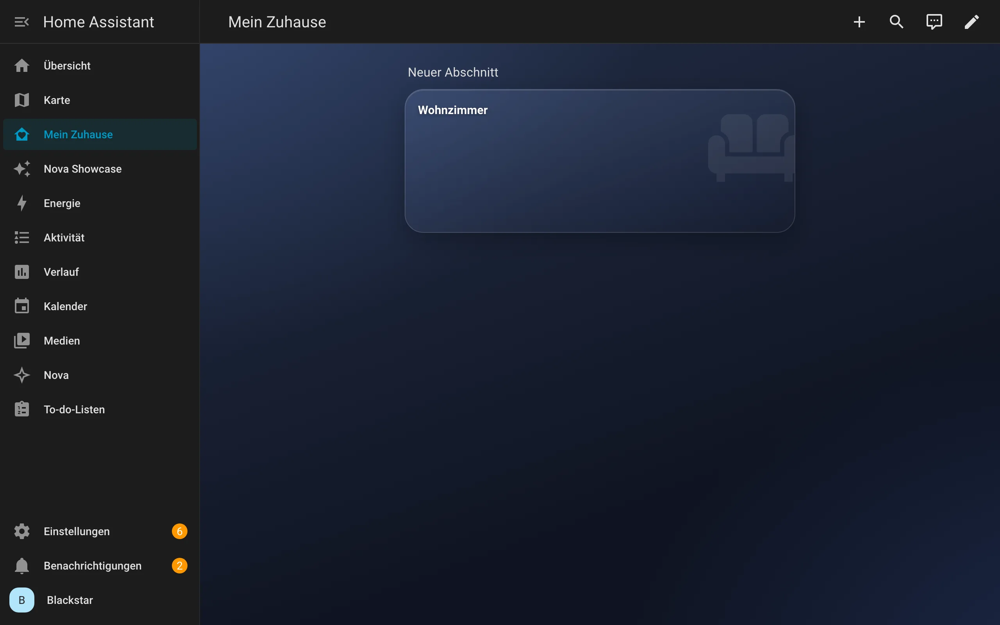

## Wie geht es weiter?

- Lies in [Kapitel 4](04-grundbegriffe.md) nach, was Dashboard, Ansicht, Karte und Entität genau bedeuten.
- Stöbere in [Kapitel 5](karten/README.md) durch alle Karten und such dir aus, was du brauchst.
- Hol dir in [Kapitel 6](06-dashboard-rezepte.md) Ideen für ganze Dashboards.

---

[← Kapitel 2: Installation](02-installation.md) · [Kapitel 4: Grundbegriffe →](04-grundbegriffe.md)
