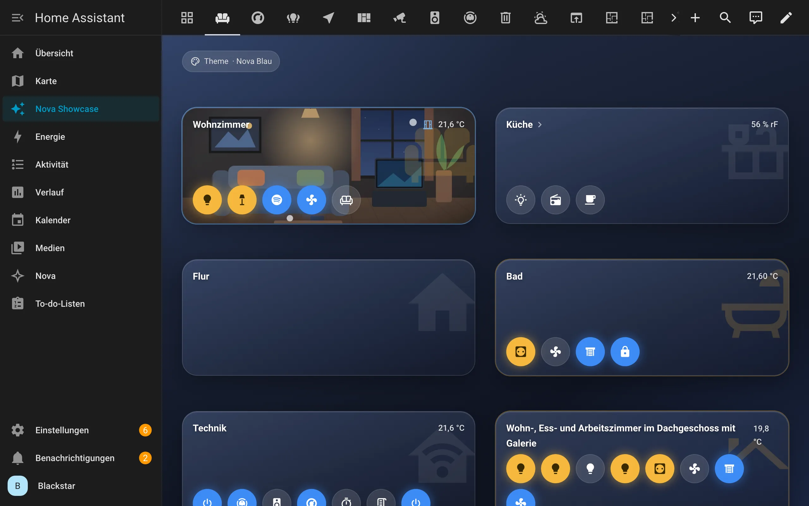
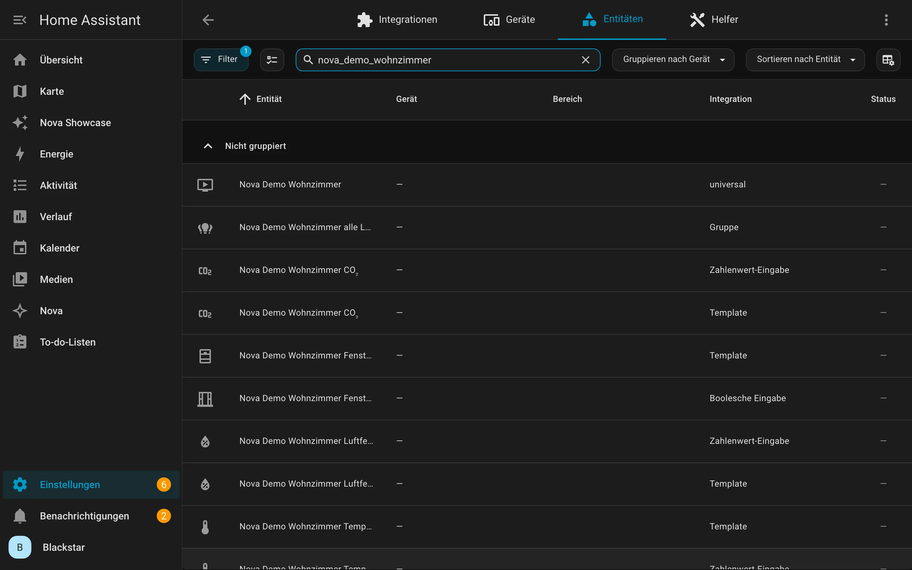
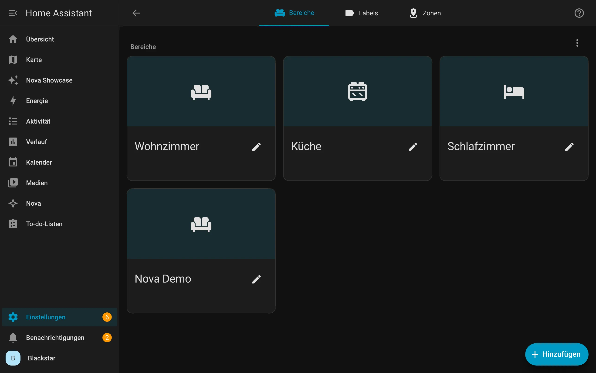
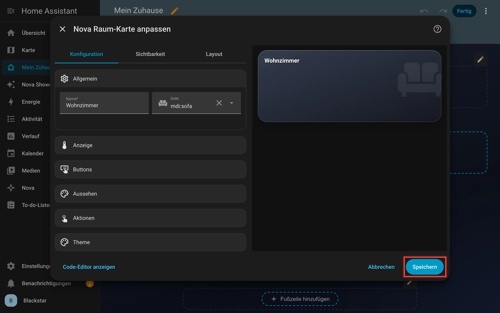

# Kapitel 4 – Grundbegriffe

[← Inhaltsverzeichnis](../README.md)

Home Assistant hat ein paar eigene Wörter. Sechs davon brauchst du ständig. Hier sind sie, mit Bildern.

## Dashboard

Ein **Dashboard** ist eine Seite, auf der deine Karten liegen. Du kannst mehrere Dashboards haben, zum Beispiel eins fürs
Handy und eins fürs Wandtablet. Jedes Dashboard steht links in der Seitenleiste.

Neue Dashboards legst du unter **Einstellungen → Dashboards** an. Wie das geht, steht in
[Kapitel 3](03-erste-schritte.md#3-erstes-dashboard-anlegen).

## Ansicht

Ein Dashboard kann mehrere **Ansichten** haben. Das sind Unterseiten, die oben als Reiter stehen, zum Beispiel
„Wohnzimmer“, „Küche“ und „Garten“. Im Bild oben sind es die vielen kleinen Symbole in der Kopfzeile.

Eine Ansicht hat einen **Typ**. Für Nova Homeverse empfehlen wir den Typ **Abschnitte**. Dort liegen die Karten in **Abschnitten**,
also in Gruppen, die sich der Bildschirmbreite anpassen. Für Wandtablets gibt es den Typ **Panel**: Dann füllt eine
einzige Karte die ganze Seite.

Mit [Nova Navi](karten/navi.md) springst du bequem zwischen den Ansichten hin und her.

## Karte

Eine **Karte** ist ein Kästchen auf dem Dashboard. Sie zeigt etwas an oder bedient etwas. Home Assistant bringt eigene
Karten mit. Nova Homeverse bringt 24 weitere dazu, alle im selben Look. Eine Übersicht findest du in [Kapitel 5](karten/README.md).

## Entität

Eine **Entität** ist ein einzelnes Ding, das Home Assistant kennt: eine Lampe, ein Temperatursensor, ein Fensterkontakt,
ein Lautsprecher. Jede Entität hat einen **Zustand** (zum Beispiel „an“, „21,5 °C“ oder „offen“) und eine **Entitäts-ID**.
Die ID sieht so aus: `light.wohnzimmer_decke`. Vor dem Punkt steht die Art (hier `light` für Licht), dahinter der Name.

Alle Entitäten findest du unter **Einstellungen → Geräte & Dienste → Entitäten**.

Die meisten Nova Cards fragen dich zuerst nach einer Entität. Die Auswahl hat eine Suche, du musst die IDs also nicht
auswendig kennen.

| Beginnt mit | Was ist das? |
|---|---|
| `light.` | Lampe |
| `switch.` | Schalter, zum Beispiel eine Steckdose |
| `sensor.` | Messwert, zum Beispiel Temperatur |
| `binary_sensor.` | Etwas mit zwei Zuständen, zum Beispiel ein Fenster (offen/zu) |
| `climate.` | Heizung oder Klimaanlage |
| `media_player.` | Lautsprecher, Fernseher |
| `camera.` | Kamera |
| `weather.` | Wetter |
| `calendar.` | Kalender |
| `todo.` | Liste, zum Beispiel eine Einkaufsliste |

## Bereich

Ein **Bereich** ist ein Raum oder Ort in deinem Zuhause: Wohnzimmer, Küche, Garten. Du ordnest Geräte einem Bereich zu.
Manchmal steht in Home Assistant auch das englische Wort **Area**.

Bereiche verwaltest du unter **Einstellungen → Bereiche, Labels & Zonen**.

Warum das für Nova Homeverse wichtig ist: Einige Karten können mit Bereichen arbeiten. Die [Licht Card](karten/licht.md) holt sich
zum Beispiel alle Lampen eines Bereichs selbst. Es lohnt sich also, deine Geräte den richtigen Räumen zuzuordnen.

## Editor

Der **Editor** ist das Fenster, in dem du eine Karte einstellst. Er öffnet sich, wenn du eine Karte hinzufügst oder im
Bearbeitungsmodus eine Karte antippst. Links stehen die Einstellungen, rechts die **Vorschau**.

Alle Nova Cards lassen sich komplett im Editor einstellen. Unten links gibt es noch **Code-Editor anzeigen**. Dort steht die
Karte als **YAML**, eine Textform für Einstellungen. Das brauchst du nicht, aber es ist praktisch zum Kopieren.

---

[← Kapitel 3: Erste Schritte](03-erste-schritte.md) · [Kapitel 5: Die Karten →](karten/README.md)
