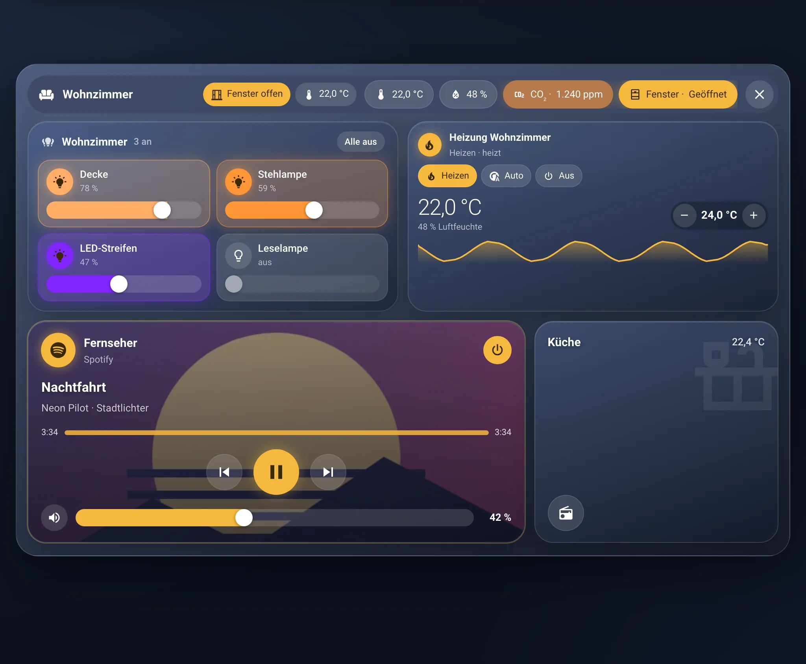
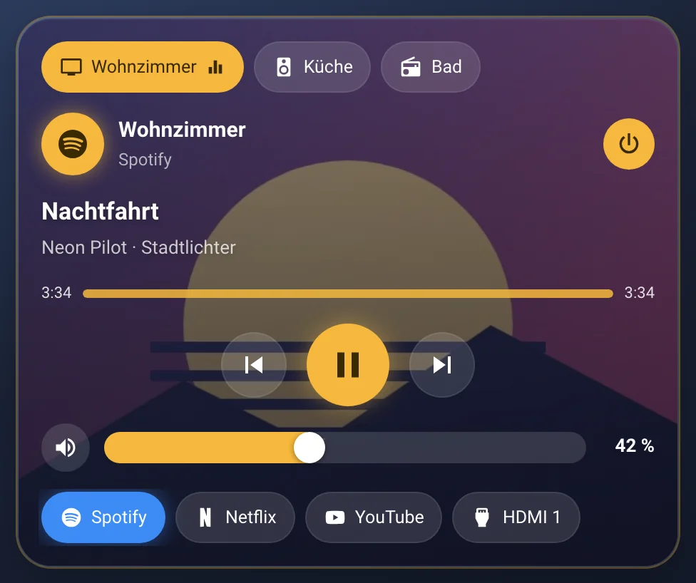
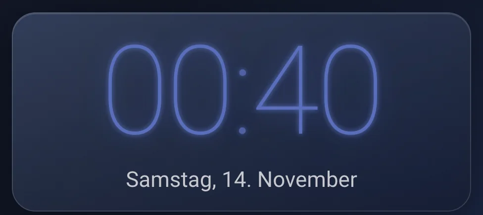
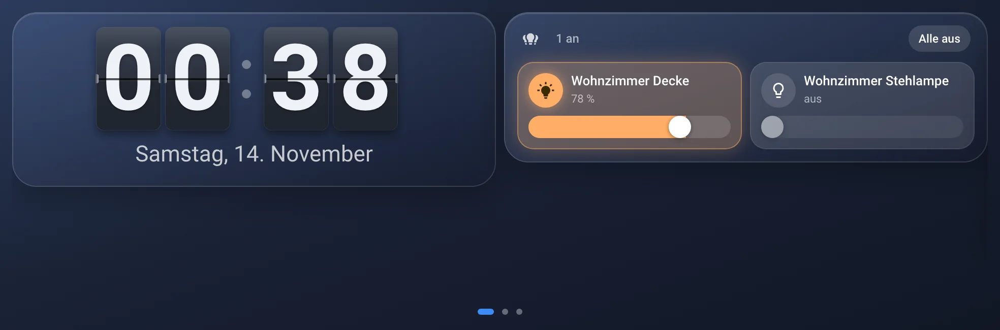
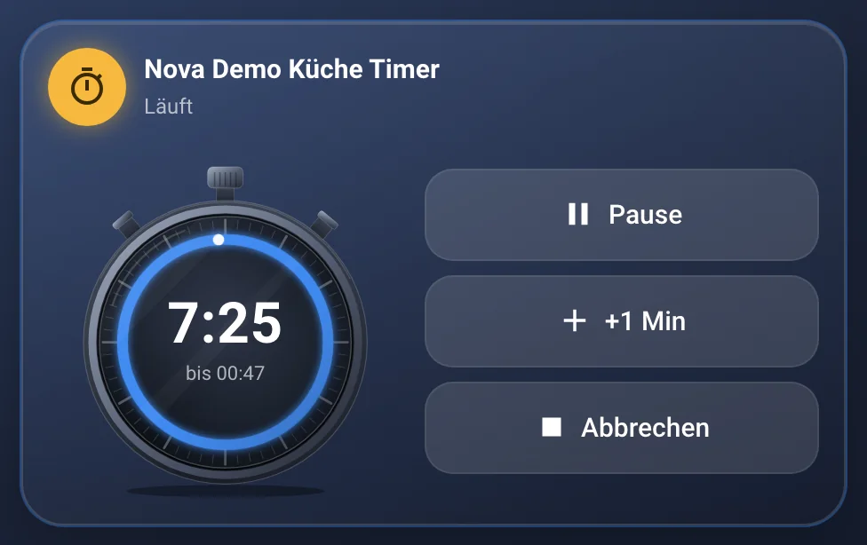
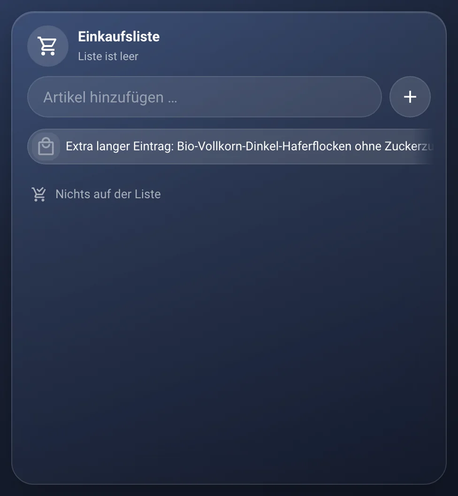
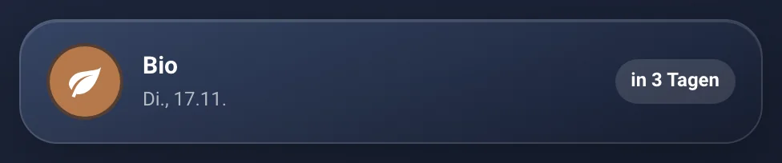

# Kapitel 6 – Rezepte für ganze Dashboards

[← Inhaltsverzeichnis](../README.md)

Du kennst jetzt die Karten. Aber welche passen zusammen? Hier sind drei fertige Rezepte. Nimm sie als Startpunkt und
bau sie nach deinem Geschmack um.

Für jedes Rezept legst du zuerst ein eigenes Dashboard an, wie in [Kapitel 3](03-erste-schritte.md#3-erstes-dashboard-anlegen).

## Rezept 1: Das Wohnzimmer-Tablet

Ein Tablet an der Wand oder auf dem Sideboard, das alle im Haus benutzen. Große Kacheln, wenig Text, alles mit einem Tipp.

**Zutaten**

| Karte | Wofür |
|---|---|
| [Nova Navi](karten/navi.md) | Leiste unten: Start, Licht, Medien, Küche |
| [Nova Uhr](karten/uhr.md) und [Nova Wetter](karten/wetter.md) | Oben: Uhrzeit und Wetter auf einen Blick |
| [Nova Raum Card](karten/raum.md) | Eine Kachel pro Raum |
| [Nova Pop-up Card](karten/popup.md) | Details zu jedem Raum, ohne eigene Seite |
| [Nova Licht Card](karten/licht.md) | Im Pop-up: alle Lampen des Raums |
| [Nova Media Card](karten/media.md) | Musik und Fernseher |

<table>
<tr>
<td align="center" width="33%"> Uhr</td>
<td align="center" width="33%"> Wetter</td>
<td align="center" width="33%"> Raum</td>
</tr>
<tr>
<td align="center" width="33%"> Pop-up</td>
<td align="center" width="33%"> Licht</td>
<td align="center" width="33%"> Media</td>
</tr>
</table>

**Zubereitung**

1. Leg eine Ansicht vom Typ **Abschnitte** an. Im ersten Abschnitt liegen Uhr und Wetter nebeneinander.
2. Im zweiten Abschnitt kommt pro Raum eine **Raum Card**. Gib jeder Kachel die Temperatur und zwei bis drei Knöpfe.
3. Leg für jeden Raum eine **Pop-up Card** an, zum Beispiel mit dem Hash `wohnzimmer`. Hinein kommen die **Licht Card**
   mit dem Bereich „Wohnzimmer“ und alles andere aus dem Raum.
4. In jeder Raum Card wählst du unter **Aktionen** bei **Beim Antippen Nova Pop-up öffnen** das passende Pop-up.
5. Ganz unten kommt die **Navi**. Ein Knopf „Medien“ öffnet ein Pop-up mit der **Media Card**.

**Tipps**

- Im Nova-Panel unter **Animationen** auf „Vereinfacht“ stellen, wenn das Tablet älter ist.
- Ein Tablet zeigt am besten nur dieses Dashboard. Viele nutzen dafür eine Kiosk-App wie Fully Kiosk Browser.

## Rezept 2: Das Nachttisch-Display

Ein kleines Display neben dem Bett, zum Beispiel ein Echo Show oder ein altes Handy. Dunkel, ruhig und gut lesbar.

**Zutaten**

| Karte | Wofür |
|---|---|
| [Nova Swipe Card](karten/swipe.md) | Mehrere Seiten auf einem kleinen Bildschirm |
| [Nova Uhr](karten/uhr.md) | Seite 1: große Uhr, zum Beispiel als Radiowecker |
| [Nova Wetter](karten/wetter.md) | Seite 1: das Wetter für morgen früh |
| [Nova Licht Card](karten/licht.md) | Seite 2: Schlafzimmerlampen |
| [Nova Timer Card](karten/timer.md) | Seite 3: Kurzzeitwecker fürs Nickerchen |

<table>
<tr>
<td align="center" width="33%"> Uhr (Leuchtziffern)</td>
<td align="center" width="33%"> Swipe</td>
<td align="center" width="33%"> Timer</td>
</tr>
</table>

**Zubereitung**

1. Leg eine Ansicht vom Typ **Panel** an. Dann füllt eine einzige Karte den ganzen Bildschirm.
2. Füg die **Swipe Card** hinzu. Schalte unter **Wischen und Anzeige** „Bis zum unteren Bildschirmrand“ ein.
3. Seite 1: **Uhr** im Stil „Leuchtziffern“ oder „Radiowecker“, darunter das **Wetter** nur mit dem aktuellen Wetter.
4. Seite 2: **Licht Card** mit dem Bereich „Schlafzimmer“.
5. Seite 3: **Timer Card**. Den Timer-Helfer dafür legst du vorher an (siehe [Timer Card](karten/timer.md)).
6. Stell „Zurück zu Seite 1 nach“ auf 120 Sekunden. Dann zeigt das Display von selbst wieder die Uhr.

**Tipps**

- Nachts ist Nova Midnight am angenehmsten. Wie du ein Theme nur für dieses eine Gerät festlegst, steht bei
  [Themes Schalter](karten/themes-schalter.md) unter „Theme je Karte und je Gerät“.
- Animationen im Nova-Panel auf „Vereinfacht“ stellen. Das spart Strom und blendet weniger.

## Rezept 3: Die Handy-Ansicht

Für unterwegs und auf dem Sofa. Schmal, zum Scrollen, mit einer Leiste unten wie in einer App.

**Zutaten**

| Karte | Wofür |
|---|---|
| [Nova Chips Card](karten/chips.md) | Oben: wichtige Werte und Schnellknöpfe |
| [Nova Raum Card](karten/raum.md) | Eine Kachel pro Raum |
| [Nova Navi](karten/navi.md) | Leiste unten |
| [Nova Einkauf Card](karten/einkauf.md) | Die Einkaufsliste für den Supermarkt |
| [Nova Müllkalender](karten/muellkalender.md) | Wann welche Tonne raus muss |

<table>
<tr>
<td align="center" width="33%"> Chips</td>
<td align="center" width="33%"> Einkauf</td>
<td align="center" width="33%"> Müllkalender</td>
</tr>
</table>

**Zubereitung**

1. Leg eine Ansicht vom Typ **Abschnitte** an. Auf dem Handy stehen die Abschnitte von selbst untereinander.
2. Ganz oben die **Chips Card**: zum Beispiel Außentemperatur, offene Fenster und „Alle Lichter aus“.
3. Darunter die **Raum Cards**, jede mit einem Pop-up wie in Rezept 1.
4. Eine zweite Ansicht „Alltag“ mit **Einkauf** und **Müllkalender**.
5. Die **Navi** springt zwischen „Zuhause“ und „Alltag“. Sie gehört in beide Ansichten.

**Tipps**

- Auf dem Handy lohnt sich in der Navi „Kompakt“: kleinere Knöpfe, mehr Platz.
- Die Einkaufsliste ist auf allen Geräten gleich. Was jemand zu Hause aufs Tablet tippt, siehst du im Laden sofort.

---

[← Kapitel 5: Die Karten](karten/README.md) · [Kapitel 7: Hilfe bei Problemen →](07-hilfe.md)
