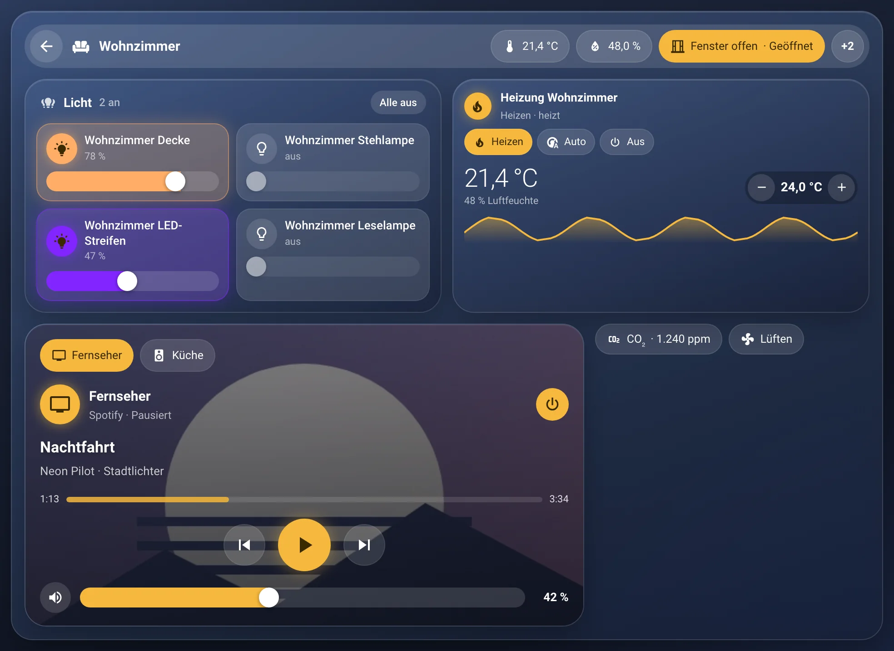
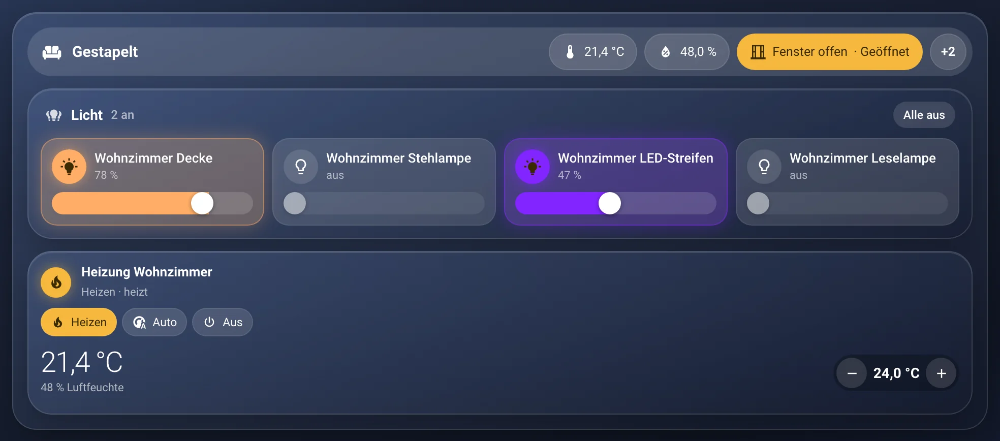
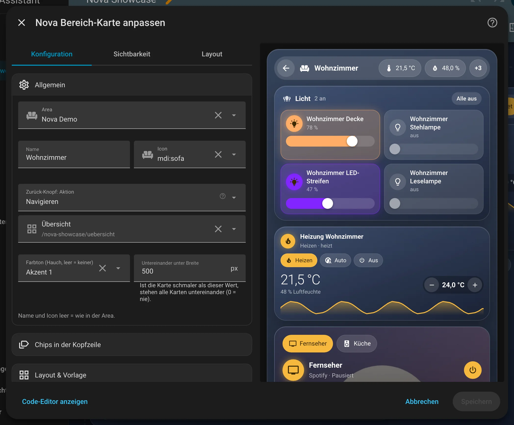

# Nova Bereich Card

[← Alle Karten](README.md) · [Inhaltsverzeichnis](../../README.md)

## Was macht die Karte?

<p align="center"></p>

Eine ganze Raumansicht in einem großen Glasrahmen. Oben stehen ein Zurück-Knopf, Icon und Name des Raums, daneben kleine Chips. Darunter legst du beliebige Karten in Zeilen und Spalten. Wie ein Pop-up, nur fest im Dashboard.

So kann sie aussehen:

<table>
<tr><td align="center" width="50%"><br><sub>Standard</sub></td><td align="center" width="50%"><br><sub>Untereinander</sub></td></tr>
</table>

## Wofür brauche ich sie?

- Du baust für jeden Raum eine eigene Unterseite.
- Du willst oben immer einen Zurück-Knopf zur Startseite.

## Einrichten Schritt für Schritt

Wie du eine Karte grundsätzlich hinzufügst, steht in [Kapitel 3](../03-erste-schritte.md#4-erste-karte-hinzufügen). Kurz gesagt:

1. Öffne dein Dashboard und tippe oben rechts auf den **Stift** (Dashboard bearbeiten).
2. Tippe im Abschnitt auf **+**, wechsle zum Reiter **Nach Karte** und suche nach „Nova Bereich“. Tippe die Karte an.
3. Unter **Allgemein** wählst du den **Bereich**. Name und Icon kommen von dort.
4. Unter **Chips in der Kopfzeile** fügst du zum Beispiel die Temperatur oder „Alle Lichter aus“ hinzu.
5. Unter **Layout & Vorlage** wählst du eine Vorlage und füllst unter **Inhalt** die leeren Plätze mit Karten.
6. Rechts siehst du sofort, wie die Karte aussieht. Passt alles, tippe auf **Speichern**.

<p align="center"></p>

Im Editor findest du diese Bereiche: Allgemein · Chips in der Kopfzeile · Layout & Vorlage · Inhalt · Theme. Tipp einen Bereich an, um ihn aufzuklappen.

## Häufige Fragen

**Die Karte ist so breit. Ist das richtig?**  
Ja. Sie nimmt immer die ganze Breite ein. Am besten passt sie in eine Ansicht mit nur einem Abschnitt.

Mehr Hilfe gibt es in [Kapitel 7](../07-hilfe.md).

## Alle Optionen (für Fortgeschrittene)

Alles hier kannst du auch im grafischen Editor einstellen. Wer lieber Text schreibt, tippt im Editor unten auf **Code-Editor anzeigen**. Dort steht die Karte als YAML (eine einfache Textform für Einstellungen). Der Kartentyp ist `custom:nova-area-card`.

Gedacht für Raum-Unteransichten, zum Beispiel `/zuhause/wohnzimmer`. Die Chips sind derselbe Baustein wie in der [Nova Chips Card](chips.md).

### Anlegen

1. Dashboard bearbeiten → **Karte hinzufügen** → **Nova Bereich Card**.
2. Unter **Allgemein** die **Area** wählen. Name und Icon kommen aus der Area, beides lässt sich überschreiben.
3. Unter **Layout & Vorlage** eine Vorlage wählen und unter **Inhalt** die Plätze mit Karten füllen
   (Kartenauswahl von Home Assistant, danach der normale Karteneditor der gewählten Karte).

Die Karte nimmt im Abschnitt immer die volle Breite ein. Am besten in einer Ansicht vom Typ „Abschnitte“ mit nur
einem Abschnitt bzw. in einer Panel-Ansicht verwenden.

### Kopfzeile

| Option | Bedeutung |
|---|---|
| `area` | Area, aus der Name und Icon kommen |
| `name`, `icon` | Eigener Name / eigenes Icon (leer = wie in der Area). Ein zu langer Name läuft langsam hin und her statt umzubrechen |
| `back_action` | Aktion des Zurück-Knopfs. Ohne Angabe eine Seite zurück, `action: none` blendet den Knopf aus |
| `tint` | Farbton des Rahmens als Nova-Farbrolle (`neutral`, `accent-1` … `accent-4`), leer = keiner. Nur ein Hauch (7 %) über dem Rahmen, Karten darin bleiben in der Theme-Farbe |

### Chips in der Kopfzeile

| Option | Bedeutung |
|---|---|
| `chips` | Liste der Chips, gleiche Optionen wie in der [Nova Chips Card](chips.md#optionen-je-chip). Standard: keine |

Die Kopfzeile hat immer dieselbe Höhe, Chips stehen einzeilig darin. Höchstens drei Chips sind direkt zu sehen, und nur so viele,
wie neben dem Namen Platz haben – der Rest steckt hinter einem „+X“-Chip, der sie beim Antippen unter der Leiste aufklappt.
Der Name nimmt den übrigen Platz und läuft nur dort durch. (Die frühere Option `chips_layout` wird ignoriert.)

„Alle Lichter im Raum aus“ schaltet die Lichter der gewählten `area` aus. Auf dem Handy zeigen Chips mit Icon nur das
Icon (Wert-Chips Icon und Wert).

### Raster

Wie bei der Pop-up Card: `rows` ist eine Liste von Zeilen, jede Zeile hat `cells` mit je einer Karte (`card`) und
optional einer Breite (`width`: `1/4`, `1/3`, `1/2`, `2/3`, `3/4`, `1`; ohne Angabe teilen sich die Spalten den Platz).
Ohne Karten (`rows: []`) zeigt die Karte nur die Kopfzeile – praktisch als Titelleiste mit Zurück-Knopf über einer anderen Karte.

Mit `equal_height: true` („Gleiche Höhe pro Reihe“, Standard aus) werden alle Karten einer Zeile so hoch wie die höchste. Ist die Karte schmaler als `stack_below` (Standard 500 px, 0 = nie),
stehen alle Karten untereinander.

### Beispiel

```yaml
type: custom:nova-area-card
area: wohnzimmer
back_action:
  action: navigate
  navigation_path: /zuhause/home
chips:
  - type: button
    preset: lights_off
rows:
  - cells:
      - card:
          type: custom:nova-chips-card
          area: wohnzimmer
          chips:
            - entity: sensor.wohnzimmer_temperatur
            - type: button
              preset: lights_off
  - cells:
      - width: 1/2
        card:
          type: custom:nova-light-card
          area: wohnzimmer
      - card:
          type: custom:nova-thermostat-card
          entity: climate.wohnzimmer_heizung
  - cells:
      - card:
          type: custom:nova-media-card
```

---

[← Alle Karten](README.md) · [Inhaltsverzeichnis](../../README.md)
