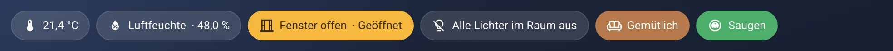
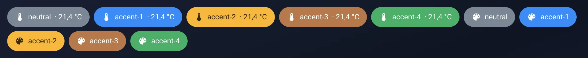
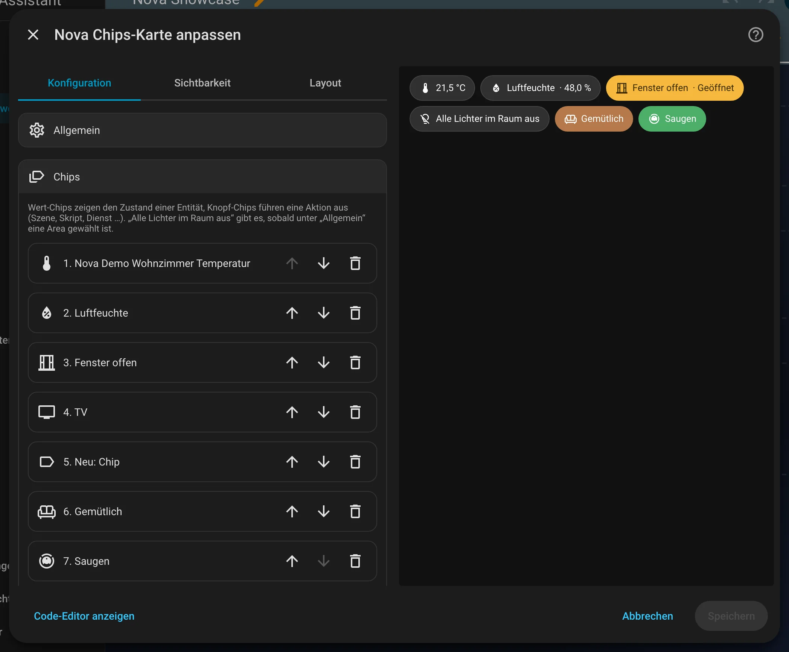
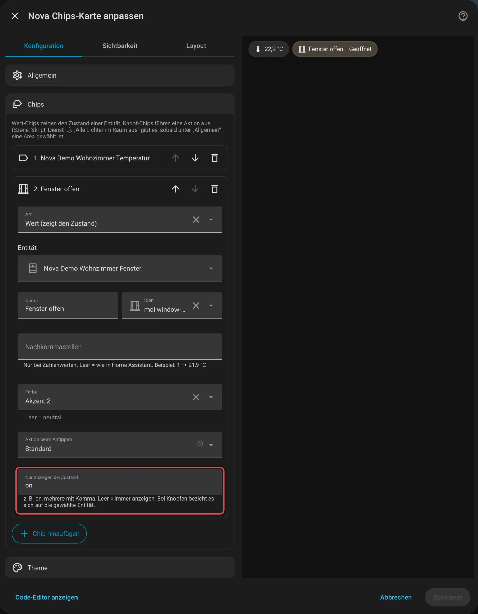

# Nova Chips Card

[← Alle Karten](README.md) · [Inhaltsverzeichnis](../../README.md)

## Was macht die Karte?

<p align="center"></p>

Eine Reihe kleiner, runder Chips. Ein Wert-Chip zeigt einen Zustand, zum Beispiel die Temperatur. Ein Knopf-Chip führt etwas aus, zum Beispiel „Alle Lichter im Raum aus“.

So kann sie aussehen:

<table>
<tr><td align="center" width="50%"><br><sub>Standard</sub></td><td align="center" width="50%"><br><sub>Farbrollen</sub></td></tr>
</table>

## Wofür brauche ich sie?

- Du willst oben auf einer Seite wichtige Werte auf einen Blick.
- Du willst ein paar Schnellknöpfe, die wenig Platz brauchen.

## Einrichten Schritt für Schritt

Wie du eine Karte grundsätzlich hinzufügst, steht in [Kapitel 3](../03-erste-schritte.md#4-erste-karte-hinzufügen). Kurz gesagt:

1. Öffne dein Dashboard und tippe oben rechts auf den **Stift** (Dashboard bearbeiten).
2. Tippe im Abschnitt auf **+**, wechsle zum Reiter **Nach Karte** und suche nach „Nova Chips“. Tippe die Karte an.
3. Unter **Allgemein** wählst du einen **Bereich**, wenn du „Alle Lichter im Raum aus“ nutzen willst.
4. Unter **Chips** tippst du auf **Chip hinzufügen** und wählst Wert-Chip oder Knopf-Chip.
5. Gib dem Chip eine Entität, und bei Bedarf ein eigenes Icon und eine Farbe.
6. Rechts siehst du sofort, wie die Karte aussieht. Passt alles, tippe auf **Speichern**.

<p align="center"></p>

Im Editor findest du diese Bereiche: Allgemein · Chips · Theme. Tipp einen Bereich an, um ihn aufzuklappen.

## Rezepte: Wenn du … willst, dann so

Alle Rezepte gehen im grafischen Editor. Öffne dazu dein Dashboard, tippe oben rechts auf den **Stift** und dann auf die Karte.
Die rot umrahmten Felder im Bild sind die, um die es geht. Darunter steht jeweils dasselbe als YAML, falls du lieber Text schreibst.

### Wenn ein Chip nur bei offenem Fenster erscheinen soll, dann so

1. Klapp **Chips** auf und dann den Chip mit dem Fenstersensor.
2. Trag bei **Nur anzeigen bei Zustand** `on` ein.
3. Tippe auf **Speichern**.

<p align="center"></p>

<details><summary>Für Fortgeschrittene: als YAML</summary>

```yaml
type: custom:nova-chips-card
chips:
  - entity: binary_sensor.wohnzimmer_fenster
    name: Fenster offen
    icon: mdi:window-open-variant
    state: "on"
```

</details>
## Alle Optionen (für Fortgeschrittene)

Alles hier kannst du auch im grafischen Editor einstellen. Wer lieber Text schreibt, tippt im Editor unten auf **Code-Editor anzeigen**. Dort steht die Karte als YAML (eine einfache Textform für Einstellungen). Der Kartentyp ist `custom:nova-chips-card`.

Jeder Chip ist entweder ein **Wert-Chip** (zeigt den Zustand einer Entität) oder ein **Knopf-Chip** (führt eine Aktion aus).

### Optionen der Karte

| Option | Bedeutung |
|---|---|
| `chips` | Liste der Chips (siehe unten), Reihenfolge im Editor per Pfeil änderbar |
| `layout` | `wrap` (umbrechen, Standard) oder `scroll` (waagrecht scrollen) |
| `size` | `normal` (Standard) oder `large`: höhere Chips, die die Zeile gleichmäßig füllen – für kleine Touch-Displays wie den Echo Show |
| `area` | Nur für die Schnellauswahl „Alle Lichter im Raum aus“ nötig |

### Optionen je Chip

| Option | Bedeutung |
|---|---|
| `type` | `value` (Wert, Standard) oder `button` (Knopf) |
| `entity` | Wert-Chip: die angezeigte Entität. Knopf-Chip: optional, für Aktionen wie „Umschalten“ und für `state` |
| `name`, `icon` | Eigener Name / eigenes Icon. Wert-Chips ohne Name zeigen nur den Zustand |
| `decimals` | Nur Wert-Chips mit Zahl: feste Nachkommastellen im Zahlenformat des HA-Profils, z. B. `1` → „21,9 °C“. Leer = wie HA es anzeigt |
| `color` | Farbrolle (`neutral`, `accent-1` … `accent-4`), leer = neutral |
| `tap_action` | Aktion über die HA-Aktionsauswahl (Dienst, Szene, Skript, Navigation …). Wert-Chips ohne Aktion öffnen die Details |
| `preset` | Nur Knopf-Chips: Schnellauswahl statt eigener Aktion. `lights_off` = alle Lichter der gewählten Area aus |
| `state` | Nur anzeigen, wenn `entity` diesen Zustand hat (mehrere mit Komma, z. B. `on`) |

### Beispiel

```yaml
type: custom:nova-chips-card
area: wohnzimmer
chips:
  - entity: sensor.wohnzimmer_temperatur
    icon: mdi:thermometer
  - entity: binary_sensor.wohnzimmer_fenster
    name: Fenster offen
    color: accent-2
    state: "on"
  - type: button
    preset: lights_off
  - type: button
    name: Gemütlich
    icon: mdi:sofa
    tap_action:
      action: perform-action
      perform_action: scene.turn_on
      target:
        entity_id: scene.wohnzimmer_gemutlich
```

---

[← Alle Karten](README.md) · [Inhaltsverzeichnis](../../README.md)
