# Nova 3D-Drucker Card

[← Alle Karten](README.md) · [Inhaltsverzeichnis](../../README.md)

## Was macht die Karte?

<p align="center">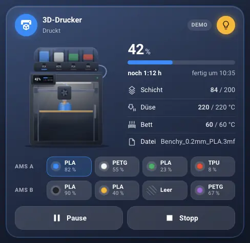</p>

Dein Bambu-Lab-Drucker als animierte Zeichnung. Du siehst Fortschritt, Restzeit, Temperaturen, Druckphase, die Spulen im AMS und das Kamerabild. Dazu gibt es Pause, Fortsetzen, Stopp und das Kammerlicht.

So kann sie aussehen:

<table>
<tr><td align="center" width="50%">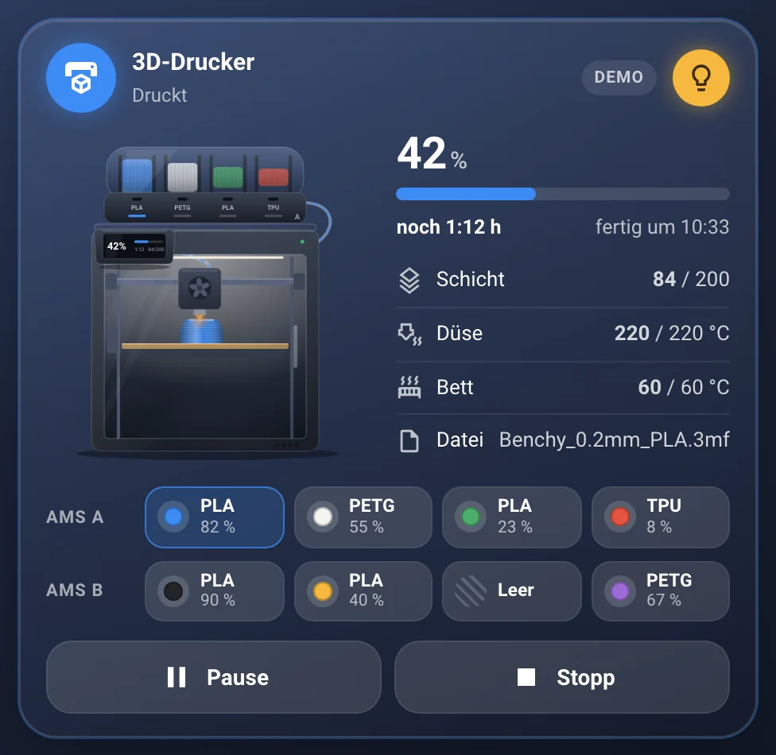<br><sub>Druckt</sub></td><td align="center" width="50%">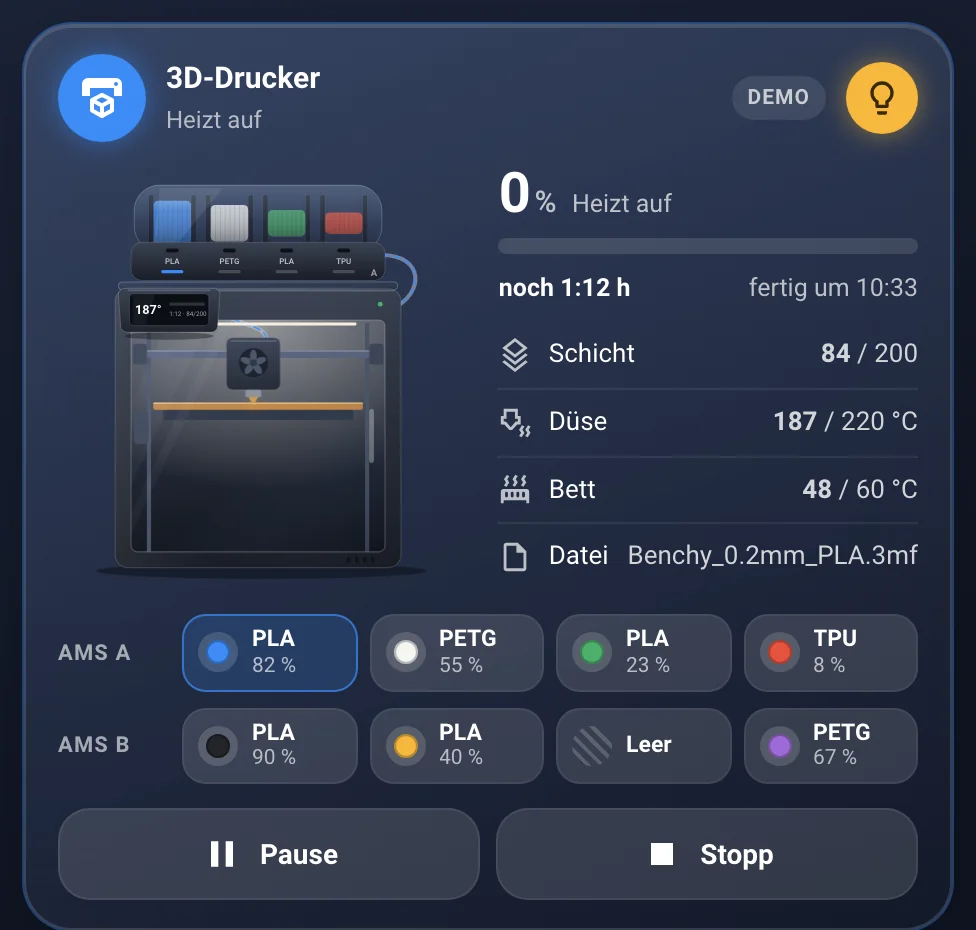<br><sub>Heizt auf</sub></td></tr>
<tr><td align="center" width="50%">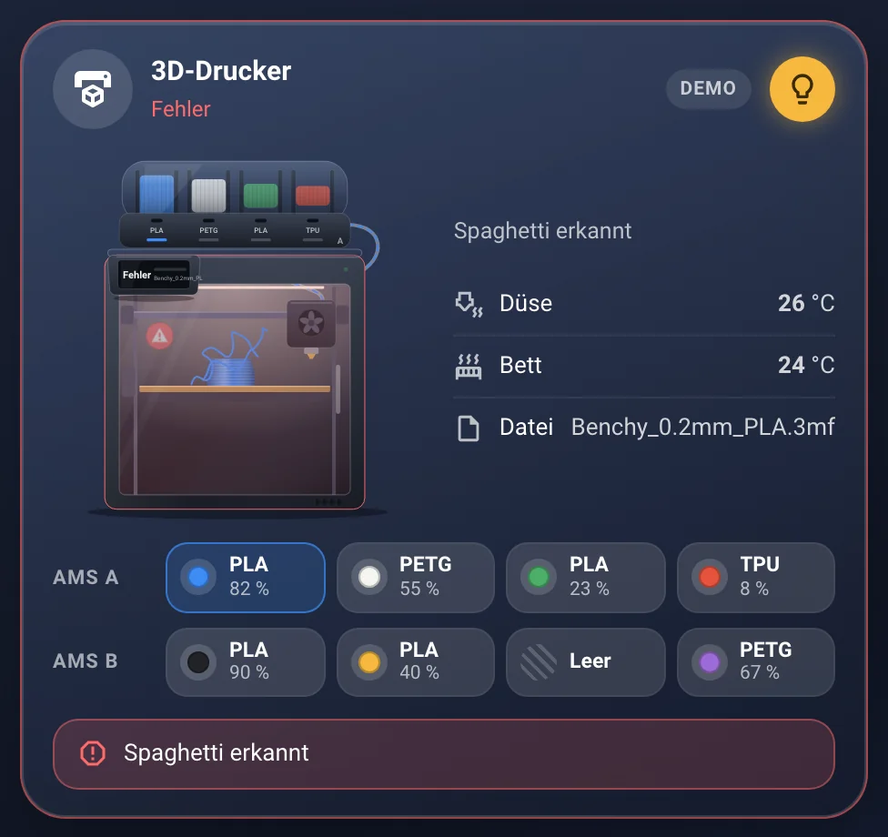<br><sub>Fehler</sub></td><td align="center" width="50%">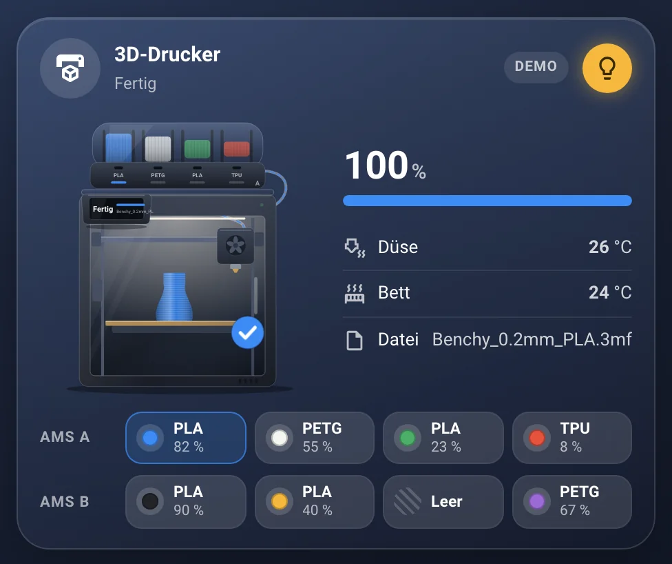<br><sub>Fertig</sub></td></tr>
<tr><td align="center" width="50%">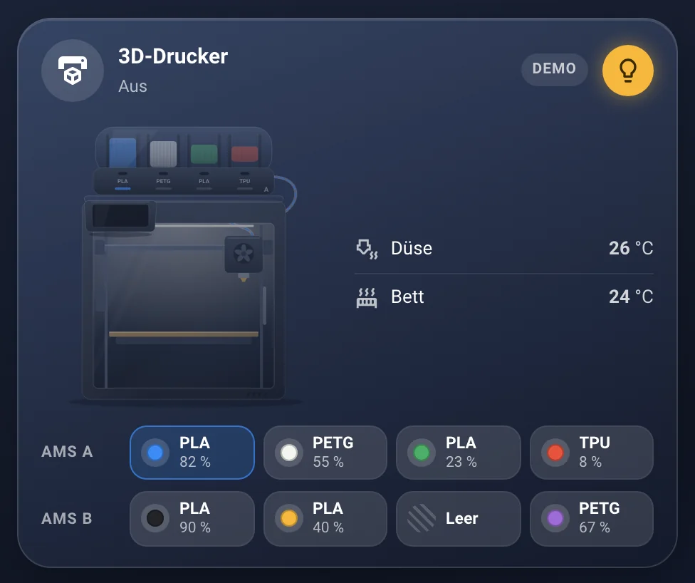<br><sub>Lampe aus</sub></td></tr>
</table>

## Wofür brauche ich sie?

- Du willst deinen Druck aus der Ferne im Blick behalten.
- Du willst sofort sehen, wenn etwas schiefgeht.

## Einrichten Schritt für Schritt

Wie du eine Karte grundsätzlich hinzufügst, steht in [Kapitel 3](../03-erste-schritte.md#4-erste-karte-hinzufügen). Kurz gesagt:

1. Öffne dein Dashboard und tippe oben rechts auf den **Stift** (Dashboard bearbeiten).
2. Tippe im Abschnitt auf **+**, wechsle zum Reiter **Nach Karte** und suche nach „Nova 3D-Drucker“. Tippe die Karte an.
3. Du brauchst die Integration „Bambu Lab“ (aus dem Marketplace).
4. Unter **Allgemein** wählst du bei **Drucker** dein Gerät. Den Rest trägt die Karte selbst ein.
5. Rechts siehst du sofort, wie die Karte aussieht. Passt alles, tippe auf **Speichern**.

<p align="center">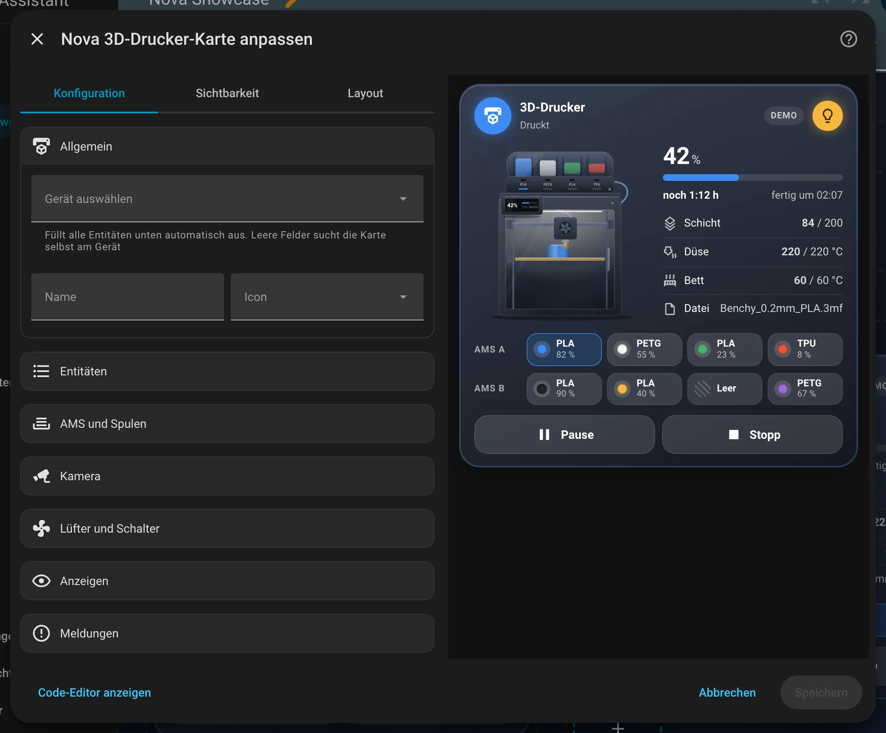</p>

Im Editor findest du diese Bereiche: Allgemein · Entitäten · AMS und Spulen · Kamera · Lüfter und Schalter · Anzeigen · Meldungen · Aussehen · Demo · Aktionen · Theme. Tipp einen Bereich an, um ihn aufzuklappen.

## Rezepte: Wenn du … willst, dann so

Alle Rezepte gehen im grafischen Editor. Öffne dazu dein Dashboard, tippe oben rechts auf den **Stift** und dann auf die Karte.
Die rot umrahmten Felder im Bild sind die, um die es geht. Darunter steht jeweils dasselbe als YAML, falls du lieber Text schreibst.

### Wenn du einfach nur deinen Drucker zeigen willst, dann so

1. Klapp **Allgemein** auf.
2. Wähl bei **Drucker** dein Bambu-Lab-Gerät. Die Karte trägt alle Entitäten selbst ein, findet das AMS (auch mehrere Einheiten) und die externe Spule.
3. Tippe auf **Speichern**.

<p align="center">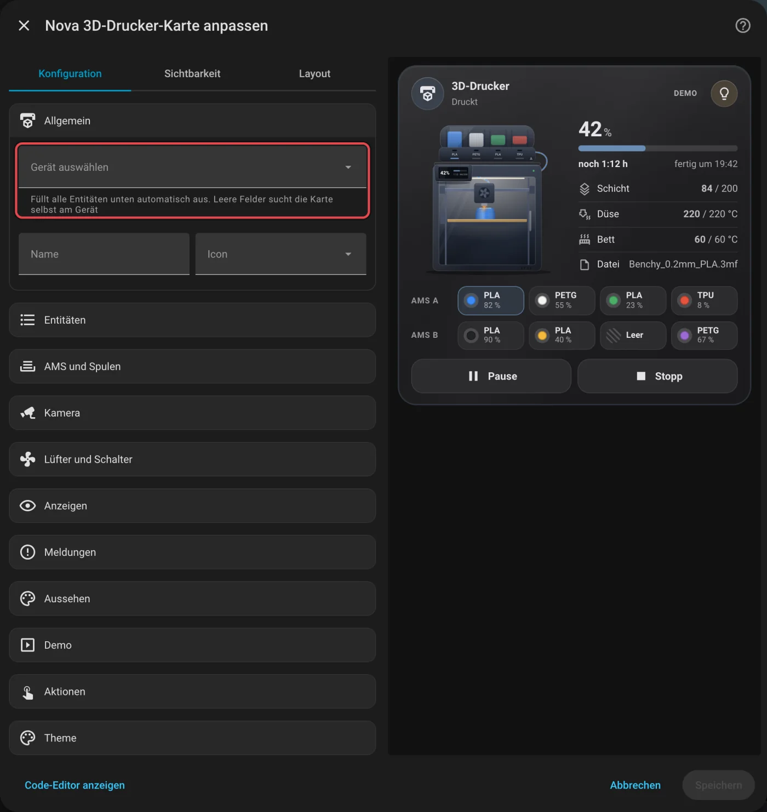</p>

<details><summary>Für Fortgeschrittene: als YAML</summary>

```yaml
type: custom:nova-drucker-card
device: 0123456789abcdef0123456789abcdef
```

</details>

### Wenn eine Entität falsch erkannt wird, dann so

1. Klapp **Entitäten** auf.
2. Trag beim falschen Feld die richtige Entität ein, zum Beispiel bei **Druckphase (Arbeitsschritt)** oder **Dateiname / Auftrag**. Leere Felder sucht die Karte weiter selbst am Gerät.
3. Tippe auf **Speichern**.

<p align="center">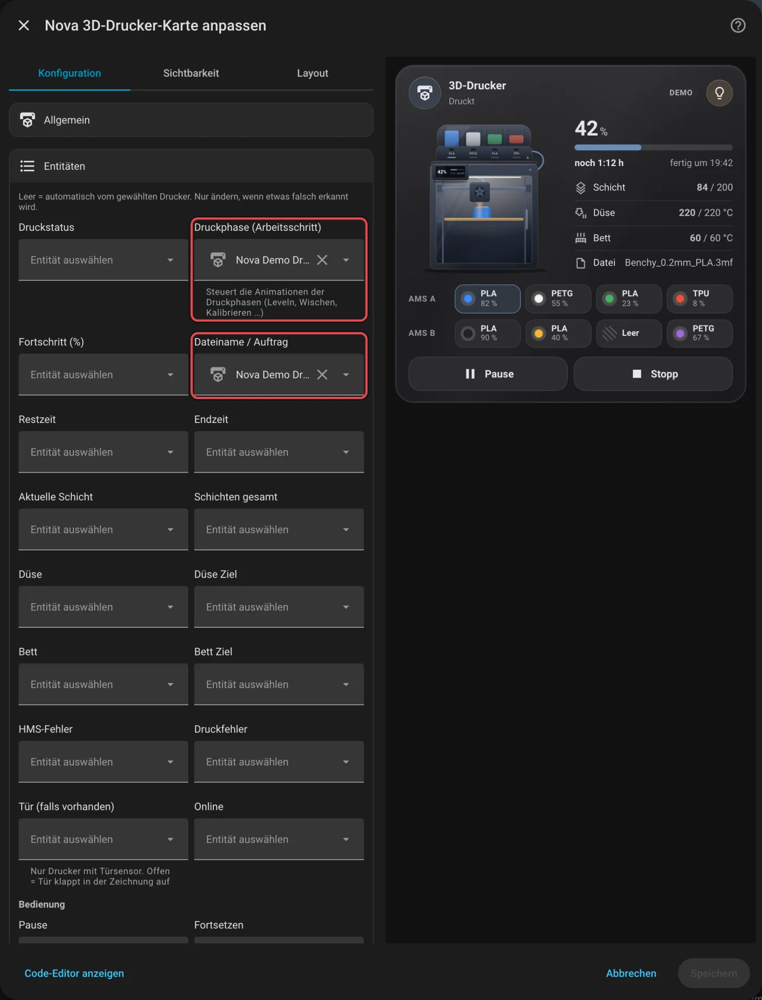</p>

<details><summary>Für Fortgeschrittene: als YAML</summary>

```yaml
type: custom:nova-drucker-card
device: 0123456789abcdef0123456789abcdef
file: sensor.p1s_gcode_dateiname
stage: sensor.p1s_aktueller_arbeitsschritt
```

</details>

### Wenn du kein AMS hast (oder es nicht sehen willst), dann so

Ohne AMS blendet die Karte es von selbst aus und zeigt stattdessen die Spule am Drucker. Festlegen kannst du es so:

1. Klapp **AMS und Spulen** auf.
2. Stell **AMS** auf Ausblenden. „Automatisch“ zeigt es nur, wenn eines gefunden wird.
3. Willst du nur bestimmte Slots sehen, trag sie bei **AMS-Slots** ein.
4. Tippe auf **Speichern**.

<p align="center">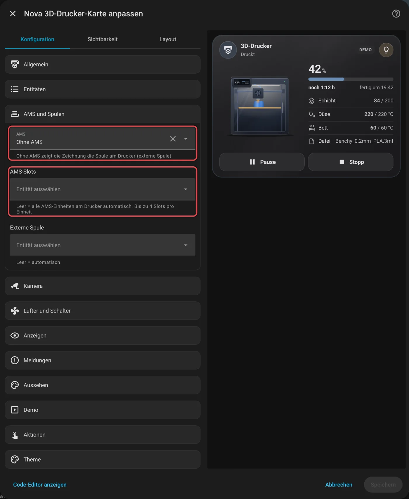</p>

<details><summary>Für Fortgeschrittene: als YAML</summary>

```yaml
type: custom:nova-drucker-card
device: 0123456789abcdef0123456789abcdef
ams: hide        # auto = nur wenn eines gefunden wird, show = immer
ams_trays:
  - sensor.ams_1_slot_1
  - sensor.ams_1_slot_2
```

</details>

### Wenn du das Kamerabild sehen willst, dann so

1. Klapp **Kamera** auf.
2. Wähl bei **Kamera** eine Kamera- oder Bild-Entität. Beim Wählen des Druckers ist sie meist schon eingetragen.
3. Bei **Kamerabild zeigen** legst du fest, ob das Bild immer oder nur während eines Drucks erscheint.
4. Tippe auf **Speichern**.

Das Bild steht in voller Kartenbreite unter der Zeichnung, antippen öffnet es groß. Ist es nicht verfügbar, verschwindet der Bereich.

<p align="center">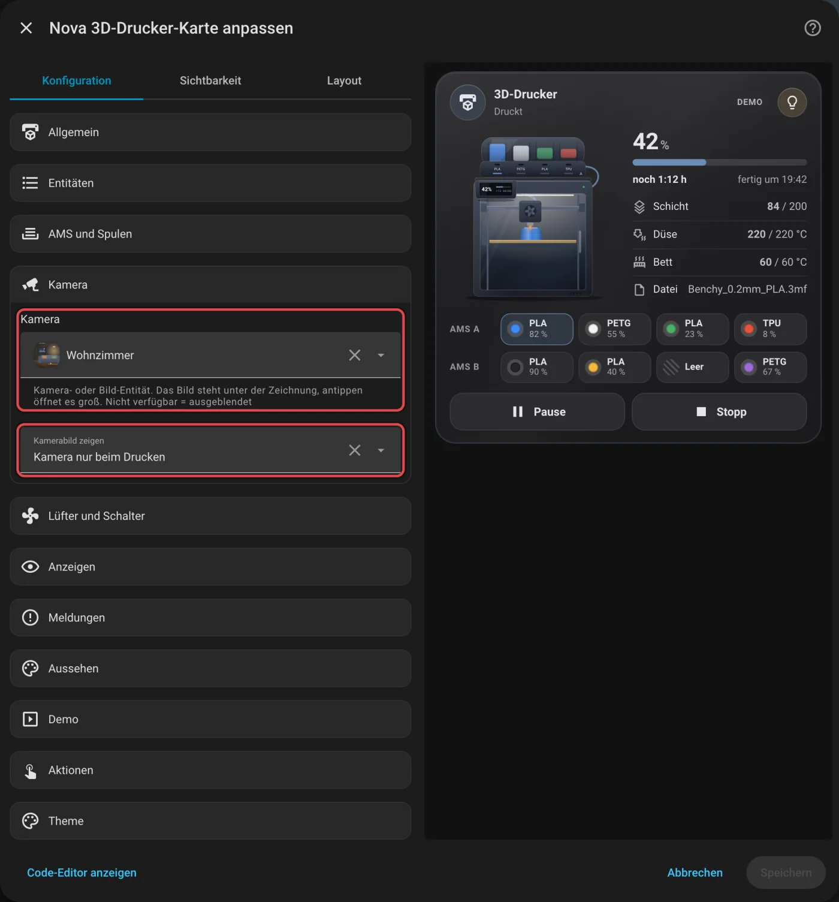</p>

<details><summary>Für Fortgeschrittene: als YAML</summary>

```yaml
type: custom:nova-drucker-card
device: 0123456789abcdef0123456789abcdef
camera: image.p1s_kamera
camera_mode: printing   # always = immer
```

</details>

### Wenn du Lüfter regeln und weitere Schalter zeigen willst, dann so

Unter der Zeichnung stehen alle Lüfter des Druckers als Regler.

1. Klapp **Lüfter und Schalter** auf.
2. Lässt du **Lüfter** leer, erscheinen alle. Sonst trägst du nur die ein, die du sehen willst.
3. Bei **Schalter** trägst du zusätzliche Schalter oder Werte ein, etwa Kamera, Zeitraffer oder WLAN-Signal. Schalter lassen sich antippen, andere Werte öffnen die Details.
4. Tippe auf **Speichern**.

<p align="center">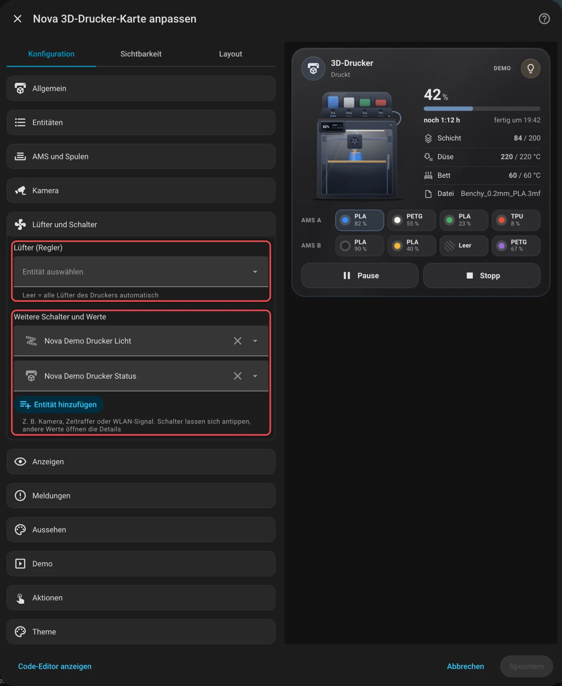</p>

<details><summary>Für Fortgeschrittene: als YAML</summary>

```yaml
type: custom:nova-drucker-card
device: 0123456789abcdef0123456789abcdef
fans:
  - fan.p1s_bauteillufter
  - fan.p1s_druckraumlufter
switches:
  - switch.p1s_kamera_aktivieren
  - sensor.p1s_wi_fi_signalqualitat
```

</details>

### Wenn du Anzeigen weglassen willst, dann so

1. Klapp **Anzeigen** auf.
2. Schalte aus, was du nicht brauchst, zum Beispiel den Dateinamen oder „fertig um …“.
3. Tippe auf **Speichern**.

<p align="center">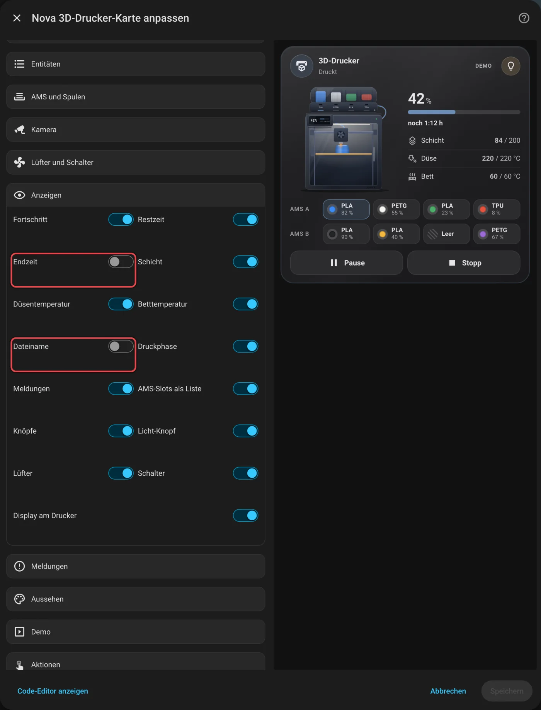</p>

<details><summary>Für Fortgeschrittene: als YAML</summary>

```yaml
type: custom:nova-drucker-card
device: 0123456789abcdef0123456789abcdef
show_file: false        # Dateiname
show_end_time: false    # „fertig um …“
show_ams_list: false    # AMS-Slots unter der Zeichnung
show_controls: false    # Pause/Fortsetzen/Stopp
show_light: false       # Licht-Knopf oben rechts
show_display: false     # Touch-Display an der Zeichnung
show_fans: false        # Lüfter-Regler
show_switches: false    # weitere Schalter
# außerdem: show_progress, show_remaining, show_layer, show_nozzle, show_bed, show_stage, show_message
```

</details>

### Wenn dich bestimmte Meldungen nerven, dann so

1. Klapp **Meldungen** auf.
2. Schalte die Meldungen aus, die du nicht sehen willst. Sie erscheinen dann weder als Hinweis noch als Animation.
3. Tippe auf **Speichern**.

<p align="center">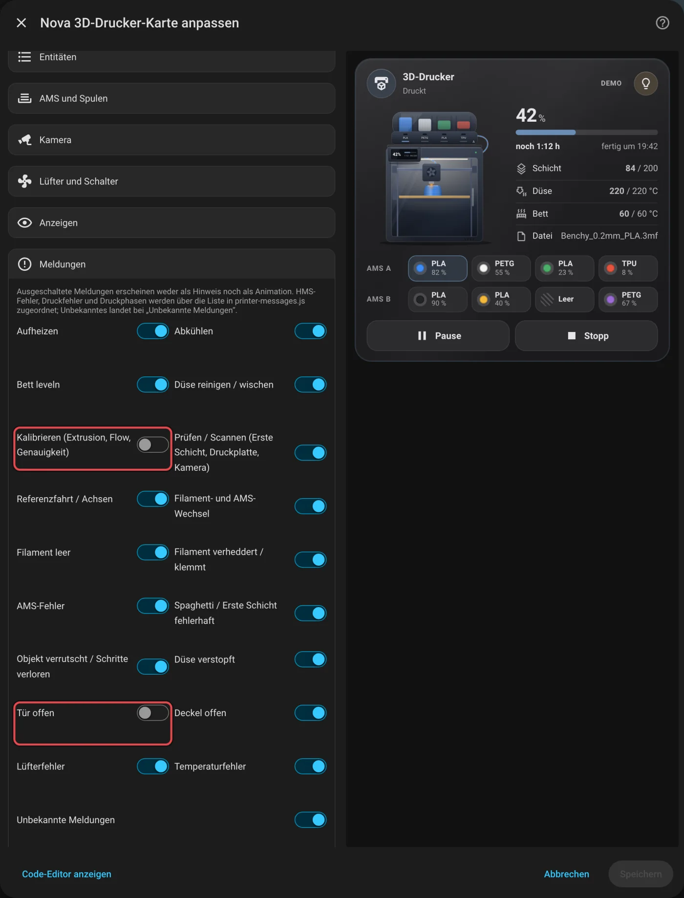</p>

<details><summary>Für Fortgeschrittene: als YAML</summary>

```yaml
type: custom:nova-drucker-card
device: 0123456789abcdef0123456789abcdef
hide_messages: [door, calib]
```

</details>

Diese Meldungen gibt es:

| Schlüssel | Meldung | Animation |
|---|---|---|
| `heat` | Aufheizen | Düse und Bett glühen pulsierend |
| `cool` | Abkühlen | Lüfter drehen, kalte Luft steigt auf, Glühen klingt ab |
| `level` | Bett leveln | Druckkopf tippt Messpunkte auf dem Bett ab |
| `wipe` | Düse reinigen / wischen | Kopf fährt zur Wischkante und wischt |
| `calib` | Kalibrieren (Extrusion, Flow …) | Linien erscheinen auf dem Bett |
| `scan` | Prüfen / Scannen | Kopf fährt mit Laserlinie über das Bett |
| `home` | Referenzfahrt | Kopf fährt in die Ecke und zurück |
| `change` | Filament- und AMS-Wechsel | Filament fährt zurück, neue Farbe läuft ein, Slot leuchtet |
| `empty` | Filament leer | Spule leer, Warnsymbol am Slot, Filament steht |
| `tangle` | Filament verheddert / klemmt | Spule ruckelt, Warnsymbol am Slot |
| `ams` | AMS-Fehler | Slot-LEDs blinken |
| `spaghetti` | Spaghetti / erste Schicht fehlerhaft | Wirre Linien auf dem Bett, rote Warnung |
| `shift` | Objekt verrutscht | Objekt verschoben, Warnung |
| `clog` | Düse verstopft | Düse blinkt rot |
| `door` | Tür offen | Tür klappt auf |
| `lid` | Deckel offen | Deckel (mit AMS) hebt sich |
| `fan` | Lüfterfehler | Lüfter steht, Lüfter-Warnung |
| `temp` | Temperaturfehler | Thermometer-Warnung, Glühen in Rot |
| `warn` | Alles Unbekannte | Allgemeine Warnung mit dem Text des Druckers |

### Wenn du alles ausprobieren willst, ohne dass gerade gedruckt wird, dann so

1. Klapp **Demo** auf.
2. Wähl einen **Demo-Zustand** und eine Meldung, oder klick dich mit „Zustand ›“ und „Meldung ›“ durch. Die Vorschau zeigt Beispielwerte mit zwei AMS-Einheiten (ausschaltbar mit „Demo mit AMS“).
3. Stell den **Demo-Zustand** vor dem Speichern wieder auf „Aus“, sonst zeigt die Karte auch im Dashboard die Beispielwerte.
4. Tippe auf **Speichern**.

<p align="center">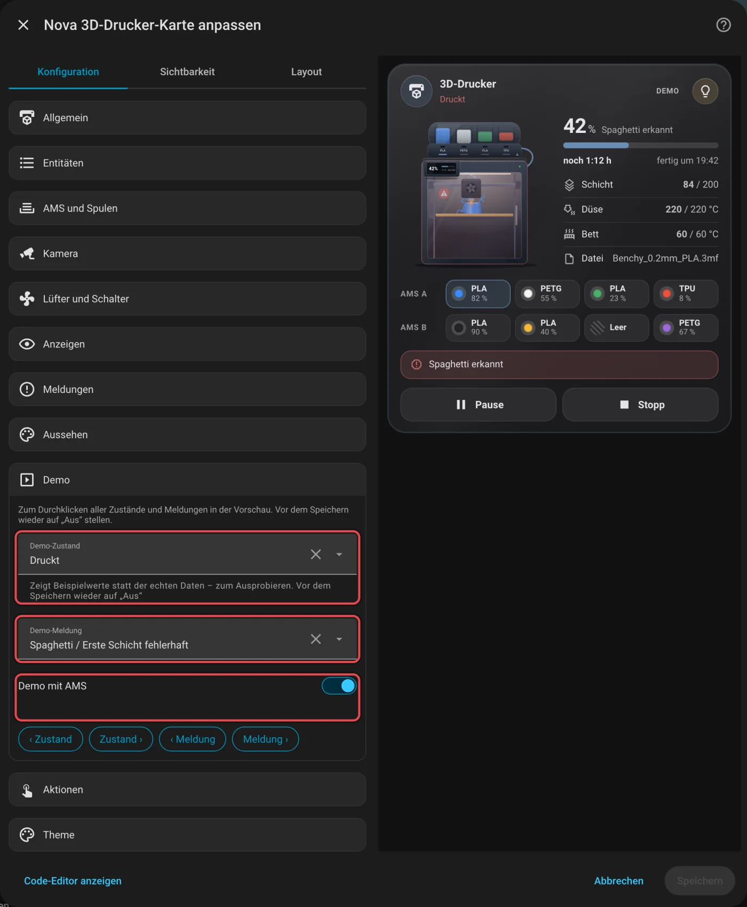</p>

<details><summary>Für Fortgeschrittene: als YAML</summary>

```yaml
type: custom:nova-drucker-card
demo: print            # heat, prep, pause, done, error, cool, idle, off
demo_message: spaghetti
demo_ams: true
```

</details>

### Wenn du die Farbe ändern willst, dann so

Die Farbe gilt für Fortschritt, Knöpfe und den aktiven Slot. Das gedruckte Objekt hat automatisch die Farbe des aktiven Filaments.

1. Klapp **Aussehen** auf.
2. Wähl bei **Farbe** eine Farbe aus deinem Theme.
3. Tippe auf **Speichern**.

<p align="center">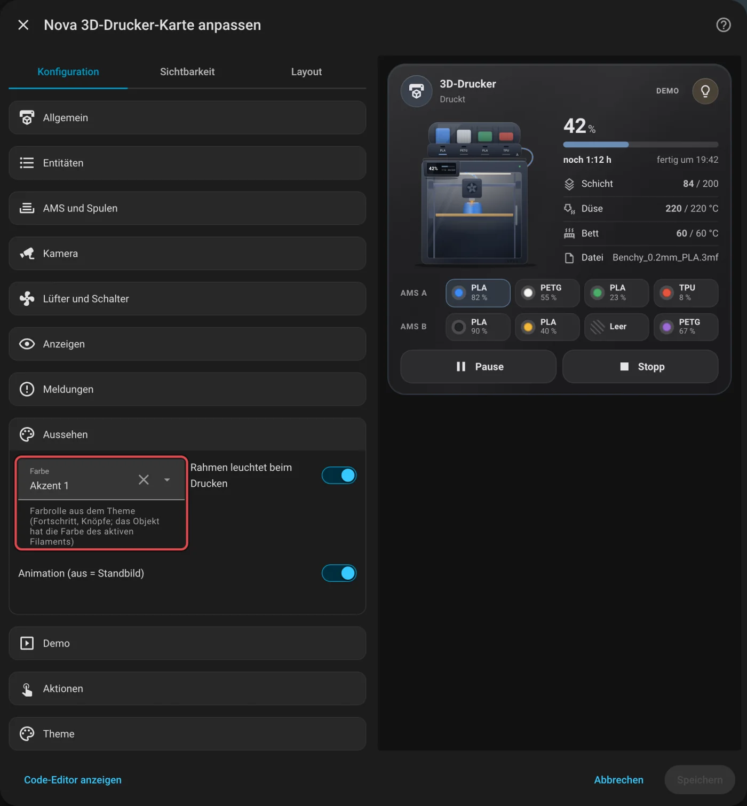</p>

<details><summary>Für Fortgeschrittene: als YAML</summary>

```yaml
type: custom:nova-drucker-card
device: 0123456789abcdef0123456789abcdef
color: accent-1
```

</details>
## Häufige Fragen

**Funktioniert die Karte auch mit anderen Druckern?**  
Sie ist für die Bambu-Lab-Integration gebaut. Für andere Drucker nimmst du am besten die [Modular Card](modular.md).

Mehr Hilfe gibt es in [Kapitel 7](../07-hilfe.md).

## Für Fortgeschrittene

### Wenn das Gehäuse eine andere Farbe haben soll, dann so

Das Gehäuse färbst du im Theme, nicht in der Karte:

```yaml
nova-printer-color: "#191d26"         # Gehäuse unten
nova-printer-color-light: "#3a4252"   # Gehäuse oben
```

### Wenn eine Meldung nicht richtig erkannt wird, dann so

Alle Zuordnungen stehen an einer Stelle: `src/printer-messages.js` in nova-cards.

- Druckphase (Sensor „Aktueller Arbeitsschritt“): in `STAGES` eintragen, z. B. `cleaning_nozzle_tip: 'wipe'`.
- HMS- oder Druckfehler-Code: in `CODES` eintragen, z. B. `'0300_0100_0001_0001': 'temp'`. Ein kürzerer Code gilt für alle, die so beginnen.
- Nur der Text ist bekannt: in `WORDS` ein Suchmuster ergänzen.

Danach `npm run build`.

## Alle Optionen (für Fortgeschrittene)

Alles hier kannst du auch im grafischen Editor einstellen. Wer lieber Text schreibt, tippt im Editor unten auf **Code-Editor anzeigen**. Dort steht die Karte als YAML (eine einfache Textform für Einstellungen). Der Kartentyp ist `custom:nova-drucker-card`.

Für Drucker der [Bambu-Lab-Integration](https://github.com/greghesp/ha-bambulab).

| Option | Standard | Bedeutung |
|---|---|---|
| `device` | – | Bambu-Lab-Drucker; füllt alle Entitäten automatisch |
| `name`, `icon` | Gerätename, `mdi:printer-3d` | Kopfzeile |
| `status`, `stage`, `progress`, `remaining`, `end_time`, `layer`, `layers` | automatisch | Druckstatus, Druckphase, Fortschritt, Restzeit, Endzeit, Schichten |
| `nozzle`, `nozzle_target`, `bed`, `bed_target` | automatisch | Temperaturen mit Ziel |
| `file` | automatisch | Name der Aufgabe bzw. Datei |
| `hms`, `print_error` | automatisch | HMS-Fehler und Druckfehler (Meldungen mit Code) |
| `door`, `online` | automatisch | Türsensor (wenn vorhanden), Online-Status |
| `pause`, `resume`, `stop`, `light` | automatisch | Knöpfe und Kammerlicht |
| `stop_confirm` | `Druck wirklich abbrechen?` | Rückfrage vor Stopp, leer = ohne |
| `ams` | `auto` | `auto`, `show`, `hide` |
| `ams_trays`, `external_spool` | automatisch | AMS-Slots bzw. externe Spule |
| `camera`, `camera_mode` | –, `always` | Kamerabild unter der Zeichnung |
| `fans` | alle Lüfter des Druckers | Lüfter als Regler |
| `switches` | – | Weitere Schalter oder Werte |
| `show_*` | `true` | Anzeigen einzeln, siehe oben |
| `hide_messages` | – | Meldungen ausblenden, siehe oben |
| `color` | `accent-1` | Farbrolle |
| `glow` | `true` | Rahmen leuchtet beim Drucken |
| `animation` | `true` | `false` = Standbild |
| `demo`, `demo_message`, `demo_ams` | – | Demo-Modus, siehe oben |
| `tap_action`, `hold_action` | more-info | Icon antippen / lange drücken |

Animationen laufen nur, solange die Karte zu sehen ist, und stehen bei „Bewegung reduzieren“ im System still.

---

[← Alle Karten](README.md) · [Inhaltsverzeichnis](../../README.md)
