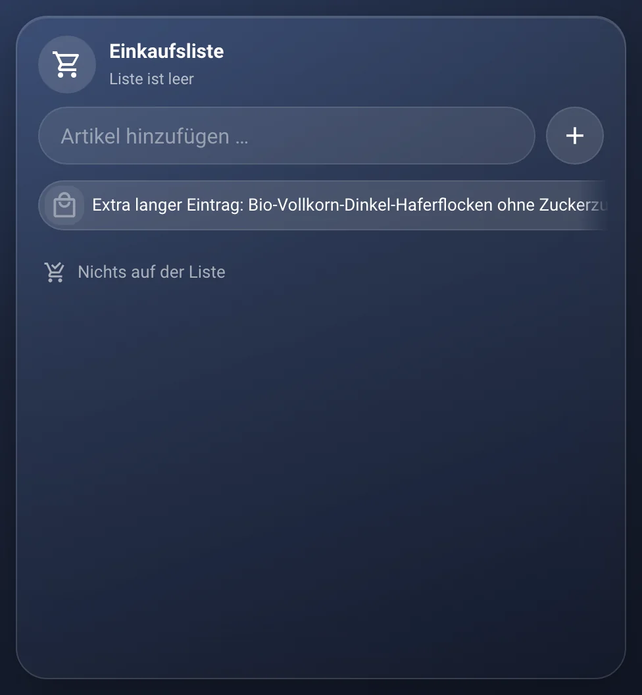
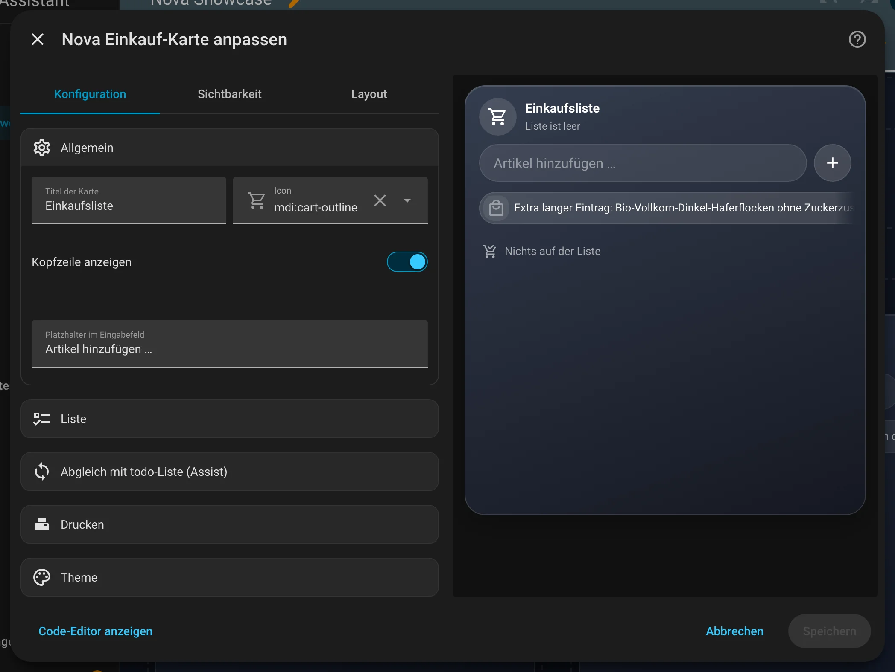

# Nova Einkauf Card

[← Alle Karten](README.md) · [Inhaltsverzeichnis](../../README.md)

## Was macht die Karte?

<p align="center"></p>

Eine Einkaufsliste, die auf allen Geräten gleich ist. Du tippst einen Artikel ein, er landet auf der Liste, nach Geschäft sortiert. Abhaken mit einem Tipp. Zuletzt gekaufte Artikel stehen als Schnellauswahl bereit.

## Wofür brauche ich sie?

- Du willst eine gemeinsame Einkaufsliste für die ganze Familie.
- Du willst „Setz Milch auf die Einkaufsliste“ per Sprachbefehl nutzen.

## Einrichten Schritt für Schritt

Wie du eine Karte grundsätzlich hinzufügst, steht in [Kapitel 3](../03-erste-schritte.md#4-erste-karte-hinzufügen). Kurz gesagt:

1. Öffne dein Dashboard und tippe oben rechts auf den **Stift** (Dashboard bearbeiten).
2. Tippe im Abschnitt auf **+**, wechsle zum Reiter **Nach Karte** und suche nach „Nova Einkauf“. Tippe die Karte an.
3. Die Karte braucht das Modul **Einkauf** der Nova-Integration. Es ist von Anfang an an.
4. Ein Name genügt. Weitere Einstellungen findest du unter **Liste**.
5. Rechts siehst du sofort, wie die Karte aussieht. Passt alles, tippe auf **Speichern**.

<p align="center"></p>

Im Editor findest du diese Bereiche: Allgemein · Liste · Abgleich mit todo-Liste (Assist) · Drucken · Theme. Tipp einen Bereich an, um ihn aufzuklappen.

## Häufige Fragen

**Wo liegen meine Einträge?**  
In Home Assistant, in der Nova-Integration. Darum sehen alle Geräte dasselbe.

**Die Karte zeigt nur einen Hinweis statt der Liste.**  
Dann ist das Modul **Einkauf** aus. Schalt es im Nova-Panel unter **Allgemein → Module** wieder an.

Mehr Hilfe gibt es in [Kapitel 7](../07-hilfe.md).

## Alle Optionen (für Fortgeschrittene)

Alles hier kannst du auch im grafischen Editor einstellen. Wer lieber Text schreibt, tippt im Editor unten auf **Code-Editor anzeigen**. Dort steht die Karte als YAML (eine einfache Textform für Einstellungen). Der Kartentyp ist `custom:nova-shopping-card`.

Einkaufsliste, die auf allen Geräten gleich ist. Die Daten liegen in der
[Nova-Integration](../../../README.md) (Modul „Einkauf“) – ohne sie zeigt die Karte nur einen Hinweis.

- **Artikel** haben Name, Menge und Einheit (Stk, g, kg, ml, l, Packung), ein Geschäft, ein Icon **oder** ein eigenes Bild und
  eine Notiz mit Formatierung.
- **Schnell hinzufügen:** Namen ins Textfeld tippen, Enter – der Artikel steht auf der Liste. Steht er dort schon offen,
  wird die Menge erhöht.
- **Mit Details hinzufügen:** Das Plus öffnet das Hinzufügen-Fenster mit allem auf einmal: Name (was im Textfeld steht, wird
  übernommen), Menge mit + / – und Einheit, Geschäft (wählen oder neu anlegen), Icon oder eigenes Bild, Notiz mit Formatierung.
  Erst „Hinzufügen“ speichert, der Pfeil bricht ab. Tippst du einen bekannten Artikel, erscheint er als Vorschlag; passt der
  Name genau, kommen Icon/Bild, Geschäft und Einheit von selbst.
- **Schnellauswahl:** Unter dem Textfeld stehen zuletzt gekaufte Artikel als Chips; beim Tippen wird gefiltert. Antippen setzt
  sie direkt auf die Liste, mit gespeichertem Icon, Bild, Geschäft und Einheit. Lange drücken entfernt einen Vorschlag.
- **Liste:** nach Geschäft gruppiert, Menge direkt mit + / – (Schritt je Einheit: 1, bei g/ml 50, bei kg/l 0,5). Der Kreis
  hakt ab – der Name wird durchgestrichen und die Zeile wandert zu „Erledigt“ ganz unten. Die Gruppe „Erledigt“ lässt sich
  auf- und zuklappen und mit „Erledigte löschen“ leeren (zweimal tippen).
- **Artikel bearbeiten:** auf den Namen tippen. Dort gibt es Einheit, Geschäft (frei anlegbar, je mit Icon; lange drücken =
  bearbeiten/löschen), Icon (Lebensmittel-Auswahl oder Suche über alle MDI-Icons), eigenes Bild (wird vor dem Speichern
  verkleinert) und die Notiz. Gespeichert wird automatisch.

Die Karte ist in allen Zuständen gleich hoch; Liste und Detailansicht scrollen in sich.

### Beispiel in YAML

```yaml
type: custom:nova-shopping-card
entity: todo.einkaufsliste          # optional: Abgleich für Assist
print_script: script.einkaufsliste_drucken
```

| Option | Standard | Bedeutung |
|---|---|---|
| `name`, `icon` | `Einkaufsliste`, `mdi:cart-outline` | Kopfzeile |
| `show_header` | `true` | Kopfzeile mit „N offen · N erledigt“ |
| `placeholder` | `Artikel hinzufügen …` | Platzhalter im Textfeld |
| `group` | `true` | Nach Geschäft gruppieren (aus = eine Liste, Geschäft steht klein unter dem Namen). Ohne Angabe gilt die Nova-Einstellung „Gruppierung“ |
| `show_images` | `true` | Eigene Bilder anzeigen (aus = nur Icons). Ohne Angabe gilt die Nova-Einstellung „Bilder zeigen“ |
| `show_completed` | `false` | Gruppe „Erledigt“ anfangs aufgeklappt |
| `show_suggestions` | `true` | Schnellauswahl unter dem Textfeld |
| `default_store` | – | Geschäft für neue Artikel, die noch nie gekauft wurden (Auswahl im Editor). Ohne Angabe gilt das Standard-Geschäft aus den Nova-Einstellungen |
| `height` | `420` | Mindesthöhe in px; im Raster füllt die Karte den Platz aus |
| `entity` | – | `todo.*`-Liste zum Abgleichen, siehe unten |
| `print_script` | – | Skript für den Druck-Knopf (leer = kein Knopf) |
| `print_field` | `text` | Feldname, unter dem das Skript die Liste als Klartext bekommt |
| `print_label`, `print_icon`, `print_style` | `Drucken`, `mdi:printer-pos`, `pill` | Aussehen des Knopfs (`pill` = länglich mit Text, `round` = rund) |

### Abgleich mit einer todo-Liste (Assist)

Mit `entity` hält die Nova-Integration die Einkaufsliste und eine `todo.*`-Liste gleich – in beide Richtungen: hinzufügen,
abhaken, umbenennen, löschen. So funktioniert „Setz Milch auf die Einkaufsliste“ weiter. In der todo-Liste steht ein Artikel
als `Milch` bzw. mit Menge als `Milch (2 l)`; neue Einträge von dort werden genauso gelesen (auch `2 l Milch`).

Die Einstellung gilt für die Integration, also für alle Einkauf-Karten gemeinsam.

### Drucken

Der Knopf ruft das Skript als Dienst `script.<name>` auf und wartet, bis es fertig ist (grün = gedruckt, rot = Fehler).
Das Skript bekommt:

- `text` – die offenen Artikel als Klartext, nach Geschäft gruppiert, Notizen eingerückt:

  ```
  LIDL
  [ ] 2 l Hafermilch
      ungesüßt
  [ ] 6 Äpfel

  DM
  [ ] Zahnpasta
  ```

- `items` – dieselben Artikel als Liste (`name`, `qty`, `unit`, `store`, `note`) für eigene Vorlagen.

Beispiel für einen ESC/POS-Bondrucker:

```yaml
alias: Einkaufsliste drucken
mode: single
fields:
  text:
    selector: {text: {multiline: true}}
sequence:
  - action: escpos_printer.print_text_utf8
    target: {entity_id: notify.mein_bondrucker}
    data: {text: "EINKAUFSLISTE\n", align: center, bold: true, width: double, height: double, cut: none}
  - action: escpos_printer.print_text_utf8
    target: {entity_id: notify.mein_bondrucker}
    data: {text: "{{ text }}", align: left, cut: none, feed: 2}
  - action: escpos_printer.print_text_utf8
    target: {entity_id: notify.mein_bondrucker}
    data: {text: "{{ now().strftime('%d.%m.%Y %H:%M') }}", align: center, feed: 2, cut: partial}
```

Ein älteres Skript, das die Einträge selbst aus der todo-Liste holt, funktioniert mit eingeschaltetem Abgleich unverändert weiter.

### Umstieg von der alten Karte

Bis 0.11 zeigte die Karte direkt eine todo-Liste. Die Option `entity` bleibt gültig und wird jetzt als Liste für den Abgleich
verwendet: Beim ersten Laden übernimmt die Integration alle offenen Einträge.

---

[← Alle Karten](README.md) · [Inhaltsverzeichnis](../../README.md)
