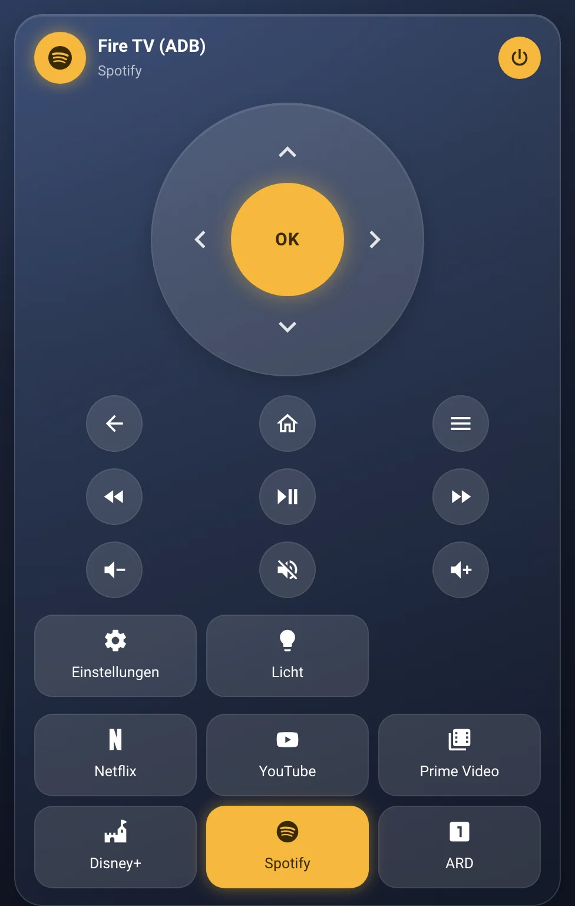
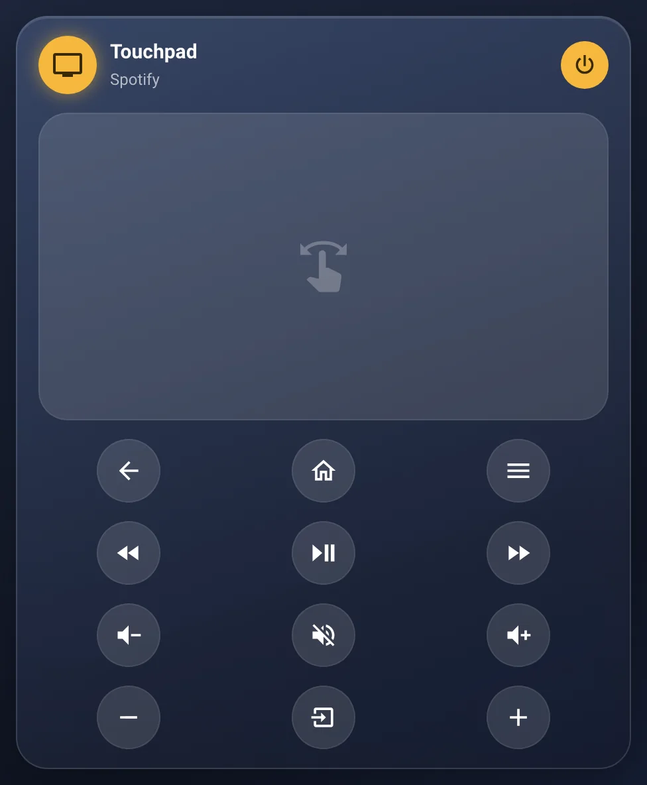
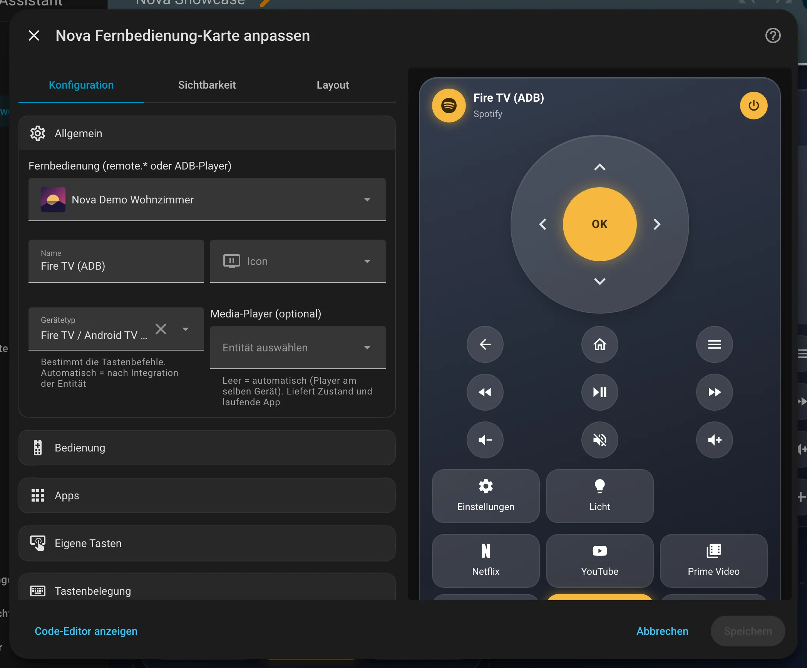
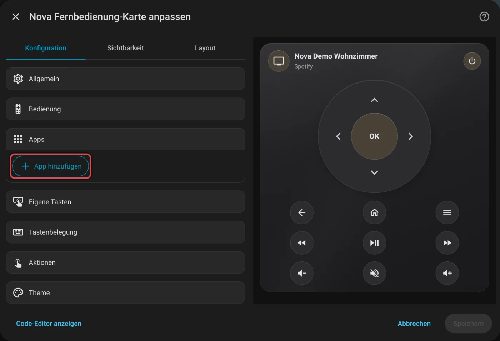

# Nova Fernbedienung

[← Alle Karten](README.md) · [Inhaltsverzeichnis](../../README.md)

## Was macht die Karte?

<p align="center"></p>

Eine Fernbedienung für Fernseher und Streaming-Boxen. Mit Steuerkreuz oder Touchpad, Lautstärke, Medientasten und App-Kacheln, die Netflix, YouTube und Co. direkt öffnen. Tasten, die dein Gerät nicht kennt, blendet die Karte aus.

So kann sie aussehen:

<table>
<tr><td align="center" width="50%"><br><sub>Standard</sub></td><td align="center" width="50%"><br><sub>Touchpad</sub></td></tr>
</table>

## Wofür brauche ich sie?

- Die echte Fernbedienung ist mal wieder weg.
- Du willst Apps auf dem Fernseher mit einem Tipp starten.

## Einrichten Schritt für Schritt

Wie du eine Karte grundsätzlich hinzufügst, steht in [Kapitel 3](../03-erste-schritte.md#4-erste-karte-hinzufügen). Kurz gesagt:

1. Öffne dein Dashboard und tippe oben rechts auf den **Stift** (Dashboard bearbeiten).
2. Tippe im Abschnitt auf **+**, wechsle zum Reiter **Nach Karte** und suche nach „Nova Fernbedienung“. Tippe die Karte an.
3. Unter **Allgemein** wählst du dein Gerät. Das ist meist eine Entität mit `remote.` am Anfang.
4. Die Karte erkennt Android TV, Fire TV, Philips, Apple TV, Roku und Samsung selbst.
5. Unter **Apps** fügst du App-Kacheln hinzu. Für bekannte Apps gibt es fertige Vorlagen.
6. Rechts siehst du sofort, wie die Karte aussieht. Passt alles, tippe auf **Speichern**.

<p align="center"></p>

Im Editor findest du diese Bereiche: Allgemein · Bedienung · Apps · Eigene Tasten · Tastenbelegung · Aktionen · Theme. Tipp einen Bereich an, um ihn aufzuklappen.

## Rezepte: Wenn du … willst, dann so

Alle Rezepte gehen im grafischen Editor. Öffne dazu dein Dashboard, tippe oben rechts auf den **Stift** und dann auf die Karte.
Die rot umrahmten Felder im Bild sind die, um die es geht. Darunter steht jeweils dasselbe als YAML, falls du lieber Text schreibst.

### Wenn du eine App hinzufügen willst, die nicht in der Liste steht, dann so

1. Öffne die App am Fernseher.
2. Klapp im Editor **Apps** auf.
3. Tippe auf **Laufende App übernehmen**. Der Knopf erscheint nur, solange eine App läuft. Über **App hinzufügen** kannst du eine App auch von Hand eintragen.
4. Tippe auf **Speichern**.

<p align="center"></p>
## Häufige Fragen

**Warum sehe ich keine Kanal-Tasten?**  
Weil dein Gerät sie nicht meldet. Die Karte zeigt nur Tasten, die funktionieren.

Mehr Hilfe gibt es in [Kapitel 7](../07-hilfe.md).

## Alle Optionen (für Fortgeschrittene)

Alles hier kannst du auch im grafischen Editor einstellen. Wer lieber Text schreibt, tippt im Editor unten auf **Code-Editor anzeigen**. Dort steht die Karte als YAML (eine einfache Textform für Einstellungen). Der Kartentyp ist `custom:nova-remote-card`.

Die Tastenbefehle passen sich der Integration der Entität an. Pfeile, Lautstärke, Kanäle und Spulen wiederholen sich beim Festhalten.

| Gerätetyp (`platform`) | Integration | Entität | Apps öffnen über |
|---|---|---|---|
| `androidtv_remote` | Android TV Remote (Xiaomi TV Box, Chromecast mit Google TV, Sony, Philips mit Google TV …) | `remote.*` | App-Link (`remote.turn_on` mit `activity`), notfalls Paketname |
| `androidtv` | Android Debug Bridge (Fire TV, Android TV) | `media_player.*` | Paketname (`select_source`) |
| `philips_js` | Philips TV (Play/Pause sendet abwechselnd `Pause` und `Play`) | `remote.*` | Quelle des Players |
| `apple_tv` | Apple TV | `remote.*` | Quelle des Players |
| `roku` | Roku | `remote.*` | Quelle des Players |
| `samsungtv` | Samsung Smart TV | `remote.*` | Quelle des Players |

### Beispiel in YAML

```yaml
type: custom:nova-remote-card
entity: remote.wohnzimmer_tv_box
layout: dpad                 # dpad | touchpad
volume_entity: media_player.wohnzimmer_fernseher   # optional: Lautstärke am Fernseher regeln
volume_mode: swipe          # buttons | swipe | slider
apps:
  - preset: netflix
  - preset: youtube
  - name: ARD
    icon: mdi:numeric-1-box
    app: https://www.ardmediathek.de
    package: de.swr.avp.ard.tv
buttons:
  - name: Einstellungen
    icon: mdi:cog
    command: SETTINGS
keys:                        # optional: eigene Belegung
  menu: SETTINGS
```

### Optionen

| Option | Standard | Bedeutung |
|---|---|---|
| `entity` | – | `remote.*` oder bei ADB `media_player.*` (Pflicht) |
| `name`, `icon` | Entität | Kopfzeile; ohne Icon zeigt sie das Icon der laufenden App |
| `platform` | automatisch | Gerätetyp (siehe oben), bestimmt die Tastenbefehle |
| `media_player` | automatisch | Player für Zustand und laufende App; leer = Player am selben Gerät |
| `layout` | `dpad` | `dpad` = Steuerkreuz mit OK, `touchpad` = wischen für Richtung, tippen für OK |
| `show_power` | `true` | Ein/Aus-Button oben rechts |
| `show_nav` | `true` | Zurück, Home, Menü |
| `show_media` | `true` | Zurückspulen, Play/Pause, Vorspulen |
| `show_volume` | `true` | Leiser, Stumm, Lauter |
| `volume_mode` | `buttons` | `buttons` = Leiser/Stumm/Lauter, `swipe` = große Wischfläche: alle paar Millimeter ein Schritt, rechts/oben lauter, links/unten leiser, tippen = stumm, `slider` = Stumm + Schieberegler (wischen). Braucht einen Player, der die Lautstärke direkt setzen kann (`volume_entity` oder `media_player`), sonst bleiben die Tasten |
| `show_channels` | `false` | Kanal runter, Eingang, Kanal hoch |
| `volume_entity` | – | Lautstärke über einen anderen `media_player` (Fernseher, AV-Receiver) |
| `apps[]` | – | App-Kacheln, siehe unten. Die laufende App leuchtet |
| `buttons[]` | – | Eigene Tasten: `name`, `icon`, `command` (mehrere nacheinander mit Komma, abwechselnd mit `\|`) oder `tap_action` |
| `keys` | – | Eigene Befehle je Taste: `up`, `down`, `left`, `right`, `ok`, `back`, `home`, `menu`, `play_pause`, `rewind`, `forward`, `vol_down`, `mute`, `vol_up`, `ch_down`, `input`, `ch_up`, `power`. Mehrere Befehle nacheinander mit Komma, abwechselnd bei jedem Druck mit `\|` (z. B. `Pause\|Play`) |
| `tap_action`, `hold_action` | more-info | Icon oben antippen / lange drücken |

### Apps

| Option | Bedeutung |
|---|---|
| `preset` | Vorlage: `netflix`, `youtube`, `prime`, `disney`, `appletv`, `spotify`, `ytmusic`, `plex`, `kodi`, `twitch`, `dazn`, `playstore`, `settings` |
| `name`, `icon` | Eigener Name / eigenes Icon (sonst aus der Vorlage) |
| `app` | Android TV Remote: App-Link, mit dem die App startet (`https://www.youtube.com`, `spotify://`). Andere Geräte: Name der Quelle |
| `package` | Paketname (`com.netflix.ninja`): erkennt die laufende App. Ohne `app` wird damit gestartet – über ADB klappt das immer, über Android TV Remote lehnen manche Boxen (z. B. Xiaomi TV Box) reine Paketnamen ab |
| `tap_action` | Optional statt App öffnen, z. B. ein Skript |

Den Paketnamen einer App muss man nicht suchen: App am Gerät öffnen, dann im Editor unter **Apps** auf
**Laufende App übernehmen** tippen. Startet die App über die Karte danach nicht, braucht sie zusätzlich einen App-Link
(meist die Webadresse des Anbieters).

---

[← Alle Karten](README.md) · [Inhaltsverzeichnis](../../README.md)
