# Nova Gerät Card

[← Alle Karten](README.md) · [Inhaltsverzeichnis](../../README.md)

## Was macht die Karte?

<p align="center">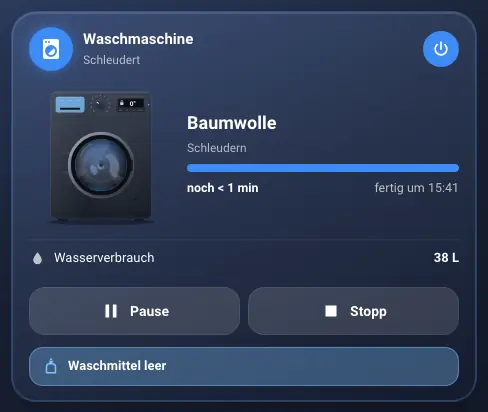</p>

Eine Karte für Haushaltsgeräte: Waschmaschine, Trockner, Spülmaschine, Airfryer, Kaffeemaschine, Futterautomat, Trinkbrunnen und mehr. Sie zeigt Status, Programm, Fortschritt und wann das Gerät fertig ist. Ein animiertes Bild zeigt, was gerade passiert.

So kann sie aussehen:

<table>
<tr><td align="center" width="50%">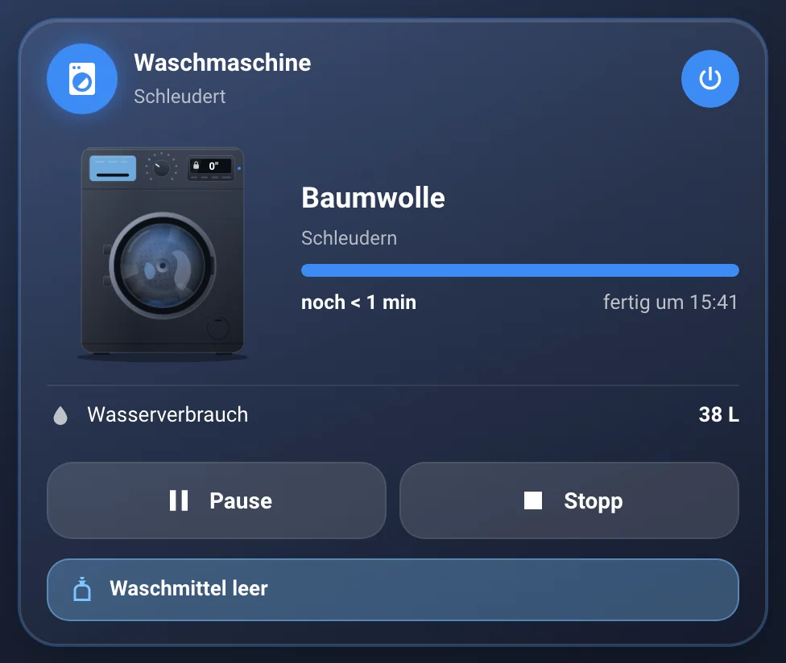<br><sub>Waschmaschine läuft</sub></td><td align="center" width="50%">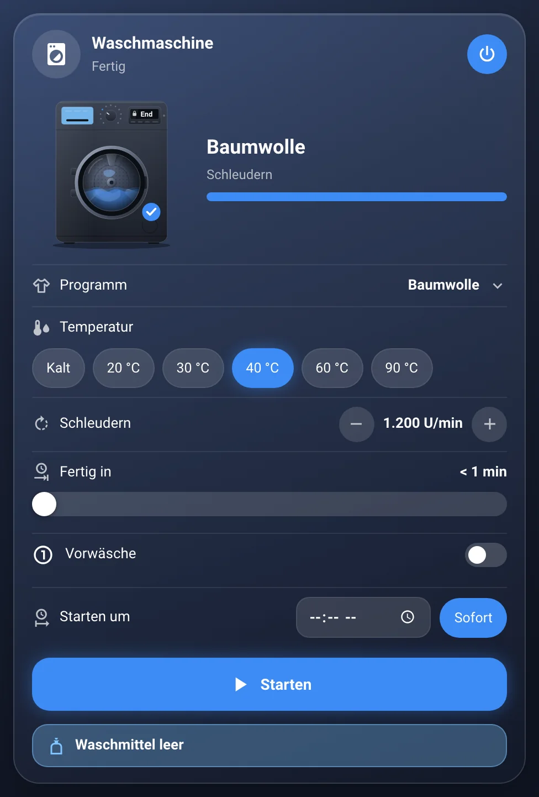<br><sub>Waschmaschine fertig</sub></td></tr>
<tr><td align="center" width="50%">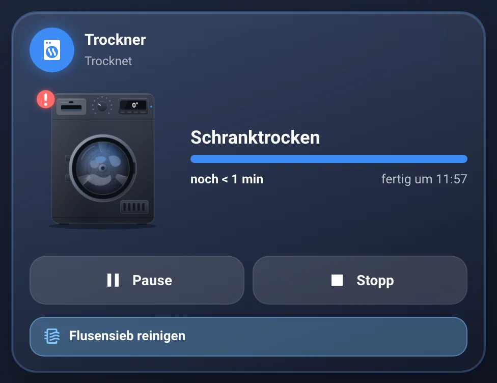<br><sub>Trockner</sub></td><td align="center" width="50%">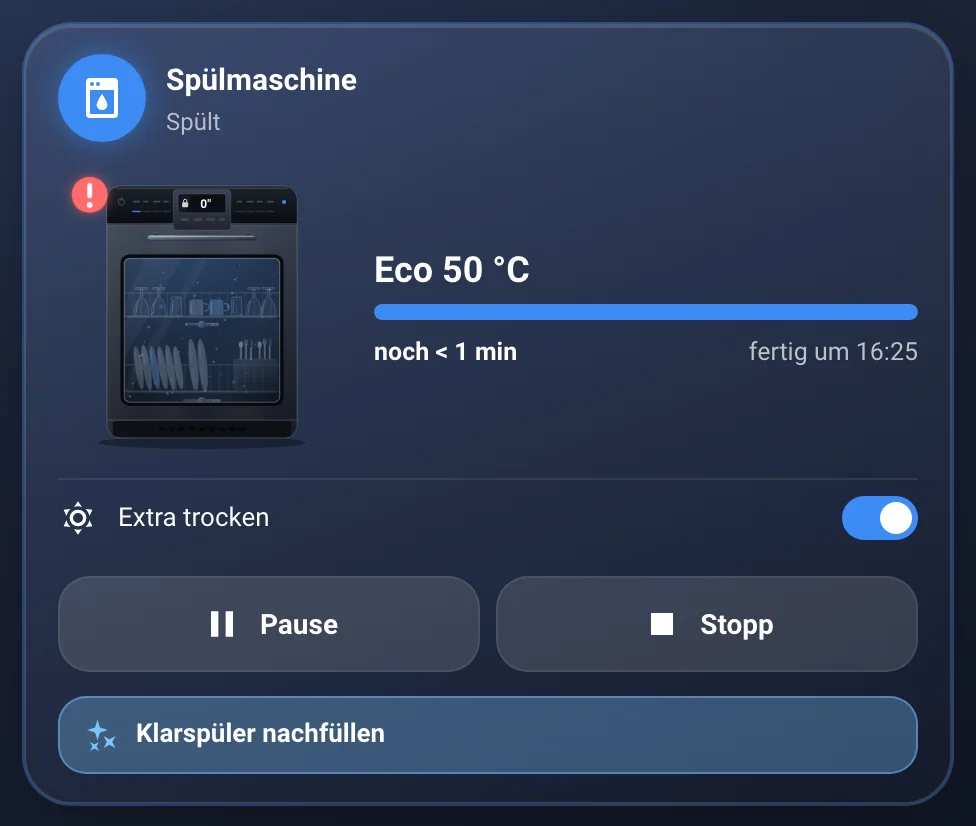<br><sub>Spülmaschine</sub></td></tr>
<tr><td align="center" width="50%">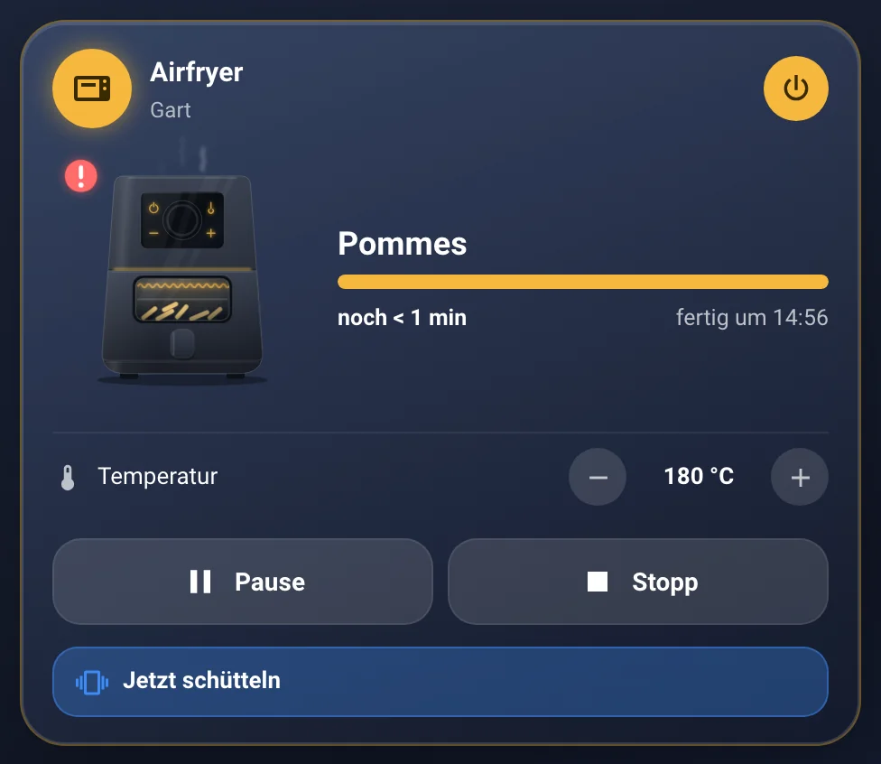<br><sub>Airfryer</sub></td><td align="center" width="50%">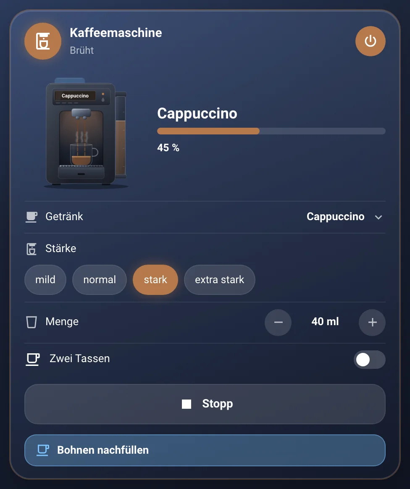<br><sub>Kaffeemaschine</sub></td></tr>
<tr><td align="center" width="50%">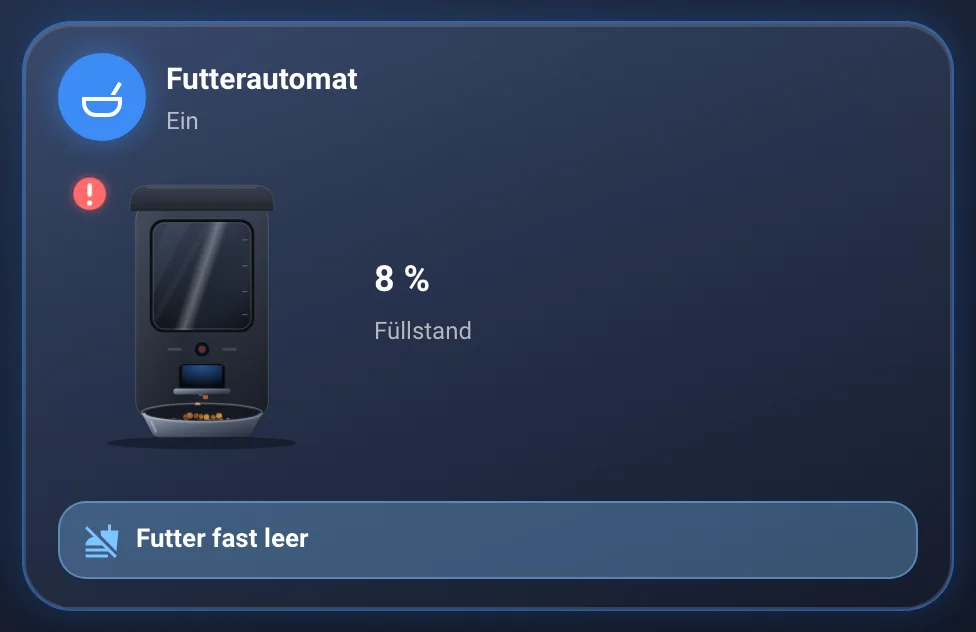<br><sub>Futterautomat</sub></td><td align="center" width="50%">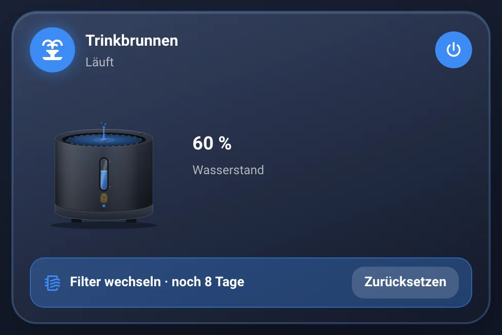<br><sub>Trinkbrunnen</sub></td></tr>
</table>

## Wofür brauche ich sie?

- Du willst wissen, wann die Wäsche fertig ist.
- Du willst Geräte im Dashboard starten oder anhalten.
- Du willst Hinweise wie „Wassertank leer“ sehen.

## Einrichten Schritt für Schritt

Wie du eine Karte grundsätzlich hinzufügst, steht in [Kapitel 3](../03-erste-schritte.md#4-erste-karte-hinzufügen). Kurz gesagt:

1. Öffne dein Dashboard und tippe oben rechts auf den **Stift** (Dashboard bearbeiten).
2. Tippe im Abschnitt auf **+**, wechsle zum Reiter **Nach Karte** und suche nach „Nova Gerät“. Tippe die Karte an.
3. Unter **Allgemein** wählst du den **Gerätetyp**, zum Beispiel Waschmaschine.
4. Bei **Status** wählst du die Entität, die sagt, ob das Gerät läuft.
5. Unter **Programm und Zeit** trägst du Fortschritt, Restzeit oder Endzeit ein, wenn dein Gerät sie meldet.
6. Rechts siehst du sofort, wie die Karte aussieht. Passt alles, tippe auf **Speichern**.

<p align="center">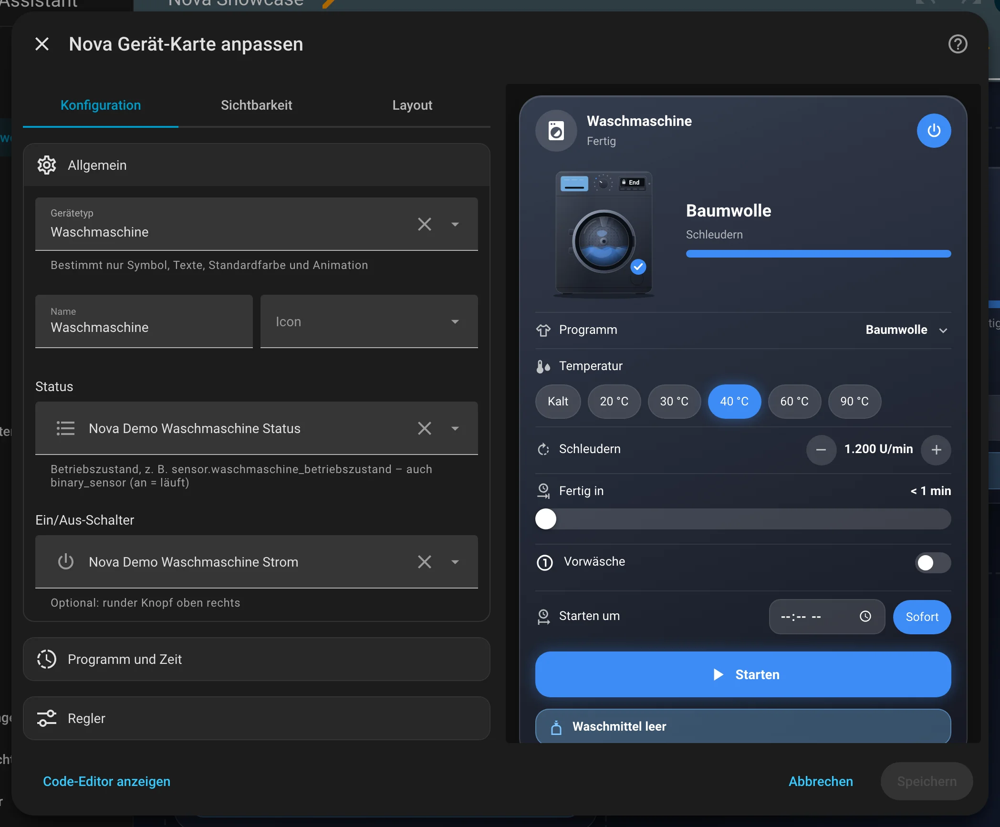</p>

Im Editor findest du diese Bereiche: Allgemein · Programm und Zeit · Regler · Bedienung · Hinweise · Zustände und Texte · Aussehen · Aktionen · Theme. Tipp einen Bereich an, um ihn aufzuklappen.

## Rezepte: Wenn du … willst, dann so

Alle Rezepte gehen im grafischen Editor. Öffne dazu dein Dashboard, tippe oben rechts auf den **Stift** und dann auf die Karte.
Die rot umrahmten Felder im Bild sind die, um die es geht. Darunter steht jeweils dasselbe als YAML, falls du lieber Text schreibst.

### Wenn du einfach nur ein Gerät zeigen willst, dann so

1. Klapp **Allgemein** auf und wähl bei **Gerätetyp** dein Gerät, zum Beispiel Spülmaschine.
2. Wähl bei **Status** die Entität, die sagt, was das Gerät gerade tut.
3. Klapp **Programm und Zeit** auf. Meldet dein Gerät eine Endzeit, Restzeit oder einen Fortschritt, trag das passende Feld ein.
   Eins davon reicht, die Karte rechnet den Rest selbst aus.
4. Tippe auf **Speichern**.

<p align="center">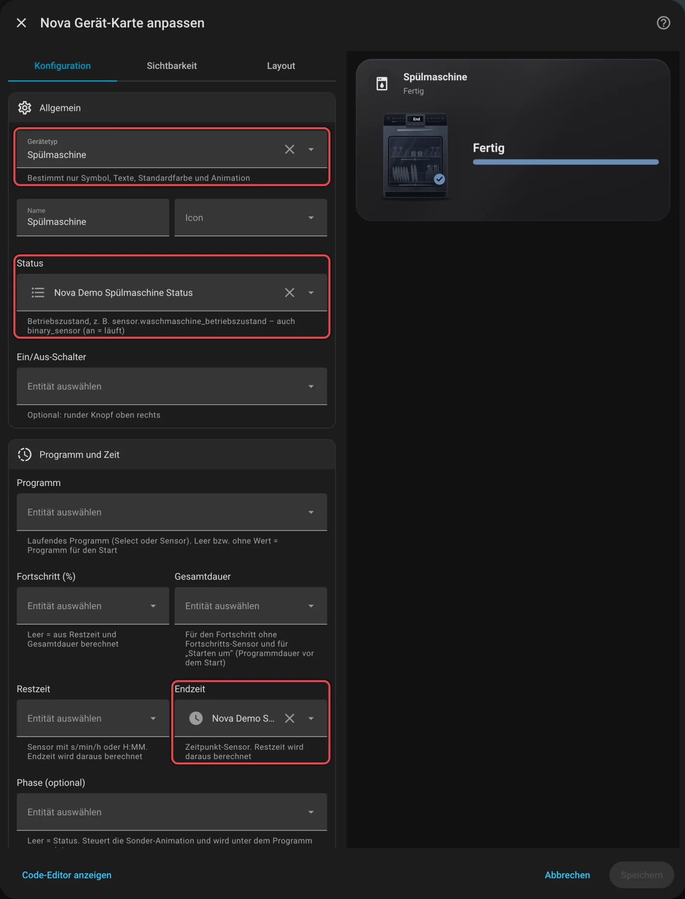</p>

<details><summary>Für Fortgeschrittene: als YAML</summary>

```yaml
type: custom:nova-geraet-card
device_type: dishwasher
name: Spülmaschine
entity: sensor.spulmaschine_status
end_time: sensor.spulmaschine_endzeit
```

</details>

### Wenn die Karte nur auf der Startseite erscheinen soll, solange etwas läuft, dann so

1. Klapp **Aussehen** auf.
2. Stell **Darstellung** auf **Kompakt (läuft gerade)**, dann ist die Karte nur eine Zeile hoch.
3. Schalte **Ausblenden, wenn aus, bereit oder fertig** ein. Im Bearbeitungsmodus bleibt die Karte trotzdem sichtbar.
4. Tippe auf **Speichern**.

<p align="center">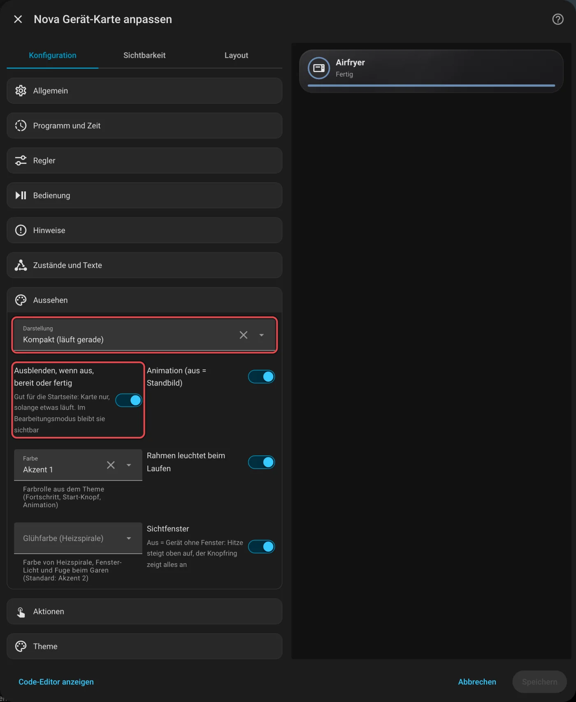</p>

<details><summary>Für Fortgeschrittene: als YAML</summary>

```yaml
type: custom:nova-geraet-card
device_type: airfryer
entity: sensor.airfryer_kochstatus
layout: compact
hide_when_off: true
```

</details>

### Wenn du Hinweise im Gerätebild willst, dann so

Ein Hinweis erscheint als Meldung unter dem Gerät und kann im Bild etwas zeigen: zum Beispiel leeren Wassertank, Bohnen,
Entkalken, Waschmittel, Weichspüler, Kondensbehälter, Flusensieb, Futter, Wasser oder Filter, je nach Gerätetyp.

1. Klapp **Hinweise** auf.
2. Für eine offene Tür wählst du bei **Tür / Schublade** den Türsensor.
3. Für alles andere tippst du unten auf **Hinweis hinzufügen**, wählst die Entität und bei **Animation im Bild**, was das Gerät zeigen soll.
4. Tippe auf **Speichern**.

<p align="center">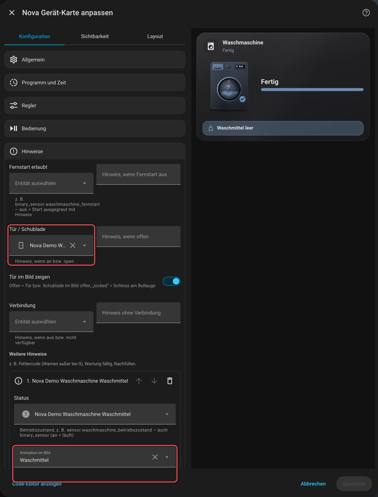</p>

<details><summary>Für Fortgeschrittene: als YAML</summary>

```yaml
type: custom:nova-geraet-card
device_type: washer
entity: sensor.waschmaschine_betriebszustand
door: sensor.waschmaschine_tur
hints:
  - entity: binary_sensor.waschmaschine_waschmittel_leer
    anim: detergent
```

Beim Trinkbrunnen mit Filter und Reset-Knopf im Hinweis:

```yaml
type: custom:nova-geraet-card
device_type: fountain
entity: binary_sensor.trinkbrunnen_power
mode: select.trinkbrunnen_modus
filter: sensor.trinkbrunnen_filter_percent
filter_days: sensor.trinkbrunnen_filter_days_remaining
hints:
  - entity: binary_sensor.trinkbrunnen_water_missing
    anim: water
    level: error
  - entity: binary_sensor.trinkbrunnen_warning_filter
    anim: filter
    reset: button.trinkbrunnen_reset_filter
```

</details>

## Häufige Fragen

**Mein Gerät steht nicht in der Liste der Gerätetypen.**  
Nimm den Gerätetyp **Gerät** (allgemein). Der Typ ändert nur Bild, Texte und Farbe. Alle Optionen gibt es für jedes Gerät.

Mehr Hilfe gibt es in [Kapitel 7](../07-hilfe.md).

## Für Fortgeschrittene

### Wenn du das Gerät aus der Karte starten willst, auch zu einer Uhrzeit (Home Connect), dann so

Geräte mit Home Connect (Bosch, Siemens, Neff, Gaggenau) lassen sich aus der Karte starten, auch zu einer bestimmten Uhrzeit.

1. Klapp **Bedienung** auf.
2. Wähl bei **Start** das Select „Aktives Programm“ deines Geräts. Ein Button, Skript oder Schalter geht auch.
3. Bei **Programm für den Start** trägst du das Select „Ausgewähltes Programm“ ein. Dessen Wert setzt die Karte beim Start.
4. Willst du eine Startzeit wählen können, stell **„Starten um“ (Uhrzeit wählen)** auf Home Connect. Dafür braucht die Karte unter
   **Programm und Zeit** die **Gesamtdauer** (bei Home Connect „Beenden in relativ“).
5. Pause, Fortsetzen und Stopp trägst du darunter ein, wenn dein Gerät die Knöpfe hat.
6. Tippe auf **Speichern**.

<p align="center">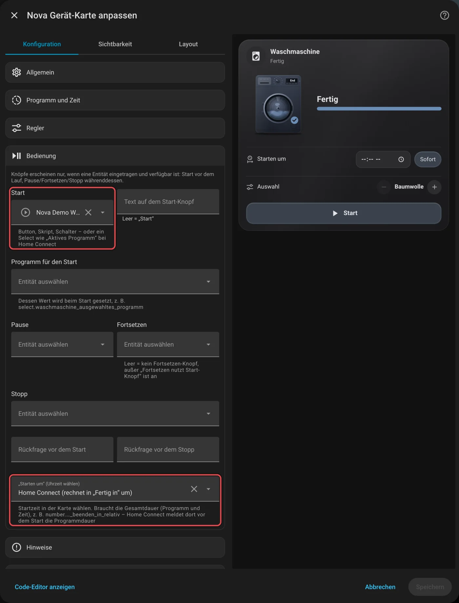</p>

<details><summary>Als YAML</summary>

```yaml
type: custom:nova-geraet-card
device_type: washer
name: Waschmaschine
entity: sensor.waschmaschine_betriebszustand
power: switch.waschmaschine_einschalter
program: select.waschmaschine_aktives_programm
progress: sensor.waschmaschine_programm_fortschritt
end_time: sensor.waschmaschine_programm_endzeit
duration: number.waschmaschine_beenden_in_relativ
controls:
  - entity: select.waschmaschine_ausgewahltes_programm
    name: Programm
    show: idle
  - entity: select.waschmaschine_temperatur
    name: Temperatur
    show: idle
start: select.waschmaschine_aktives_programm
start_option: select.waschmaschine_ausgewahltes_programm
start_at: home_connect
pause: button.waschmaschine_programm_pausieren
resume: button.waschmaschine_programm_fortsetzen
stop: button.waschmaschine_programm_stoppen
stop_confirm: Waschgang wirklich abbrechen?
remote_start: binary_sensor.waschmaschine_fernstart
door: sensor.waschmaschine_tur
```

</details>

## Alle Optionen (für Fortgeschrittene)

Alles hier kannst du auch im grafischen Editor einstellen. Wer lieber Text schreibt, tippt im Editor unten auf **Code-Editor anzeigen**. Dort steht die Karte als YAML (eine einfache Textform für Einstellungen). Der Kartentyp ist `custom:nova-geraet-card`.

#### Allgemein

| Option | Bedeutung |
|---|---|
| `device_type` | `washer` (Waschmaschine), `dryer` (Trockner), `dishwasher` (Spülmaschine), `airfryer`, `coffee` (Kaffeemaschine), `feeder` (Futterautomat), `fountain` (Trinkbrunnen) oder `generic` (Gerät). Bestimmt nur Symbol, Texte, Standardfarbe und Animation |
| `name`, `icon` | Name und Icon |
| `entity` | Betriebszustand, z. B. `sensor.waschmaschine_betriebszustand`, auch `binary_sensor` (an = läuft) |
| `power` | Optional: Schalter für den runden Knopf oben rechts |

#### Programm und Fortschritt

| Option | Bedeutung |
|---|---|
| `program` | Laufendes Programm (Select oder Sensor) |
| `drink` | Nur Kaffeemaschine: Getränk. Leer = Programm. Erkennt Espresso, Kaffee, Cappuccino, Latte (Macchiato), Milch, Heißwasser |
| `fill_level` | Futterautomat/Trinkbrunnen: Prozent-Sensor oder `binary_sensor` „niedrig“ (an = niedrig) |
| `filter`, `filter_days` | Trinkbrunnen: Filter in % und Resttage für den Hinweis „Filter wechseln“ |
| `mode` | Futterautomat/Trinkbrunnen: Modus für die LED. Smart grün, aus grau, sonst blau |
| `feed_count`, `feed_done_minutes` | Futterautomat ohne Zustand „füttert“: Zähler der Fütterungen, und wie lange danach „Fertig“ stehen bleibt (Standard 10 min) |
| `progress` | Fortschritt in %. Leer = aus Restzeit und Gesamtdauer berechnet |
| `duration` | Gesamtdauer, für den Fortschritt und für „Starten um“ |
| `remaining` | Restzeit (s/min/h oder H:MM), die Endzeit wird daraus berechnet |
| `end_time` | Endzeit als Zeitpunkt-Sensor, die Restzeit wird daraus berechnet |
| `phase` | Optional: Phase, steuert die Sonder-Animation (z. B. Schleudern, Trocknen) |
| `phase_states` | Zustände der Sonder-Animation. Leer = Vorschlag zum Gerätetyp |

#### Regler (`controls`)

Liste von Entitäten (`select`, `number`, `switch`, `sensor` …), je mit `entity`, `name`, `icon`, `display`
(Select: `auto`, `pills`, `list`; Zahl: `buttons`, `slider`), `step` und `show` (`always`, `idle` = nur vor dem Start,
`running` = nur während des Laufs). Buttons, Skripte und Szenen erscheinen als Zeile mit rundem Knopf zum Auslösen
(z. B. Warmhalten beim Airfryer). `controls_columns: 2` stellt die Regler zu zweit nebeneinander – spart Höhe auf kleinen Displays. `controls_labels: icon` zeigt bei den Reglern nur Icons (Name im Tooltip); Standard `auto` blendet den Namen nur aus, wenn er nicht passt.

#### Steuerung

| Option | Bedeutung |
|---|---|
| `start`, `start_name` | Start (Button, Skript, Schalter oder Select) und Text auf dem Knopf (Standard „Start“) |
| `start_option`, `start_option_name` | Bei Start über ein Select: dessen Wert wird gesetzt. Ohne `start_option` wählt man in der Karte aus |
| `pause`, `resume`, `stop` | Knöpfe für Pause, Fortsetzen und Stopp |
| `resume_with_start` | Bei Pause erscheint „Fortsetzen“ und drückt den Start-Knopf (z. B. Philips Airfryer) |
| `start_confirm`, `stop_confirm` | Rückfrage vor Start bzw. Stopp |
| `start_at` | `home_connect`: Startzeit in der Karte wählen, wird in „Fertig in“ umgerechnet |

#### Hinweise

| Option | Bedeutung |
|---|---|
| `remote_start`, `remote_start_text` | Fernstart erlaubt? Aus = Start ausgegraut mit Hinweis |
| `door`, `door_text`, `door_anim` | Tür/Schublade offen als Hinweis, auf Wunsch auch im Bild |
| `connection`, `connection_text` | Hinweis, wenn das Gerät nicht verbunden ist |
| `hints` | Liste eigener Hinweise: `entity`, `anim` (Bild), `message`, `icon`, `state`/`state_not`, `above`/`below`, `level` (`warning`, `error`, `info`), `reset`/`reset_name` (Knopf im Hinweis) |

#### Zustände und Texte

`running_states`, `paused_states`, `waiting_states`, `finished_states`, `error_states`, `prep_states`, `ready_states`,
`heat_states`, `warm_states` legen fest, welche Rohzustände wozu gehören. Leer = übliche Zustände (z. B. `run`, `running`,
`cooking`). Mit `text_running`, `text_paused`, `text_waiting`, `text_finished`, `text_error`, `text_off`, `text_prep`,
`text_ready`, `text_heat`, `text_warm` überschreibst du die angezeigten Texte.

#### Aussehen und Aktionen

| Option | Bedeutung |
|---|---|
| `layout` | `full` (Standard) oder `compact` |
| `hide_when_off` | Karte nur zeigen, solange etwas läuft (im Bearbeitungsmodus bleibt sie sichtbar) |
| `animation` | Aus = Standbild |
| `color` | Farbrolle (`neutral`, `accent-1` … `accent-4`) |
| `glow` | Rahmen leuchtet beim Laufen |
| `window`, `heat_color` | Nur Airfryer: Sichtfenster an/aus und Glühfarbe der Heizspirale |
| `tap_action`, `hold_action` | Aktionen beim Antippen und langen Drücken |

---

[← Alle Karten](README.md) · [Inhaltsverzeichnis](../../README.md)
