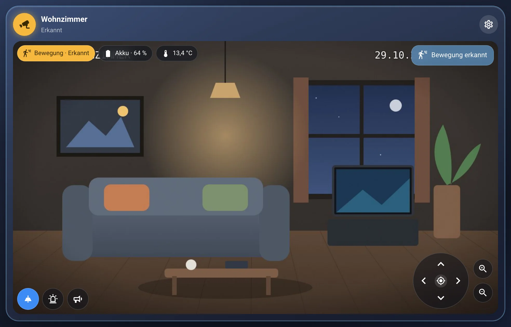
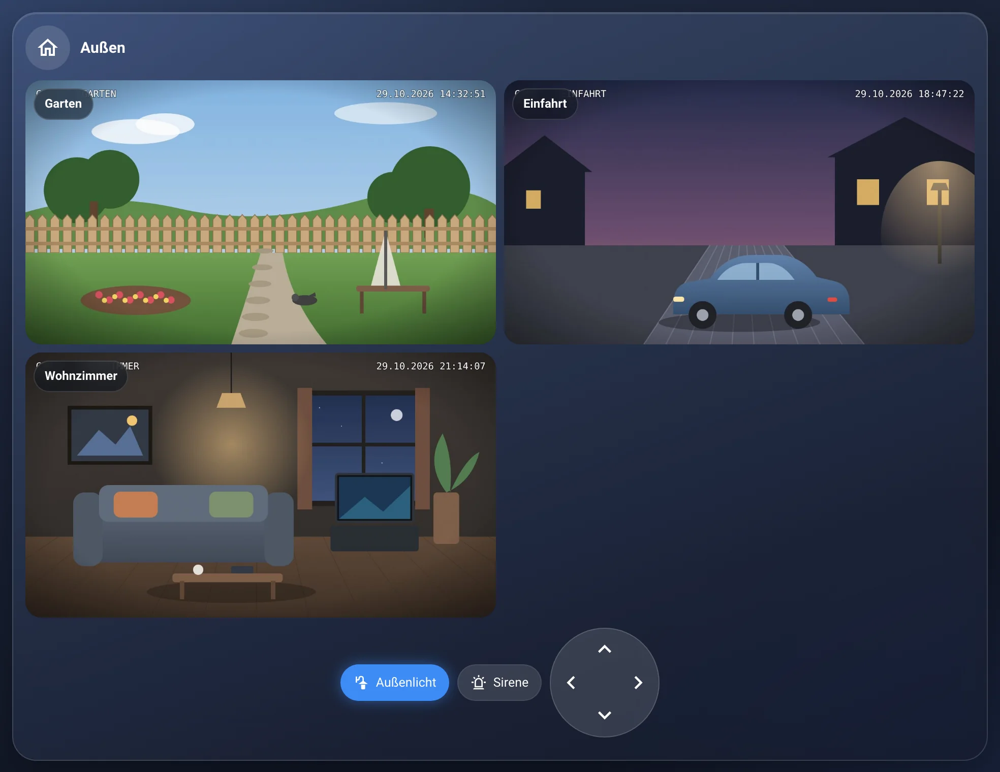
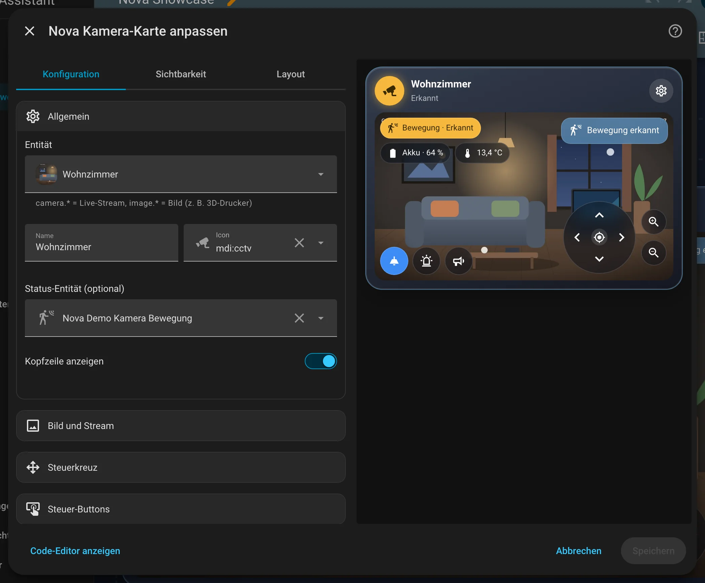
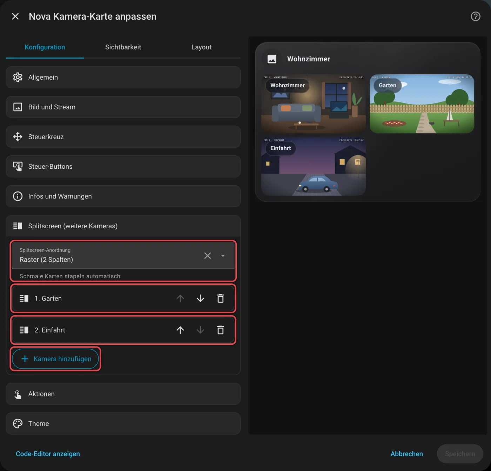
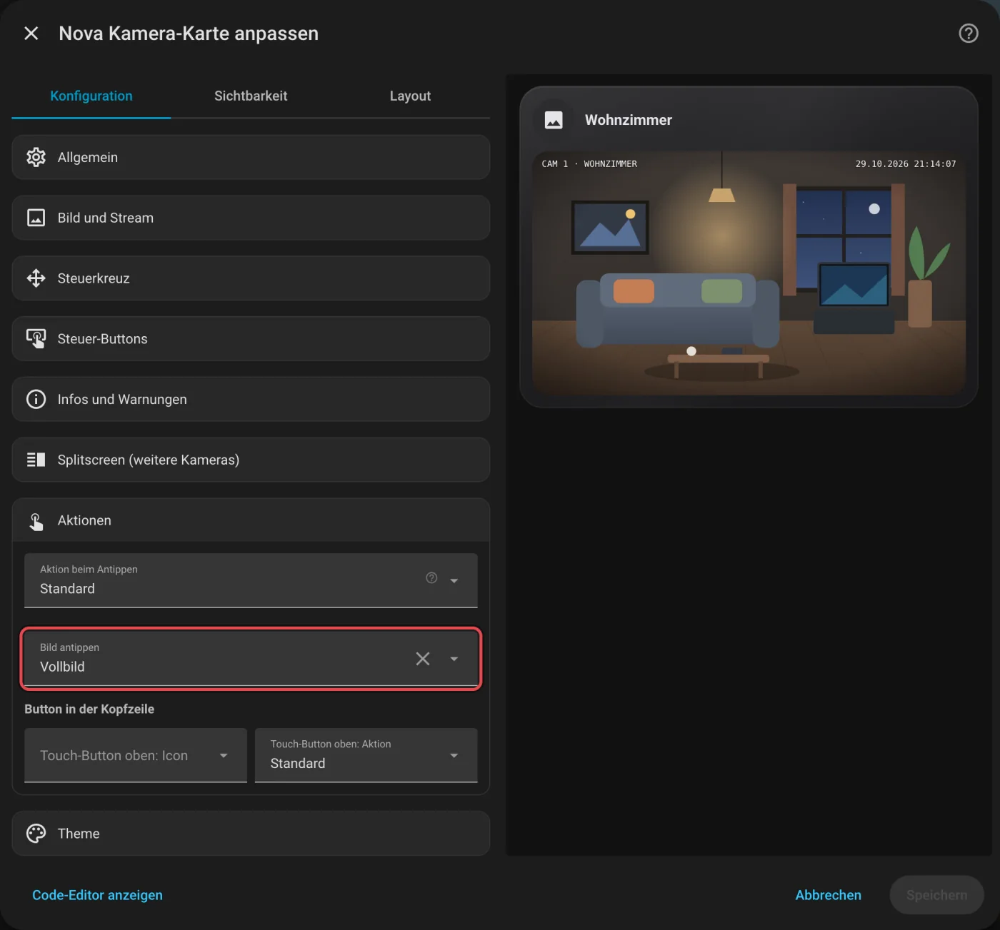

# Nova Kamera Card

[← Alle Karten](README.md) · [Inhaltsverzeichnis](../../README.md)

## Was macht die Karte?

<p align="center"></p>

Das Live-Bild deiner Kamera mit Kopfzeile. Kann die Kamera schwenken, erscheint ein rundes Steuerkreuz. Dazu kommen Knöpfe (zum Beispiel für Licht), kleine Info-Chips und Warnungen direkt im Bild. Mehrere Kameras zeigst du im Splitscreen.

So kann sie aussehen:

<table>
<tr><td align="center" width="50%"><br><sub>Standard</sub></td><td align="center" width="50%"><br><sub>Splitscreen</sub></td></tr>
</table>

## Wofür brauche ich sie?

- Du willst sehen, was vor der Tür oder im Garten los ist.
- Du willst mehrere Kameras auf einer Karte.

## Einrichten Schritt für Schritt

Wie du eine Karte grundsätzlich hinzufügst, steht in [Kapitel 3](../03-erste-schritte.md#4-erste-karte-hinzufügen). Kurz gesagt:

1. Öffne dein Dashboard und tippe oben rechts auf den **Stift** (Dashboard bearbeiten).
2. Tippe im Abschnitt auf **+**, wechsle zum Reiter **Nach Karte** und suche nach „Nova Kamera“. Tippe die Karte an.
3. Unter **Allgemein** wählst du deine **Kamera**. Das ist eine Entität mit `camera.` oder `image.` am Anfang.
4. Unter **Bild und Stream** legst du das Seitenverhältnis fest und was beim Antippen des Bildes passiert.
5. Unter **Steuer-Buttons** fügst du Knöpfe hinzu, zum Beispiel für das Licht in der Einfahrt.
6. Rechts siehst du sofort, wie die Karte aussieht. Passt alles, tippe auf **Speichern**.

<p align="center"></p>

Im Editor findest du diese Bereiche: Allgemein · Bild und Stream · Steuerkreuz · Steuer-Buttons · Infos und Warnungen · Splitscreen (weitere Kameras) · Aktionen · Theme. Tipp einen Bereich an, um ihn aufzuklappen.

## Rezepte: Wenn du … willst, dann so

Alle Rezepte gehen im grafischen Editor. Öffne dazu dein Dashboard, tippe oben rechts auf den **Stift** und dann auf die Karte.
Die rot umrahmten Felder im Bild sind die, um die es geht. Darunter steht jeweils dasselbe als YAML, falls du lieber Text schreibst.

### Wenn du mehrere Kameras auf einmal sehen willst, dann so

1. Klapp **Splitscreen (weitere Kameras)** auf.
2. Tippe auf **Kamera hinzufügen** und wähl die Kamera. Das wiederholst du für jede weitere.
3. Bei **Splitscreen-Anordnung** legst du fest, wie die Kacheln stehen. Schmale Karten stapeln automatisch.
4. Tippe auf **Speichern**.

<p align="center"></p>

<details><summary>Für Fortgeschrittene: als YAML</summary>

```yaml
type: custom:nova-camera-card
entity: camera.wohnzimmer
split:
  - entity: camera.garten
  - entity: camera.einfahrt
```

</details>

### Wenn das Bild beim Antippen groß werden soll, dann so

1. Klapp **Aktionen** auf.
2. Wähl bei **Bild antippen** das Vollbild.
3. Tippe auf **Speichern**.

<p align="center"></p>

<details><summary>Für Fortgeschrittene: als YAML</summary>

```yaml
type: custom:nova-camera-card
entity: camera.wohnzimmer
image_action: fullscreen
```

</details>
## Häufige Fragen

**Läuft der Stream die ganze Zeit?**  
Nein. Er läuft nur, solange die Karte zu sehen ist. Sonst zeigt sie ein Standbild. Das schont dein Wandpanel und dein Netzwerk.

**Das Steuerkreuz erscheint nicht.**  
Die Karte sucht die Schwenk-Knöpfe am Gerät der Kamera. Findet sie keine, bleibt das Kreuz weg. Unter **Steuerkreuz** kannst du die Knöpfe selbst eintragen.

Mehr Hilfe gibt es in [Kapitel 7](../07-hilfe.md).

## Alle Optionen (für Fortgeschrittene)

Alles hier kannst du auch im grafischen Editor einstellen. Wer lieber Text schreibt, tippt im Editor unten auf **Code-Editor anzeigen**. Dort steht die Karte als YAML (eine einfache Textform für Einstellungen). Der Kartentyp ist `custom:nova-camera-card`.

Für `camera.*` (Stream) oder `image.*` (zum Beispiel 3D-Drucker). Der Stream läuft nur, solange die Karte sichtbar ist, sonst steht ein Standbild da (schont das Wandpanel).

### Beispiel in YAML

```yaml
type: custom:nova-camera-card
entity: camera.wohnzimmer_cam_live_ansicht
name: Wohnzimmer
status: binary_sensor.wohnzimmer_bewegung
aspect_ratio: "16:9"        # 4:3, 1:1
image_action: fullscreen    # more-info | fullscreen | none
ptz: auto                   # Steuerkreuz, findet Schwenk-/Neige-Buttons der Kamera selbst
buttons_position: overlay   # oder below
buttons:
  - entity: light.wohnzimmer_decke
    name: Licht
chips:
  - entity: binary_sensor.wohnzimmer_bewegung
    name: Bewegung
    icon: mdi:motion-sensor
    state: "on"             # nur anzeigen, wenn Bewegung
  - entity: sensor.cam_akku
alerts:
  - entity: sensor.cam_akku
    below: 20
    message: Akku {state}
    level: error
split:                      # optional: Splitscreen mit weiteren Kameras
  - entity: image.katzenhohle_p1s_01p09c542801466_kamera
    name: 3D-Drucker
split_layout: grid          # grid | row | column
```

| Option | Standard | Bedeutung |
|---|---|---|
| `entity` | – | `camera.*` oder `image.*` (Pflicht) |
| `name`, `icon`, `status` | Entität | Kopfzeile; `status` = Text unter dem Namen |
| `tap_action`, `button_icon` + `button_action` | more-info | Icon antippen / Touch-Button oben rechts |
| `show_header` | `true` | Kopfzeile anzeigen |
| `aspect_ratio` / `fit` | `16:9` / `cover` | Seitenverhältnis, `contain` = ganzes Bild |
| `image_action` | `more-info` | Bild antippen: `more-info`, `fullscreen`, `none` |
| `stream` | `auto` | `auto` (HA-Stream, sonst MJPEG), `mjpeg`, `webrtc` (braucht webrtc-camera, Optionen unter `webrtc:`), `snapshot` |
| `refresh` | `10` | Standbild-Intervall in s ohne Stream (`0` = aus) |
| `buttons[]` | – | `entity` (button/script/scene werden ausgelöst, Licht/Schalter umgeschaltet) oder `tap_action`, `name`, `icon`, `hold_action`, `confirm` |
| `ptz` | `auto` | Rundes Steuerkreuz: `auto` (Schwenk-/Neige-/Zoom-Buttons am Gerät der Kamera), `onvif` (Dienst `onvif.ptz`, Extras unter `ptz_onvif:`), `false` = aus, oder manuell: `up`, `down`, `left`, `right`, `home`, `zoom_in`, `zoom_out` je eine Button-/Skript-Entität oder Aktion. Gedrückt halten = weiterfahren |
| `ptz_position` | `overlay` | `overlay` = unten rechts im Bild, `below` = darunter |
| `buttons_position` | `overlay` | `overlay` = runde Buttons im Bild, `below` = Pillen darunter |
| `chips[]` | – | `entity`, `name`, `icon`, `unit`, `decimals`; optional `state` / `state_not` / `above` / `below` = nur dann zeigen |
| `split[]` | – | Splitscreen: weitere Kameras als Kacheln, je `entity`, `name`, `ptz` (`auto`/`onvif`/`off`), `image_action`. Jede Kachel streamt nur, wenn sichtbar |
| `split_layout` | `grid` | `grid` (2 Spalten), `row` (nebeneinander), `column` (untereinander); schmale Karten stapeln automatisch |
| `alerts[]` | – | wie bei der Modular Card; Badge oben rechts, `glow: false` = Rahmen nicht einfärben |

---

[← Alle Karten](README.md) · [Inhaltsverzeichnis](../../README.md)
