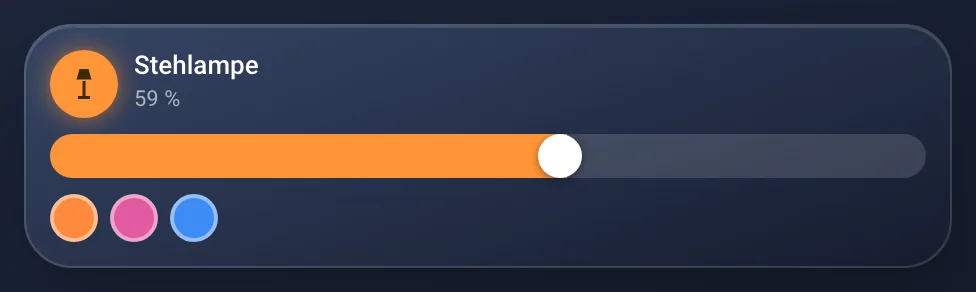
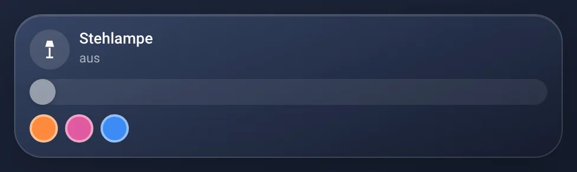
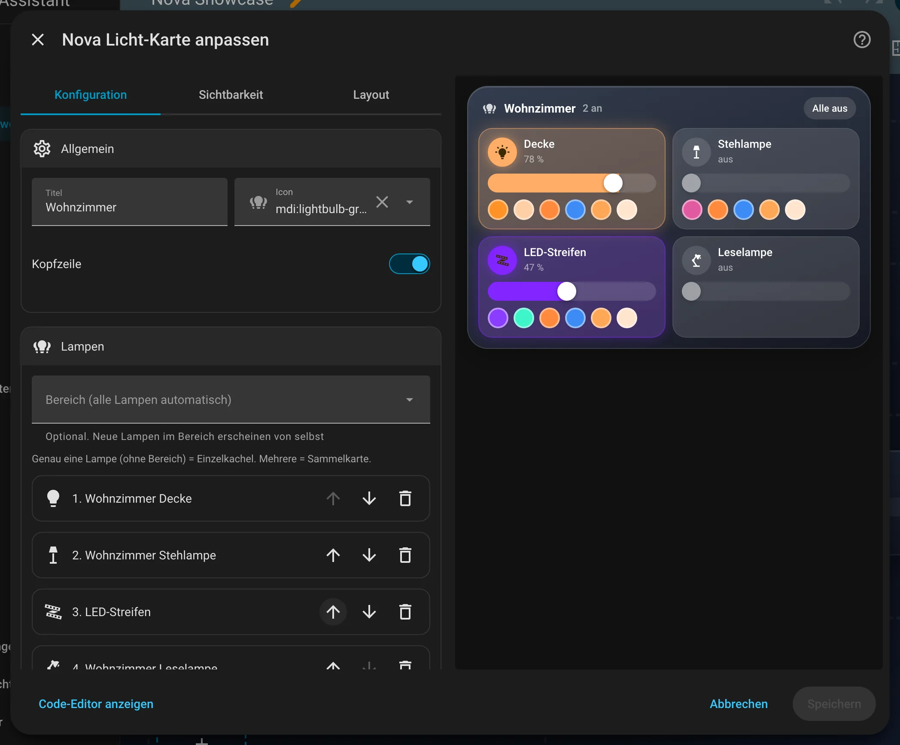
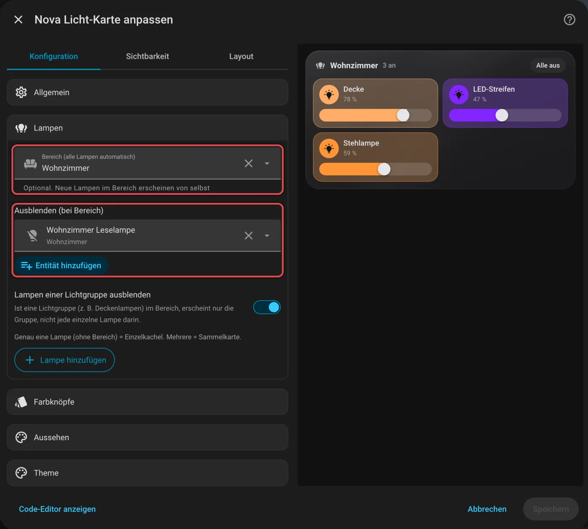
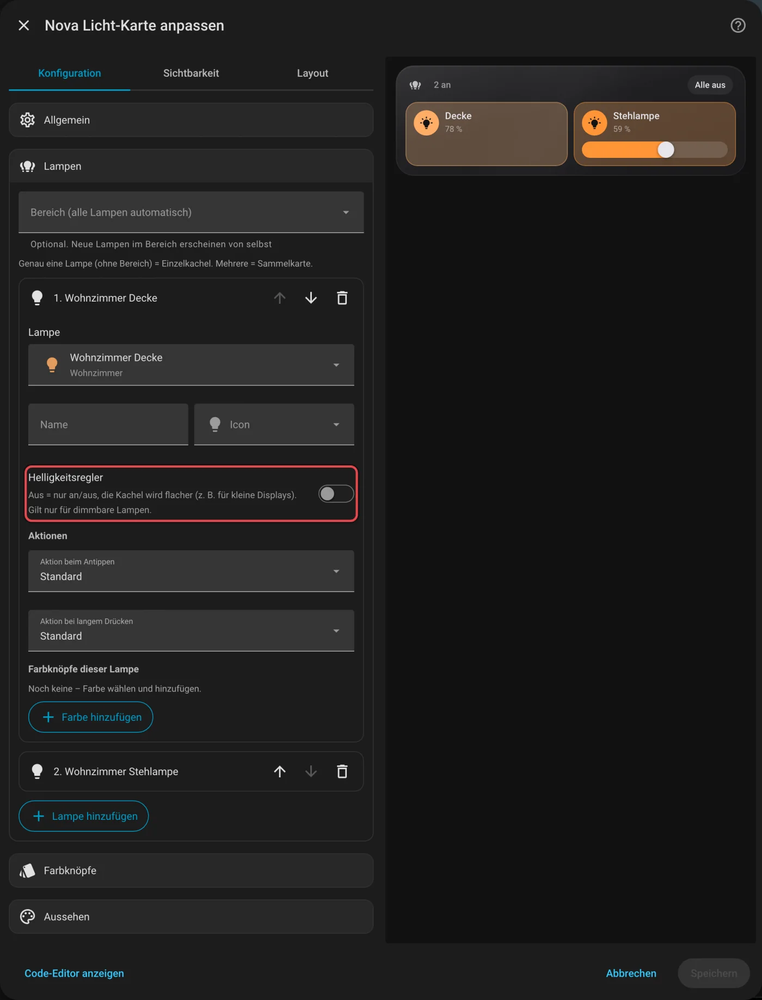

# Nova Licht Card

[← Alle Karten](README.md) · [Inhaltsverzeichnis](../../README.md)

## Was macht die Karte?

<p align="center"></p>

Deine Lampen als Kacheln. Antippen schaltet, Schieben dimmt, und jede Kachel leuchtet in der Farbe ihrer Lampe. Eine Lampe ergibt eine einzelne Kachel, mehrere Lampen eine Sammelkarte mit „Alle aus“-Knopf.

So kann sie aussehen:

<table>
<tr><td align="center" width="50%"><br><sub>Sammelkarte</sub></td><td align="center" width="50%"><br><sub>Lampe an</sub></td></tr>
<tr><td align="center" width="50%"><br><sub>Lampe aus</sub></td></tr>
</table>

## Wofür brauche ich sie?

- Du willst alle Lampen eines Raums an einer Stelle bedienen.
- Du willst Lieblingsfarben mit einem Tipp setzen.

## Einrichten Schritt für Schritt

Wie du eine Karte grundsätzlich hinzufügst, steht in [Kapitel 3](../03-erste-schritte.md#4-erste-karte-hinzufügen). Kurz gesagt:

1. Öffne dein Dashboard und tippe oben rechts auf den **Stift** (Dashboard bearbeiten).
2. Tippe im Abschnitt auf **+**, wechsle zum Reiter **Nach Karte** und suche nach „Nova Licht“. Tippe die Karte an.
3. Unter **Allgemein** wählst du einen **Bereich**, zum Beispiel „Wohnzimmer“. Die Karte holt sich dann alle Lampen aus diesem Raum selbst.
4. Willst du lieber selbst auswählen? Dann lässt du den Bereich leer und tippst unter **Lampen** auf **Lampe hinzufügen**.
5. Unter **Farbknöpfe** legst du per Farbscheibe deine Lieblingsfarben an.
6. Rechts siehst du sofort, wie die Karte aussieht. Passt alles, tippe auf **Speichern**.

<p align="center"></p>

Im Editor findest du diese Bereiche: Allgemein · Lampen · Farbknöpfe · Aussehen · Theme. Tipp einen Bereich an, um ihn aufzuklappen.

## Rezepte: Wenn du … willst, dann so

Alle Rezepte gehen im grafischen Editor. Öffne dazu dein Dashboard, tippe oben rechts auf den **Stift** und dann auf die Karte.
Die rot umrahmten Felder im Bild sind die, um die es geht. Darunter steht jeweils dasselbe als YAML, falls du lieber Text schreibst.

### Wenn eine Lampe nicht in der Karte auftauchen soll, dann so

Das geht, wenn die Karte die Lampen aus einem Bereich holt.

1. Klapp **Lampen** auf.
2. Wähl bei **Bereich (alle Lampen automatisch)** deinen Raum.
3. Trag bei **Ausblenden (bei Bereich)** die Lampe ein, die fehlen soll.
4. Tippe auf **Speichern**.

<p align="center"></p>

<details><summary>Für Fortgeschrittene: als YAML</summary>

```yaml
type: custom:nova-light-card
area: wohnzimmer
exclude:
  - light.leselampe
```

</details>

### Wenn die Kacheln flacher sein sollen (kleines Display), dann so

1. Klapp **Lampen** auf und dann die Lampe.
2. Schalte **Helligkeitsregler** aus. Die Kachel wird deutlich flacher.
3. Tippe auf **Speichern**.

<p align="center"></p>

<details><summary>Für Fortgeschrittene: als YAML</summary>

```yaml
type: custom:nova-light-card
entities:
  - entity: light.deckenlampe
    slider: false
  - light.stehlampe
```

</details>
## Häufige Fragen

**Warum steht „Wohnzimmer“ nicht vor jedem Lampennamen?**  
Die Karte entfernt den Raumnamen aus den Lampennamen, damit es kürzer wird. Aus „Wohnzimmer Stehlampe“ wird „Stehlampe“. Das kannst du unter **Allgemein** abschalten.

**Ich habe eine Lichtgruppe. Erscheinen die Lampen dann doppelt?**  
Nein. Ist eine Gruppe im Bereich, blendet die Karte ihre einzelnen Lampen aus. Selbst eingetragene Lampen bleiben immer sichtbar.

Mehr Hilfe gibt es in [Kapitel 7](../07-hilfe.md).

## Alle Optionen (für Fortgeschrittene)

Alles hier kannst du auch im grafischen Editor einstellen. Wer lieber Text schreibt, tippt im Editor unten auf **Code-Editor anzeigen**. Dort steht die Karte als YAML (eine einfache Textform für Einstellungen). Der Kartentyp ist `custom:nova-light-card`.

Eine Lampe ergibt eine Einzelkachel, mehrere eine Sammelkarte.

### Beispiel in YAML

```yaml
type: custom:nova-light-card
title: Wohnzimmer
area: wohnzimmer          # alle Lampen im Bereich automatisch
exclude:
  - light.wohnzimmer_nachtlicht
colors: ['#ff8a3d', k2700] # Farbknöpfe für alle Lampen (kXXXX = Weißton in Kelvin)
entities:
  - entity: light.stehlampe
    name: Stehlampe
    colors: ['#3d8bf5']
```

| Option | Standard | Bedeutung |
|---|---|---|
| `entities` / `area` | – | Lampen (mindestens eins von beiden) |
| `exclude` | – | Ausblenden bei `area` |
| `hide_group_members` | `true` | Bei `area`: Ist eine Lichtgruppe dabei (z. B. Deckenlampen), erscheinen ihre Mitglieder nicht zusätzlich. Eingetragene Lampen bleiben immer. |
| `strip_area_name` | `true` | Raumnamen aus den Lampennamen entfernen („Wohnzimmer Pilzlampe“ → „Pilzlampe“). Eigene Namen bleiben. Lange Namen brechen um. |
| `show_header` / `show_all_off` | `true` | Kopfzeile, „Alle aus“ |
| `use_light_color` | `true` | In Lichtfarbe leuchten |
| `show_colors` / `colors` | `true` / – | Farbknöpfe (im Editor per Farbscheibe anlegen) |

Je Lampe unter `entities` (statt nur der Entity-ID): `entity`, `name`, `icon`, `colors`, `tap_action`, `hold_action` und
`slider: false` – dann hat die Kachel keinen Helligkeitsregler und wird flacher (praktisch für kleine Displays wie den Echo Show).

---

[← Alle Karten](README.md) · [Inhaltsverzeichnis](../../README.md)
