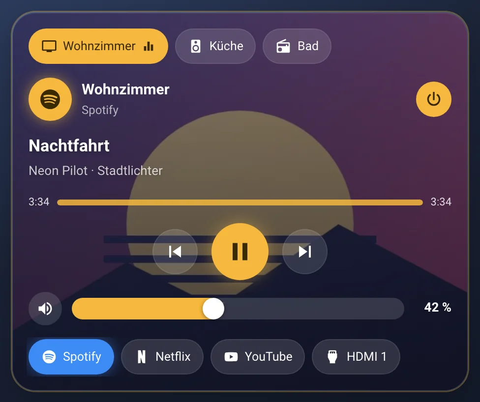
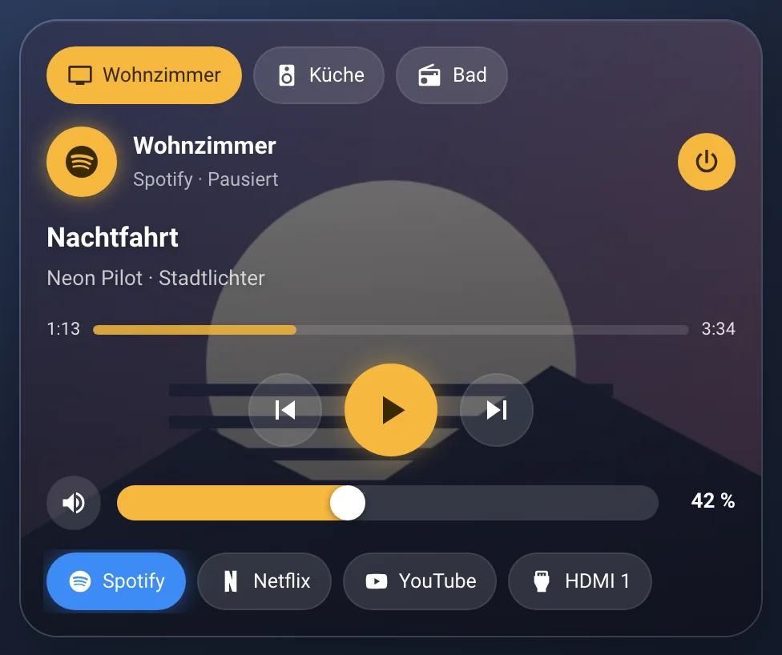
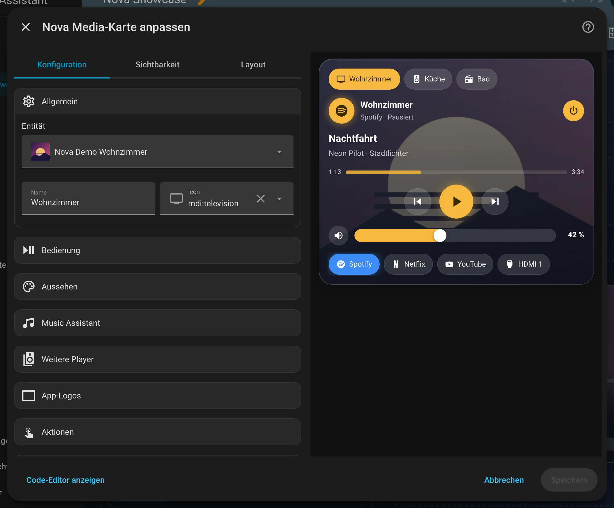

# Nova Media Card

[← Alle Karten](README.md) · [Inhaltsverzeichnis](../../README.md)

## Was macht die Karte?

<p align="center"></p>

Ein Musik- und Video-Player. Das Cover füllt den Hintergrund, darauf stehen Titel, Interpret und das Logo der App. Darunter liegen Play, Pause, Vor, Zurück und die Lautstärke. Es erscheinen nur Knöpfe, die dein Gerät wirklich kann.

So kann sie aussehen:

<table>
<tr><td align="center" width="50%"><br><sub>Spielt</sub></td><td align="center" width="50%"><br><sub>Pausiert</sub></td></tr>
</table>

## Wofür brauche ich sie?

- Du willst Musik oder Fernseher im Dashboard steuern.
- Du hast mehrere Lautsprecher und willst zwischen ihnen wechseln.

## Einrichten Schritt für Schritt

Wie du eine Karte grundsätzlich hinzufügst, steht in [Kapitel 3](../03-erste-schritte.md#4-erste-karte-hinzufügen). Kurz gesagt:

1. Öffne dein Dashboard und tippe oben rechts auf den **Stift** (Dashboard bearbeiten).
2. Tippe im Abschnitt auf **+**, wechsle zum Reiter **Nach Karte** und suche nach „Nova Media“. Tippe die Karte an.
3. Unter **Allgemein** wählst du deinen **Player**. Das ist eine Entität mit `media_player.` am Anfang.
4. Unter **Bedienung** schaltest du Lautstärke, Stumm, Ein/Aus und Quellen an oder aus.
5. Hast du mehrere Lautsprecher? Dann trägst du sie unter **Weitere Player** ein.
6. Rechts siehst du sofort, wie die Karte aussieht. Passt alles, tippe auf **Speichern**.

<p align="center"></p>

Im Editor findest du diese Bereiche: Allgemein · Bedienung · Aussehen · Music Assistant · Weitere Player · App-Logos · Aktionen · Theme. Tipp einen Bereich an, um ihn aufzuklappen.

## Rezepte: Wenn du … willst, dann so

### Wenn die Karte automatisch zum Lautsprecher springen soll, der gerade spielt, dann so

Unter **Weitere Player** die Lautsprecher eintragen und **Automatisch zum spielenden Player** einschalten.

## Häufige Fragen

**Warum fehlt bei mir der Lautstärkeregler?**  
Die Karte zeigt nur, was dein Player kann. Meldet er keine Lautstärke, gibt es auch keinen Regler.

**Ich nutze Music Assistant. Muss ich etwas einstellen?**  
Nein. Die Karte erkennt Music Assistant selbst.

Mehr Hilfe gibt es in [Kapitel 7](../07-hilfe.md).

## Alle Optionen (für Fortgeschrittene)

Alles hier kannst du auch im grafischen Editor einstellen. Wer lieber Text schreibt, tippt im Editor unten auf **Code-Editor anzeigen**. Dort steht die Karte als YAML (eine einfache Textform für Einstellungen). Der Kartentyp ist `custom:nova-media-card`.

Media-Player-Karte im Look der Modular Card: Cover als Hintergrund, Titel, Interpret, App-Logo – leuchtet beim Abspielen.
Buttons erscheinen nur, wenn der Player sie kann (`supported_features`). Music Assistant wird automatisch erkannt.

### Beispiel in YAML

```yaml
type: custom:nova-media-card
entity: media_player.wohnzimmer_tv
name: Wohnzimmer
artwork: cover              # background | cover | none
show_source: true
sources: [HDMI 1, Netflix]  # optional: nur diese Quellen
players:                    # optional: weitere Player, oben umschaltbar
  - entity: media_player.kueche
    name: Küche
  - media_player.bad
icon_map:                   # App/Quelle → Logo (Groß/Klein egal)
  netflix: /local/logos/netflix.svg
  youtube: mdi:youtube
  HDMI 1: mdi:video-input-hdmi
```

| Option | Standard | Bedeutung |
|---|---|---|
| `entity` | – | `media_player.*` (Pflicht) |
| `name`, `icon` | Entität | Kopfzeile |
| `tap_action`, `hold_action` | more-info | Icon antippen / lange drücken |
| `artwork` | `background` | `background` = Cover als Hintergrund, `cover` = Cover-Bild + unscharfer Hintergrund, `none` |
| `glow` | `true` | Rahmen leuchtet beim Abspielen |
| `show_progress` | `true` | Fortschrittsbalken mit Zeit, antippen = springen (wenn der Player Seek kann) |
| `show_volume`, `show_mute` | `true` | Lautstärke-Regler (bzw. −/+ bei Playern ohne `volume_set`) und Stumm-Button |
| `show_power` | `true` | Ein/Aus-Button oben rechts |
| `show_source` / `sources` | `false` / alle | Quellen als Pillen; `sources` = nur diese anzeigen |
| `players[]` | – | Weitere Player: `entity`, `name`, `icon`. Antippen = umschalten, lange drücken = Details |
| `show_players` | `true` | Umschalter anzeigen |
| `auto_switch` | `true` | Wechselt zum Player, der gerade spielt – bis man selbst umschaltet |
| `music_assistant` | automatisch | Findet den Music-Assistant-Player mit gleichem Namen. Spielt der, kommen Titel, Cover und Vor/Zurück von dort (das nackte Gerät, z. B. ESPHome, kennt die nicht). Fest: Entität angeben, `false` = aus. Auch je Eintrag in `players[]` |
| `icon_map` + `icon_entity` | – | Logo statt Icon: Schlüssel = App-Name, Quelle oder Kanal des Players; mit `icon_entity` zählt deren Zustand (wie bei der Raum Card). Gilt auch für die Quellen-Pillen |

---

[← Alle Karten](README.md) · [Inhaltsverzeichnis](../../README.md)
