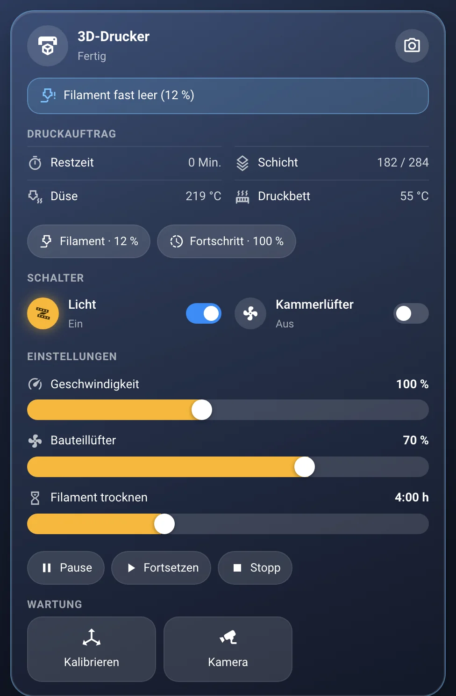
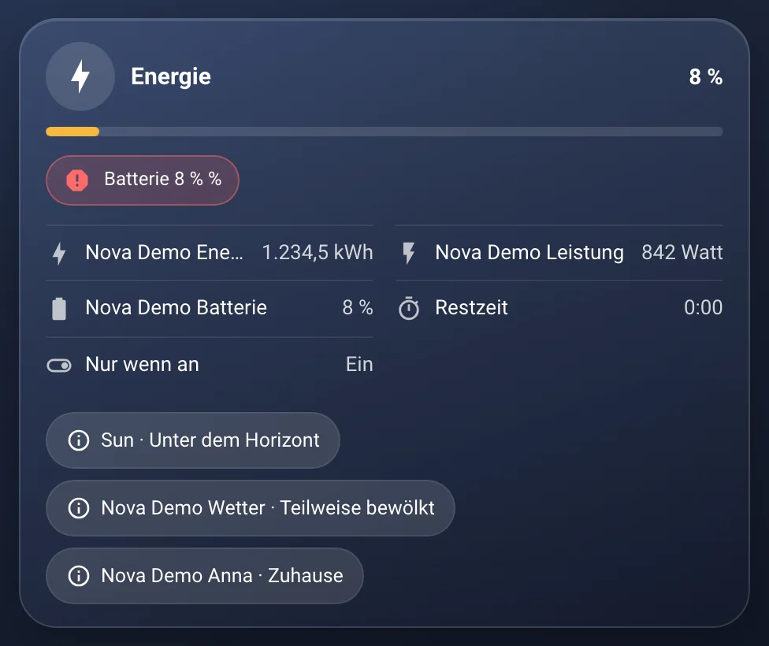
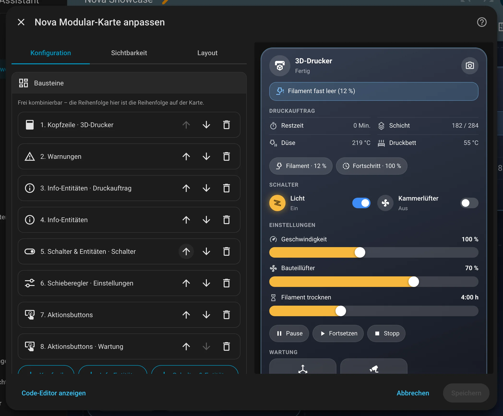
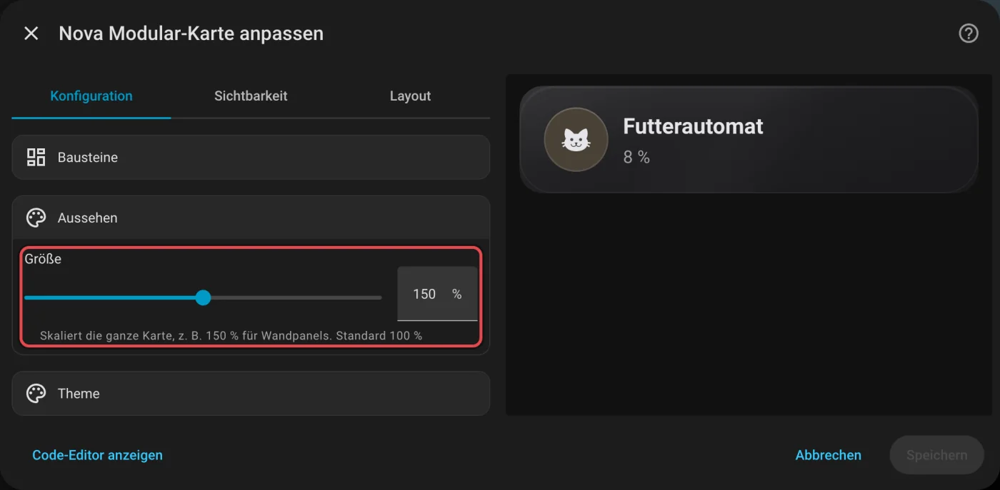
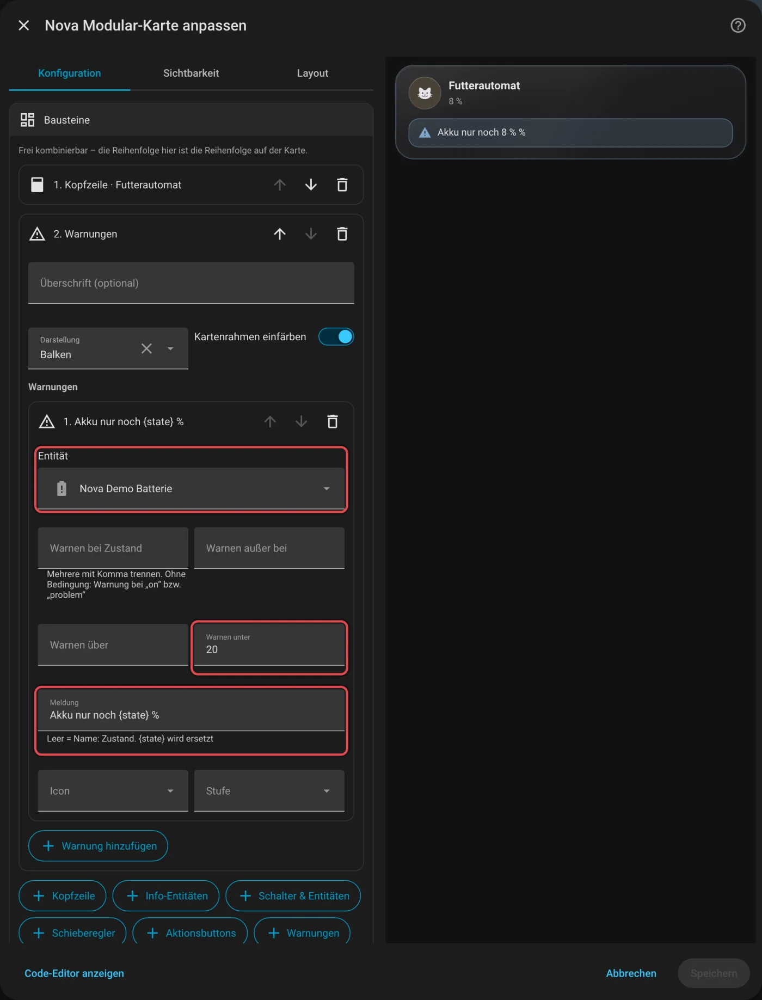

# Nova Modular Card

[← Alle Karten](README.md) · [Inhaltsverzeichnis](../../README.md)

## Was macht die Karte?

<p align="center"></p>

Eine Gerätekarte zum Selbstbauen. Du setzt sie aus Bausteinen zusammen: Kopfzeile, Infos, Schalter, Schieberegler, Knöpfe und Warnungen. Damit passt sie zu fast jedem Gerät, für das es keine eigene Nova Card gibt.

So kann sie aussehen:

<table>
<tr><td align="center" width="50%"><br><sub>Standard</sub></td><td align="center" width="50%"><br><sub>Info</sub></td></tr>
</table>

## Wofür brauche ich sie?

- Du hast ein Gerät, für das keine andere Nova Card passt.
- Du willst genau festlegen, was auf der Karte steht und in welcher Reihenfolge.

## Einrichten Schritt für Schritt

Wie du eine Karte grundsätzlich hinzufügst, steht in [Kapitel 3](../03-erste-schritte.md#4-erste-karte-hinzufügen). Kurz gesagt:

1. Öffne dein Dashboard und tippe oben rechts auf den **Stift** (Dashboard bearbeiten).
2. Tippe im Abschnitt auf **+**, wechsle zum Reiter **Nach Karte** und suche nach „Nova Modular“. Tippe die Karte an.
3. Unter **Bausteine** sind schon eine Kopfzeile und ein Schalter-Baustein angelegt. Tipp sie an, um sie zu bearbeiten.
4. Mit den Knöpfen darunter fügst du weitere Bausteine hinzu, zum Beispiel **Info-Entitäten** oder **Warnungen**.
5. Die Reihenfolge im Editor ist die Reihenfolge auf der Karte. Am Griff ziehst du einen Baustein nach oben oder unten.
6. Rechts siehst du sofort, wie die Karte aussieht. Passt alles, tippe auf **Speichern**.

<p align="center"></p>

Im Editor findest du diese Bereiche: Bausteine · Aussehen · Theme. Tipp einen Bereich an, um ihn aufzuklappen.

## Rezepte: Wenn du … willst, dann so

Alle Rezepte gehen im grafischen Editor. Öffne dazu dein Dashboard, tippe oben rechts auf den **Stift** und dann auf die Karte.
Die rot umrahmten Felder im Bild sind die, um die es geht. Darunter steht jeweils dasselbe als YAML, falls du lieber Text schreibst.

### Wenn die Karte auf einem Wandpanel größer sein soll, dann so

1. Klapp **Aussehen** auf.
2. Stell **Größe** zum Beispiel auf 150 Prozent. Schrift, Icons und Abstände wachsen mit.
3. Tippe auf **Speichern**.

<p align="center"></p>

<details><summary>Für Fortgeschrittene: als YAML</summary>

```yaml
type: custom:nova-modular-card
size: 150
blocks: …
```

</details>

### Wenn eine Warnung erscheinen soll, dann so

1. Klapp **Bausteine** auf und tippe unten auf **+ Warnungen**.
2. Klapp darin eine Warnung auf und wähl die Entität.
3. Setz eine Bedingung, zum Beispiel **Warnen unter** 20.
4. Schreib die **Meldung**. `{state}` steht dabei für den aktuellen Wert.
5. Tippe auf **Speichern**.

<p align="center"></p>

<details><summary>Für Fortgeschrittene: als YAML</summary>

```yaml
type: custom:nova-modular-card
blocks:
  - type: header
    name: Futterautomat
    icon: mdi:cat
  - type: alerts
    alerts:
      - entity: sensor.futterautomat_batterie
        below: 20
        message: Akku nur noch {state} %
```

</details>
## Häufige Fragen

**Was ist der Unterschied zur Nova Gerät Card?**  
Die [Gerät Card](geraet.md) kennt typische Haushaltsgeräte und bringt Bilder und Texte mit. Die Modular Card ist leer und du baust alles selbst.

Mehr Hilfe gibt es in [Kapitel 7](../07-hilfe.md).

## Alle Optionen (für Fortgeschrittene)

Alles hier kannst du auch im grafischen Editor einstellen. Wer lieber Text schreibt, tippt im Editor unten auf **Code-Editor anzeigen**. Dort steht die Karte als YAML (eine einfache Textform für Einstellungen). Der Kartentyp ist `custom:nova-modular-card`.

### Beispiel in YAML

```yaml
type: custom:nova-modular-card
blocks:
  - type: header
    name: Airfryer
    icon: mdi:chef-hat
    status: sensor.airfryer_kochstatus
    progress: sensor.airfryer_fortschritt
    button_icon: mdi:cog
    button_action:
      action: more-info
  - type: alerts
    alerts:
      - entity: binary_sensor.futterautomat_food_level
        message: Futterstand niedrig
      - entity: sensor.airfryer_fehlercode
        state_not: "0"
        level: error
  - type: info
    entities:
      - entity: sensor.airfryer_verbleibende_zeit
        name: Verbleibend
      - entity: sensor.futterautomat_dispensed
        decimals: 0
        unit: g
  - type: entities
    columns: 2
    entities:
      - switch.airfryer_stromversorgung
  - type: sliders
    entities:
      - entity: number.airfryer_temperatur
      - entity: number.airfryer_kochzeit
        format: duration
  - type: buttons
    layout: grid
    buttons:
      - entity: button.airfryer_start
        name: Start
        icon: mdi:play
      - name: Reinigung erledigt
        icon: mdi:check-circle
        confirm: Wirklich erledigt?
        tap_action:
          action: perform-action
          perform_action: script.turn_on
          target:
            entity_id: script.katzenklo_reinigung_bestaetigen
```

| Baustein | Optionen |
|---|---|
| `header` | `name`, `icon`, `status` (Text + an/aus), `active` (statt `status` für an/aus), `progress` (%-Balken), `tap_action`, `button_icon` + `button_action` (Touch-Button oben rechts) |
| `info` | `entities[]`: `entity`, `name`, `icon`, `unit`, `decimals`, `format: value\|clock` (`clock` = Dauer als m:ss, z. B. Restzeit), `hide_idle` (Zeile nur, solange der Wert nicht 0/aus ist), `tap_action` · `layout: rows\|chips`, `columns` |
| `entities` | `entities[]`: `entity`, `name`, `icon`, `tap_action`, `hold_action`, `confirm` · `columns`. Standard: schalten, sonst more-info |
| `sliders` | `entities[]`: `entity` (number, input_number, light, fan, cover, media_player, climate, water_heater), `name`, `icon`, `min`/`max`/`step`, `unit`, `format: duration` (Minuten → Std:Min) |
| `buttons` | `buttons[]`: `name`, `icon`, `entity` (button/script/scene werden ausgelöst) oder `tap_action`, `confirm` · `layout: pills\|flat\|grid` (`flat` = flache Knöpfe nebeneinander, spart Höhe) |
| `alerts` | `alerts[]`: `entity`, `state` / `state_not` (Komma-Liste), `above` / `below`, `message` (`{state}` wird ersetzt), `icon`, `level: warning\|error\|info` · `layout: list\|chips`, `glow` (Kartenrahmen, Standard `true`) |

Für die ganze Karte: `size` (Größe in Prozent, Standard `100`, z. B. `150` für Wandpanels) – skaliert Schrift, Icons und Abstände.

Alle Bausteine außer `header` haben optional `title`. Einträge dürfen auch als Kurzform `- sensor.xyz` angegeben werden.

---

[← Alle Karten](README.md) · [Inhaltsverzeichnis](../../README.md)
