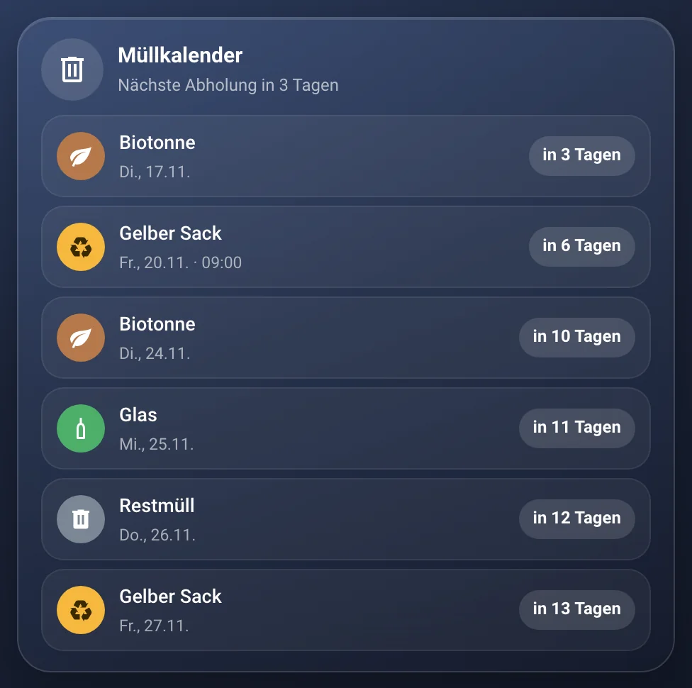
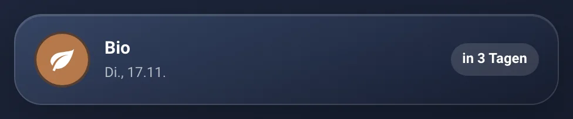
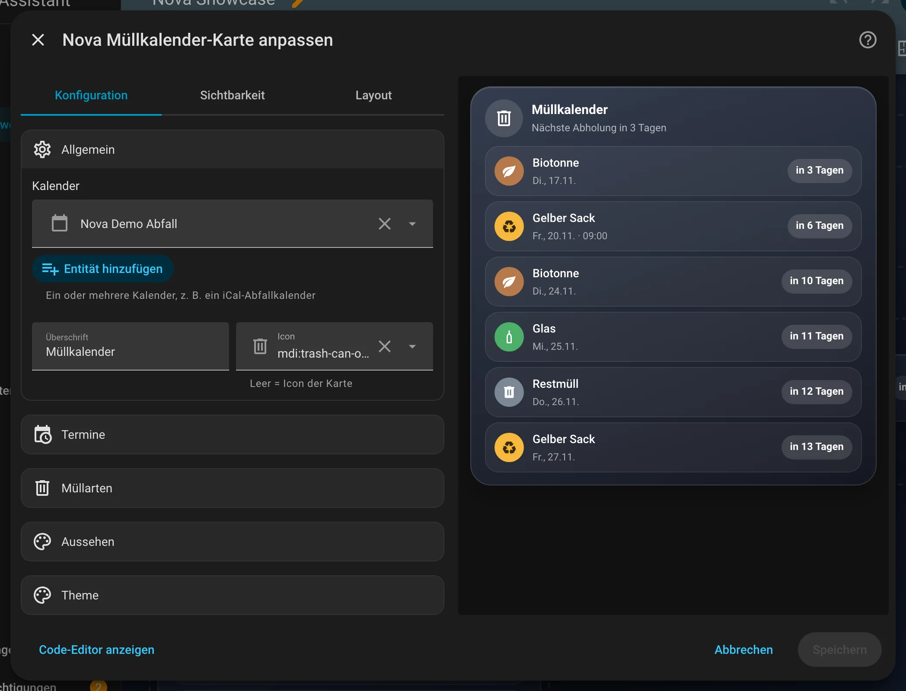
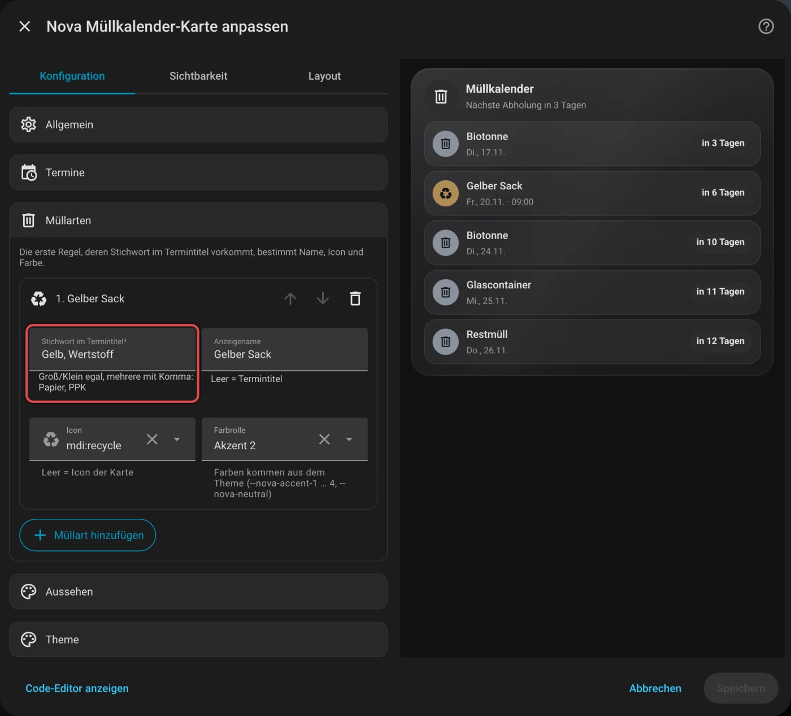

# Nova Müllkalender Card

[← Alle Karten](README.md) · [Inhaltsverzeichnis](../../README.md)

## Was macht die Karte?

<p align="center"></p>

Zeigt die nächsten Müllabholungen: welche Tonne, an welchem Tag und wie lange noch. Heute und morgen werden hervorgehoben, und der Rahmen leuchtet in der Farbe der Tonne. Die Termine kommen aus einem Kalender in Home Assistant.

So kann sie aussehen:

<table>
<tr><td align="center" width="50%"><br><sub>Standard</sub></td><td align="center" width="50%"><br><sub>Kompakt</sub></td></tr>
</table>

## Wofür brauche ich sie?

- Du willst nie wieder vergessen, die Tonne rauszustellen.

## Einrichten Schritt für Schritt

Wie du eine Karte grundsätzlich hinzufügst, steht in [Kapitel 3](../03-erste-schritte.md#4-erste-karte-hinzufügen). Kurz gesagt:

1. Öffne dein Dashboard und tippe oben rechts auf den **Stift** (Dashboard bearbeiten).
2. Tippe im Abschnitt auf **+**, wechsle zum Reiter **Nach Karte** und suche nach „Nova Müllkalender“. Tippe die Karte an.
3. Du brauchst einen Abfallkalender in Home Assistant. Viele Städte bieten einen iCal-Link an. Den bindest du über die Integration „Remote-Kalender“ (oder „Abfall Erinnerung“) ein.
4. Unter **Allgemein** wählst du deinen Kalender. Er beginnt mit `calendar.`.
5. Unter **Müllarten** tippst du auf **Standard-Müllarten einfügen**. Dann kennt die Karte Restmüll, Papier, Gelben Sack, Bio und Glas.
6. Rechts siehst du sofort, wie die Karte aussieht. Passt alles, tippe auf **Speichern**.

<p align="center"></p>

Im Editor findest du diese Bereiche: Allgemein · Termine · Müllarten · Aussehen · Theme. Tipp einen Bereich an, um ihn aufzuklappen.

## Rezepte: Wenn du … willst, dann so

Alle Rezepte gehen im grafischen Editor. Öffne dazu dein Dashboard, tippe oben rechts auf den **Stift** und dann auf die Karte.
Die rot umrahmten Felder im Bild sind die, um die es geht. Darunter steht jeweils dasselbe als YAML, falls du lieber Text schreibst.

### Wenn deine Stadt die Tonnen anders nennt, dann so

1. Klapp **Müllarten** auf und dann die Art, zum Beispiel den Gelben Sack.
2. Trag bei **Stichwort im Termintitel** das Wort aus deinem Kalender ein, zum Beispiel „Wertstoff“. Mehrere Wörter trennst du mit Komma.
3. Tippe auf **Speichern**.

<p align="center"></p>

<details><summary>Für Fortgeschrittene: als YAML</summary>

```yaml
type: custom:nova-waste-card
entities:
  - calendar.abfall
types:
  - match: Gelb, Wertstoff
    name: Gelber Sack
    icon: mdi:recycle
```

</details>
## Häufige Fragen

**Wie oft holt die Karte neue Termine?**  
Beim Laden, danach jede Stunde und kurz nach Mitternacht.

**Warum kann ich die Farbe nicht frei wählen?**  
Die Karte nutzt Farbrollen aus dem Theme. So passen die Farben in jedem Theme zusammen.

Mehr Hilfe gibt es in [Kapitel 7](../07-hilfe.md).

## Alle Optionen (für Fortgeschrittene)

Alles hier kannst du auch im grafischen Editor einstellen. Wer lieber Text schreibt, tippt im Editor unten auf **Code-Editor anzeigen**. Dort steht die Karte als YAML (eine einfache Textform für Einstellungen). Der Kartentyp ist `custom:nova-waste-card`.

Farben sind Farbrollen aus dem Theme, so färbt ein Theme alle Karten einheitlich um. Die Termine kommen über die Kalender-API von Home Assistant: beim Laden der Karte, danach stündlich und direkt nach Mitternacht.

### Beispiel in YAML

```yaml
type: custom:nova-waste-card
entities:
  - calendar.abfallkalender
title: Müllkalender
layout: list                # list | compact
count: 5
days: 30
types:                      # erste passende Regel gewinnt
  - match: Papier, PPK      # Stichwort(e) im Termintitel, Groß/Klein egal
    name: Papiertonne
    icon: mdi:newspaper-variant-outline
    color: accent-1         # Farbrolle: neutral | accent-1 … accent-4
  - match: Gelb, Wertstoff
    name: Gelber Sack
    icon: mdi:recycle
    color: accent-2
```

| Option | Standard | Bedeutung |
|---|---|---|
| `entities` | – | Ein oder mehrere `calendar.*` (Pflicht; einzeln auch als `entity`) |
| `title`, `icon` | `Müllkalender`, `mdi:trash-can-outline` | Kopfzeile; `icon` ist auch das Icon für Termine ohne eigene Regel |
| `show_header` | `true` | Kopfzeile mit „Nächste Abholung …“ |
| `layout` | `list` | `list` = nächste Termine untereinander, `compact` = nur der nächste Abholtag (mehrere Müllarten an dem Tag nebeneinander) |
| `count` | `5` | Anzahl Termine in der Liste |
| `days` | `30` | Zeitraum in Tagen ab heute |
| `types[]` | – | Regeln: `match` (Stichwort, mehrere mit Komma), `name` (leer = Termintitel), `icon`, `color` (Farbrolle; Standard `neutral`) |
| `hide_unmatched` | `false` | Termine ohne passende Regel ausblenden |
| `glow` | `true` | Rahmen leuchtet bei einer Abholung heute oder morgen |

Ganztägige Termine zählen für ihren Kalendertag, mehrtägige ab heute bis zu ihrem letzten Tag. Termine mit Uhrzeit zeigen die
Uhrzeit mit an und richten sich nach der Zeitzone aus dem HA-Profil (Browser oder Server). Die gleiche Müllart am gleichen Tag
aus mehreren Kalendern erscheint nur einmal. Antippen öffnet die Details des Kalenders.
Im Editor fügt **„Standard-Müllarten einfügen“** Restmüll, Papier, Gelber Sack, Bio und Glas als Vorlage ein.

---

[← Alle Karten](README.md) · [Inhaltsverzeichnis](../../README.md)
