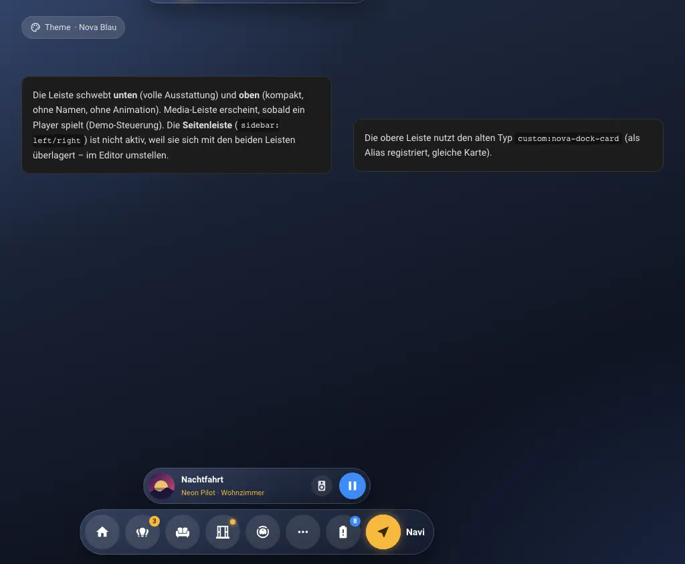
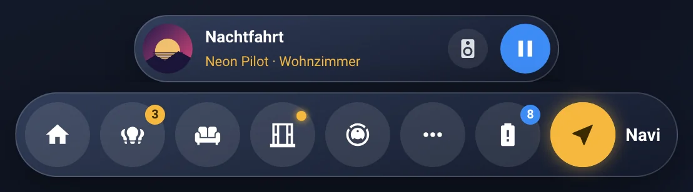
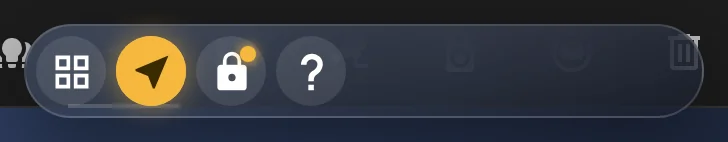
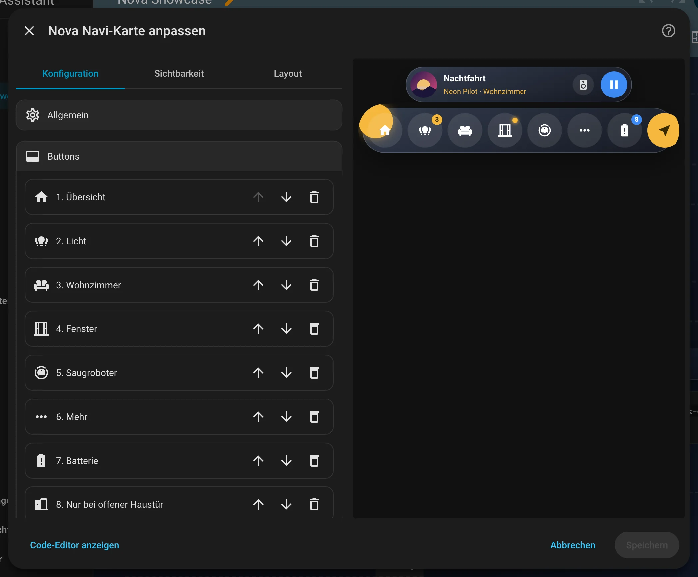
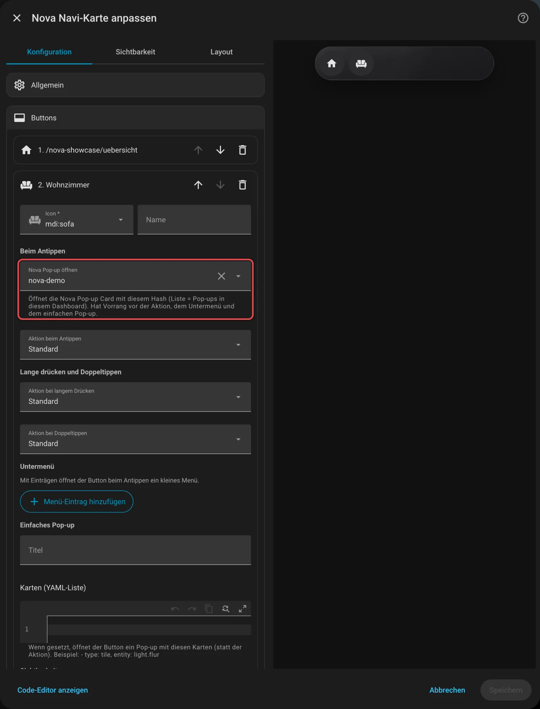
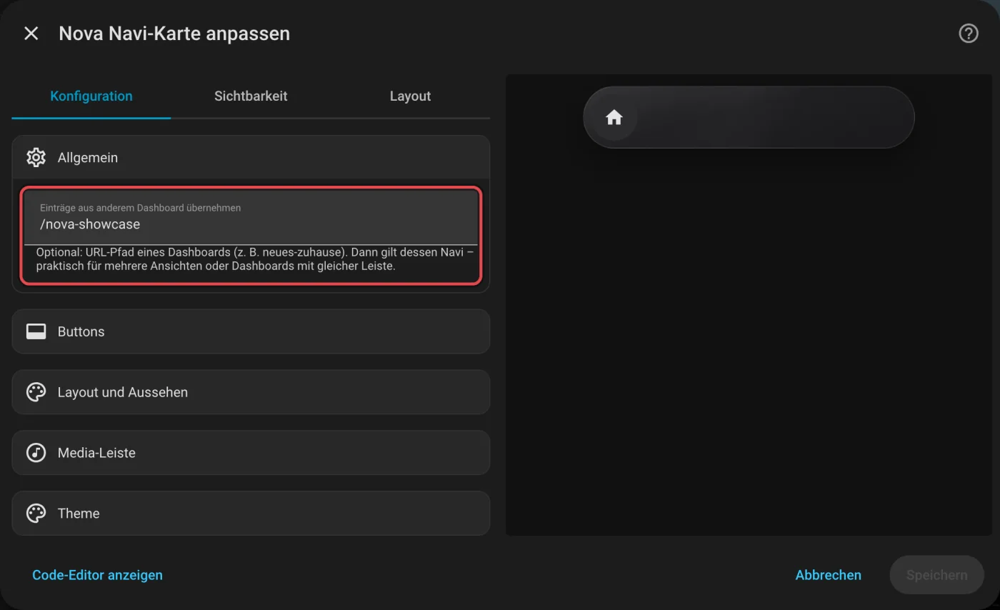
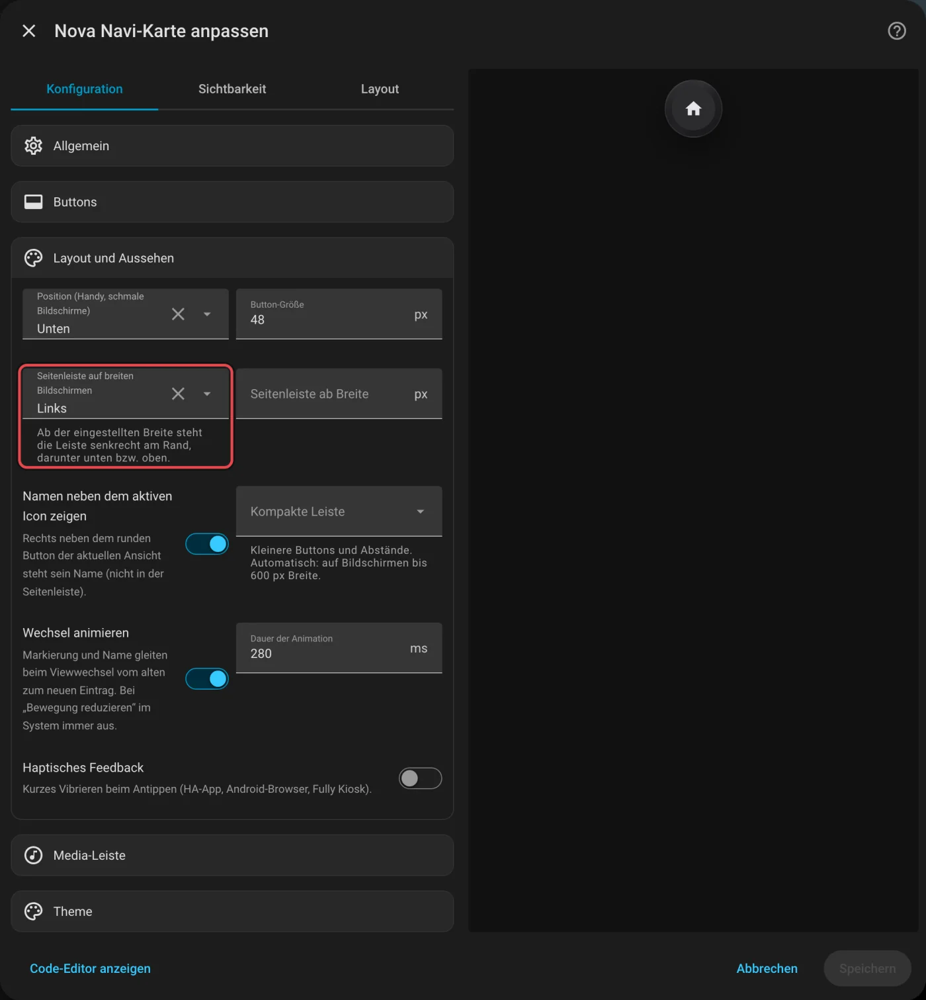

# Nova Navi

[← Alle Karten](README.md) · [Inhaltsverzeichnis](../../README.md)

## Was macht die Karte?

<p align="center"></p>

Eine schwebende Leiste mit runden Knöpfen am unteren Bildschirmrand. Damit springst du zwischen den Seiten deines Dashboards. Ein Knopf kann auch ein Pop-up oder ein kleines Menü öffnen. Läuft Musik, erscheint darüber ein kleiner Player.

So kann sie aussehen:

<table>
<tr><td align="center" width="50%"><br><sub>Standard</sub></td><td align="center" width="50%"><br><sub>Kompakt</sub></td></tr>
</table>

## Wofür brauche ich sie?

- Dein Dashboard hat mehrere Ansichten und du willst schnell dazwischen wechseln.
- Du willst eine App-ähnliche Bedienung auf Handy oder Tablet.

## Einrichten Schritt für Schritt

Wie du eine Karte grundsätzlich hinzufügst, steht in [Kapitel 3](../03-erste-schritte.md#4-erste-karte-hinzufügen). Kurz gesagt:

1. Öffne dein Dashboard und tippe oben rechts auf den **Stift** (Dashboard bearbeiten).
2. Tippe im Abschnitt auf **+**, wechsle zum Reiter **Nach Karte** und suche nach „Nova Navi“. Tippe die Karte an.
3. Leg die Karte am besten in jede Ansicht. Wo sie im Abschnitt steht, ist egal: Die Leiste schwebt immer am Rand.
4. Unter **Buttons** tippst du auf **Button hinzufügen**. Gib ihm ein Icon und einen Namen.
5. Bei **Beim Antippen** wählst du **Navigieren** und trägst die Ansicht ein, zum Beispiel `/mein-zuhause/kueche`.
6. Unter **Layout und Aussehen** wählst du, ob die Leiste unten oder oben sitzt.
7. Rechts siehst du sofort, wie die Karte aussieht. Passt alles, tippe auf **Speichern**.

<p align="center"></p>

Im Editor findest du diese Bereiche: Allgemein · Buttons · Layout und Aussehen · Media-Leiste · Theme. Tipp einen Bereich an, um ihn aufzuklappen.

## Rezepte: Wenn du … willst, dann so

Alle Rezepte gehen im grafischen Editor. Öffne dazu dein Dashboard, tippe oben rechts auf den **Stift** und dann auf die Karte.
Die rot umrahmten Felder im Bild sind die, um die es geht. Darunter steht jeweils dasselbe als YAML, falls du lieber Text schreibst.

### Wenn ein Knopf ein Pop-up öffnen soll, dann so

Leg zuerst eine [Nova Pop-up Card](popup.md) an.

1. Klapp **Buttons** auf und dann den Knopf.
2. Wähl bei **Nova Pop-up öffnen** das Pop-up aus der Liste.
3. Tippe auf **Speichern**.

<p align="center"></p>

<details><summary>Für Fortgeschrittene: als YAML</summary>

```yaml
type: custom:nova-navi-card
items:
  - icon: mdi:home
    name: Start
    navigation_path: /dashboard-nova/start
  - icon: mdi:sofa
    name: Wohnzimmer
    popup_hash: wohnzimmer
```

</details>

### Wenn die Leiste in jeder Ansicht gleich sein soll, ohne sie überall neu zu bauen, dann so

Bau die Leiste einmal fertig. In allen anderen Ansichten legst du eine leere Navi Card an und holst die Knöpfe von dort:

1. Klapp **Allgemein** auf.
2. Trag bei **Einträge aus anderem Dashboard übernehmen** den Pfad des Dashboards ein, in dem die fertige Leiste liegt, zum Beispiel `/dashboard-nova`.
3. Tippe auf **Speichern**.

<p align="center"></p>

<details><summary>Für Fortgeschrittene: als YAML</summary>

```yaml
type: custom:nova-navi-card
source: /dashboard-nova
```

</details>

### Wenn am PC eine Seitenleiste statt der Leiste unten erscheinen soll, dann so

1. Klapp **Layout und Aussehen** auf.
2. Wähl bei **Seitenleiste auf breiten Bildschirmen** links oder rechts. Ab 1024 Pixeln Breite steht die Leiste dann senkrecht am Rand.
3. Tippe auf **Speichern**.

<p align="center"></p>

<details><summary>Für Fortgeschrittene: als YAML</summary>

```yaml
type: custom:nova-navi-card
sidebar: left
items: …
```

</details>
## Häufige Fragen

**Woher weiß die Leiste, welcher Knopf gerade aktiv ist?**  
Sie vergleicht die Adresse der Seite mit dem Ziel jedes Knopfs. Stimmt beides überein, wird der Knopf gelb.

**Früher hieß die Karte „Nova Dock Card“. Muss ich etwas ändern?**  
Nein. Der alte Typ `custom:nova-dock-card` läuft einfach weiter.

Mehr Hilfe gibt es in [Kapitel 7](../07-hilfe.md).

## Alle Optionen (für Fortgeschrittene)

Alles hier kannst du auch im grafischen Editor einstellen. Wer lieber Text schreibt, tippt im Editor unten auf **Code-Editor anzeigen**. Dort steht die Karte als YAML (eine einfache Textform für Einstellungen). Der Kartentyp ist `custom:nova-navi-card`.

> Früher hieß die Karte **Nova Dock Card** (`custom:nova-dock-card`). Der alte Typ funktioniert weiter, im Editor steht
> sie jetzt als **Nova Navi**. Zum Umstellen in der Konfiguration nur `type` ändern.

### Beispiel in YAML

```yaml
type: custom:nova-navi-card
position: bottom          # oder top (Handy, schmale Bildschirme)
sidebar: left             # optional: ab sidebar_min_width als Seitenleiste links/rechts
sidebar_min_width: 1024
button_size: 48
haptic: true
media_players:
  - entity: media_player.wohnzimmer
    name: Wohnzimmer
  - media_player.kuche
items:
  - icon: mdi:home
    label: Übersicht
    tap_action:
      action: navigate
      navigation_path: /wandpanel/home
    double_tap_action:
      action: perform-action
      perform_action: script.alles_aus
  - icon: mdi:dots-horizontal
    label: Mehr
    menu:
      - icon: mdi:cat
        label: Katzen
        tap_action:
          action: navigate
          navigation_path: /wandpanel/katzen
      - icon: mdi:fishbowl-outline
        label: Aquarien
        tap_action:
          action: navigate
          navigation_path: /wandpanel/aquarium
  - icon: mdi:lightbulb-group
    popup_title: Licht
    badge_count_of: light.alle_lampen
    badge_show_number: true
    cards:
      - type: custom:nova-light-card
        area: wohnzimmer
  - icon: mdi:shield-account
    label: Admin
    visible_users: [abc123]           # Benutzer-ID, im Editor per Liste
  - icon: mdi:window-open-variant
    label: Fenster
    badge: sensor.offene_fenster_anzahl
    badge_show_number: true
    badge_alert_color: accent-1
    badge_alert_above: 2
```

### Leiste

| Option | Standard | Bedeutung |
|---|---|---|
| `position` | `bottom` | `bottom` oder `top` – gilt auf dem Handy und überall, wo keine Seitenleiste gezeigt wird |
| `sidebar` | – | `left` oder `right`: auf breiten Bildschirmen senkrecht am Rand |
| `sidebar_min_width` | `1024` | Ab dieser Fensterbreite (px) gilt die Seitenleiste |
| `button_size` | `48` | Größe der Buttons in px |
| `active_label` | an | Rechts neben dem aktiven (runden) Button steht in Weiß sein Name (nicht in der Seitenleiste) |
| `compact` | automatisch | Kompakte Leiste (kleinere Buttons und Abstände): leer = automatisch bis 600 px Bildschirmbreite, `true` = immer, `false` = nie |
| `animation` | an | Beim Viewwechsel gleiten Markierung, Name und Leistenbreite weich vom alten zum neuen Eintrag. Bei „Bewegung reduzieren“ im System immer aus |
| `animation_duration` | `280` | Dauer der Animation in ms |
| `haptic` | aus | Kurzes Vibrieren beim Antippen (HA-App, Android-Browser, Fully Kiosk) |
| `source` | – | Einträge aus einem anderen Dashboard übernehmen (URL-Pfad), z. B. für mehrere Ansichten mit gleicher Leiste |

### Media-Leiste

Über der Leiste erscheint ein kleiner Player – aber nur, solange wirklich etwas läuft. Ein- und Ausblenden gleitet weich,
die Navi rückt ohne Lücke nach.

```yaml
media_players:
  - entity: media_player.wohnzimmer_echo
    name: Wohnzimmer
  - entity: media_player.kuche_echo
    name: Küche
  - media_player.bad_echo          # alte Schreibweise geht weiter
paused_timeout: 10                 # Minuten, die ein pausierter Player noch sichtbar bleibt
```

| Option | Standard | Bedeutung |
|---|---|---|
| `media_players` | – | Liste der Player: Entität als Text oder als Objekt mit `entity` und eigenem `name` (Name in der Lautsprecher-Auswahl) |
| `paused_timeout` | `10` | Minuten, die ein pausierter Player noch angezeigt wird (gemessen an `last_changed`). `0` = sofort ausblenden |
| `media_always` | aus | Alte Verhaltensweise: Leiste immer zeigen, auch wenn nichts läuft (dann der erste Player) |

- **Wann sie erscheint:** sobald ein Player auf `playing` steht. Pausierte bleiben `paused_timeout` Minuten stehen. `off`, `idle`,
  `standby`, `unavailable` oder ein Player ohne `media_title` zählen als „läuft nicht“.
- **Welcher Player:** immer der, der spielt – bei mehreren der zuletzt gestartete.
- **Lautsprecher wechseln:** Bei mehr als einem Player sitzt neben Play ein kleiner runder Knopf mit Lautsprecher. Er öffnet eine
  Auswahl mit allen Playern (Name, spielt/pausiert/aus, Titel), der aktuelle ist markiert. Die Wahl gilt, bis ein anderer Player
  neu startet.
- **Antippen:** Titel oder Cover öffnen die Details des Players, Play/Pause ruft `media_player.media_play_pause` auf. Meldet der
  Player nach etwa 3 Sekunden keine Änderung, steht kurz „Lautsprecher reagiert nicht“ in der Leiste.

In der Seitenleiste ist die Media-Leiste ein kompakter Knopf mit Cover und Play/Pause.

### Einträge (`items[]`)

| Option | Bedeutung |
|---|---|
| `icon`, `label` | Icon (MDI oder Bild-URL) und Name (Tooltip) |
| `tap_action`, `hold_action`, `double_tap_action` | Aktionen wie bei HA-Karten. Mit Doppeltippen wartet ein einfaches Antippen kurz auf den zweiten Tipp |
| `popup_hash` | Öffnet die [Nova Pop-up Card](popup.md) mit diesem Hash. Hat Vorrang vor allem anderen |
| `menu[]` | Untermenü: Antippen öffnet ein kleines Menü mit diesen Einträgen (`icon`, `label`, `tap_action`, `popup_hash`, `hold_action`, `double_tap_action`, Sichtbarkeit) |
| `cards` + `popup_title` | Einfaches Pop-up mit diesen Karten |
| `visible_users` | Nur für diese Benutzer (IDs). Leer = alle |
| `visible_entity` | Nur zeigen abhängig von dieser Entität. Ohne Bedingung: wenn sie an ist |
| `visible_state`, `visible_state_not`, `visible_above`, `visible_below` | Bedingung dazu (Zustand ist / ist nicht, Wert über / unter) |
| `badge` | Punkt, wenn die Entität an ist; mit `badge_show_number` ihr Zahlenwert |
| `badge_count_of` (+ `badge_show_number`, `badge_exclude`) | Zähler für eingeschaltete Gruppenmitglieder |
| `badge_color` | Farbrolle des Badges (`neutral`, `accent-1` … `accent-4`), leer = Akzentfarbe |
| `badge_alert_color` + `badge_alert_state` / `_state_not` / `_above` / `_below` | Andere Farbrolle, wenn die Bedingung auf die Badge-Entität zutrifft |

### Aktiver Eintrag

Markiert ist der Eintrag, dessen `navigation_path` genau dem aktuellen Pfad entspricht (ein `/` am Ende ist egal).
Liegt der Pfad in einem Untermenü, ist dessen Button markiert und zeigt den Namen des Menü-Eintrags.
Der aktive Button ist gelb (Theme-Variable `--nova-navi-active-color`, Standard `--nova-accent-2`; Textfarbe `--nova-navi-active-text-color`) und rechts daneben steht sein Name in Weiß (`active_label`). Die Markierung wird bei jedem Wechsel der Ansicht neu
berechnet. Weil Home Assistant die Karte dabei neu erzeugt, merkt sich Nova Navi den zuletzt aktiven Eintrag: Die neue
Leiste startet im alten Zustand, die gelbe Markierung gleitet zum neuen Eintrag, der alte Name fährt ein und der neue aus.
Die Animation arbeitet nach dem FLIP-Prinzip: Start- und Endlage werden einmal gemessen, danach bewegen sich Markierung,
Buttons, Namen und Leistenhintergrund nur per `transform` und `opacity` mit gleicher Dauer und Kurve – ohne Layout-Neuberechnung
in jedem Frame. Rendert Home Assistant die Karte doppelt, startet die Animation nicht ein zweites Mal; bei schnellem
Mehrfachwechsel gleitet sie aus der aktuellen Zwischenlage weiter.
Passt die Leiste nicht auf den Bildschirm (z. B. am Handy), lässt sie sich wischen: Der aktive Eintrag wird beim Wechsel
weich in die Mitte gescrollt, Pille und Schatten werden am Rand nicht abgeschnitten, und wo es weitergeht, blendet der Rand weich aus.
Jeder Button behält immer seine Inaktiv-Farbe als Grundfarbe; das Gelb liegt als eigene Ebene darüber und blendet
beim Wechsel direkt zwischen Gelb und Inaktiv-Farbe über (gleiche Dauer und Kurve wie die Markierung).

---

[← Alle Karten](README.md) · [Inhaltsverzeichnis](../../README.md)
