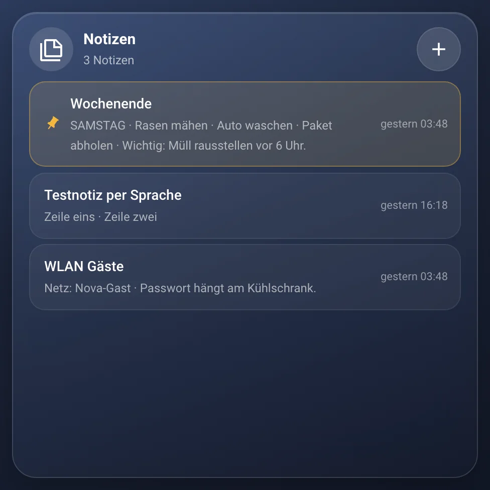
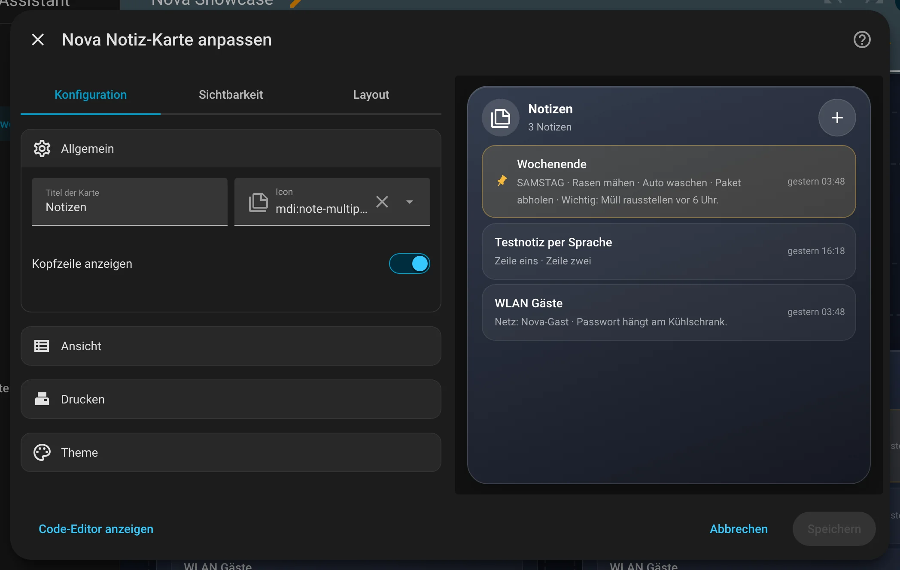

# Nova Notiz Card

[← Alle Karten](README.md) · [Inhaltsverzeichnis](../../README.md)

## Was macht die Karte?

<p align="center"></p>

Notizen mit Titel und formatiertem Text: fett, Listen, Checklisten. Die Liste zeigt angepinnte Notizen oben. Alles wird automatisch gespeichert und ist auf allen Geräten gleich.

## Wofür brauche ich sie?

- Du willst Notizen für die Familie am Kühlschrank-Tablet.
- Du willst Checklisten, die man abhaken kann.

## Einrichten Schritt für Schritt

Wie du eine Karte grundsätzlich hinzufügst, steht in [Kapitel 3](../03-erste-schritte.md#4-erste-karte-hinzufügen). Kurz gesagt:

1. Öffne dein Dashboard und tippe oben rechts auf den **Stift** (Dashboard bearbeiten).
2. Tippe im Abschnitt auf **+**, wechsle zum Reiter **Nach Karte** und suche nach „Nova Notiz“. Tippe die Karte an.
3. Die Karte braucht das Modul **Notizen** der Integration Nova Homeverse. Es ist von Anfang an an.
4. Ein Name genügt. Neue Notizen legst du später mit dem Plus in der Karte an.
5. Rechts siehst du sofort, wie die Karte aussieht. Passt alles, tippe auf **Speichern**.

<p align="center"></p>

Im Editor findest du diese Bereiche: Allgemein · Ansicht · Drucken · Theme. Tipp einen Bereich an, um ihn aufzuklappen.

## Häufige Fragen

**Die Karte zeigt nur einen Hinweis.**  
Dann ist das Modul **Notizen** aus. Schalt es im Nova-Panel unter **Allgemein → Module** wieder an.

Mehr Hilfe gibt es in [Kapitel 7](../07-hilfe.md).

## Alle Optionen (für Fortgeschrittene)

Alles hier kannst du auch im grafischen Editor einstellen. Wer lieber Text schreibt, tippt im Editor unten auf **Code-Editor anzeigen**. Dort steht die Karte als YAML (eine einfache Textform für Einstellungen). Der Kartentyp ist `custom:nova-note-card`.

Notizen, die auf allen Geräten gleich sind. Die Daten liegen in der
[Integration Nova Homeverse](../../../README.md) (Modul „Notizen“) – ohne sie zeigt die Karte nur einen Hinweis.

- **Liste:** angepinnte Notizen oben, darunter die zuletzt geänderten; je Notiz Titel, Vorschau und „zuletzt geändert“.
- **Notiz öffnen:** antippen. Titel und Text lassen sich direkt bearbeiten, gespeichert wird automatisch kurz nach dem Tippen.
  Oben: Zurück, Stand („Gespeichert“, „Geändert vor 5 Min.“), Anpinnen, Drucken, Löschen (zweimal tippen).
- **Formatierung** über die Leiste (seitlich wischbar): Fett, Kursiv, Unterstrichen, Durchgestrichen, Schriftgröße (klein,
  normal, groß, Überschrift), Aufzählung, Checkliste (Kästchen antippen = abhaken) und drei Textfarben aus dem Theme
  (Akzent, Wichtig, Gedämpft). Ohne Markierung gilt Größe und Farbe für das Wort unter dem Cursor.
- **Neue Notiz:** Plus oben rechts. Leere Notizen werden nicht angelegt.

Die Karte ist in allen Zuständen gleich hoch; Liste und Notiz scrollen in sich.

### Beispiel in YAML

```yaml
type: custom:nova-note-card
view: full                    # full | compact
max_notes: 5
print_script: script.notiz_drucken
```

| Option | Standard | Bedeutung |
|---|---|---|
| `name`, `icon` | `Notizen`, `mdi:note-multiple-outline` | Kopfzeile |
| `show_header` | `true` | Kopfzeile mit Anzahl und Plus-Knopf |
| `view` | `full` | `full` = Titel, Vorschau, Datum · `compact` = nur Titel und Datum. Ohne Angabe gilt die Nova-Einstellung „Kompakte Liste“ |
| `text_size` | `normal` | Schriftgröße der Notiz: `klein`, `normal`, `gross`. Ohne Angabe gilt die Nova-Einstellung |
| `max_notes` | `0` | Höchstens so viele Notizen zeigen, der Rest lässt sich aufklappen (0 = alle) |
| `height` | `380` | Mindesthöhe in px; im Raster füllt die Karte den Platz aus |
| `print_script` | – | Skript für den Druck-Knopf in der geöffneten Notiz (leer = kein Knopf) |
| `print_field` | `text` | Feldname, unter dem das Skript Titel und Text bekommt |
| `print_label`, `print_icon` | `Drucken`, `mdi:printer-pos` | Titel und Icon des Knopfs |

### Drucken

Bondrucker können kein HTML – die Karte gibt deshalb Klartext weiter: Titel, Leerzeile, Text. Überschriften stehen in
GROSSBUCHSTABEN, Aufzählungen mit `•`, Checklisten mit `[ ]` und `[x]`. Farben und Schriftgrößen fallen weg.

```yaml
alias: Notiz drucken
mode: queued
fields:
  text:
    selector: {text: {multiline: true}}
sequence:
  - action: escpos_printer.print_text_utf8
    target: {entity_id: notify.mein_bondrucker}
    data: {text: "{{ text }}", align: left, feed: 3, cut: partial}
```

### Sicherheit

Gespeichert wird bereinigtes HTML aus einer festen Liste von Elementen (`b`, `i`, `u`, `s`, `p`, `br`, `h3`, `ul`, `li`,
`span` mit festen Klassen). Alles andere – Skripte, Links, Bilder, Attribute – wird in der Karte **und** in der Integration
entfernt. Eingefügter Text kommt immer als reiner Text an.

### Umstieg von der alten Karte

Bis 0.11 war die Karte ein einzelnes Textfeld, gespeicherte Notizen lagen in einer todo-Liste (`notes_entity`). Diese
Optionen gibt es nicht mehr: `placeholder`, `show_clear`, `clear_after_print`, `clear_after_save`, `notes_entity`,
`notes_height`, `storage_key`, `print_style`. Notizen aus der todo-Liste werden nicht automatisch übernommen.

---

[← Alle Karten](README.md) · [Inhaltsverzeichnis](../../README.md)
