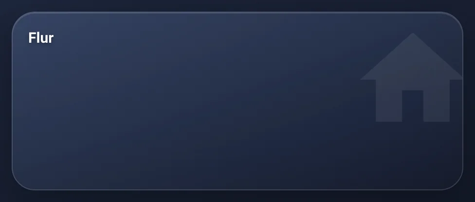
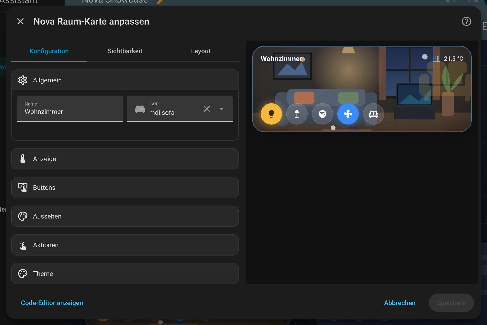

# Nova Raum Card

[← Alle Karten](README.md) · [Inhaltsverzeichnis](../../README.md)

## Was macht die Karte?

<p align="center"></p>

Eine Kachel für einen Raum. Oben stehen Name und Temperatur, unten runde Knöpfe für Licht, Fernseher und alles, was du schnell schalten willst. Ist ein Fenster offen, bekommt die Kachel einen farbigen Rahmen. Läuft im Raum etwas, leuchtet sie.

So kann sie aussehen:

<table>
<tr><td align="center" width="50%"><br><sub>Standard</sub></td><td align="center" width="50%"><br><sub>Minimal</sub></td></tr>
</table>

## Wofür brauche ich sie?

- Du willst auf einen Blick sehen, was in jedem Raum los ist.
- Du willst die wichtigsten Dinge eines Raums mit einem Tipp schalten.
- Du willst eine Startseite mit einer Kachel pro Raum bauen.

## Einrichten Schritt für Schritt

Wie du eine Karte grundsätzlich hinzufügst, steht in [Kapitel 3](../03-erste-schritte.md#4-erste-karte-hinzufügen). Kurz gesagt:

1. Öffne dein Dashboard und tippe oben rechts auf den **Stift** (Dashboard bearbeiten).
2. Tippe im Abschnitt auf **+**, wechsle zum Reiter **Nach Karte** und suche nach „Nova Raum“. Tippe die Karte an.
3. Unter **Allgemein** gibst du der Kachel einen **Namen** (zum Beispiel „Wohnzimmer“) und ein **Icon**. Das Icon steht groß im Hintergrund.
4. Unter **Anzeige** wählst du bei **Temperatur** deinen Temperatursensor. Bei **Fenster & Türen** trägst du deine Fenstersensoren ein.
5. Unter **Buttons** tippst du auf **Button hinzufügen** und wählst zum Beispiel deine Deckenlampe. Das wiederholst du für jeden Knopf.
6. Rechts siehst du sofort, wie die Karte aussieht. Passt alles, tippe auf **Speichern**.

<p align="center"></p>

Im Editor findest du diese Bereiche: Allgemein · Anzeige · Buttons · Aussehen · Aktionen · Theme. Tipp einen Bereich an, um ihn aufzuklappen.

## Rezepte: Wenn du … willst, dann so

### Wenn beim Antippen der Kachel ein Pop-up aufgehen soll, dann so

Leg zuerst eine [Nova Pop-up Card](popup.md) an. Dann wählst du im Editor der Raum Card unter **Aktionen** bei **Beim Antippen Nova Pop-up öffnen** dein Pop-up aus der Liste.

### Wenn statt der Temperatur ein anderer Wert oben rechts stehen soll, dann so

Unter **Anzeige** bei **Info-Entität (ersetzt Temperatur)** eine andere Entität wählen, zum Beispiel die Luftfeuchte.

### Wenn die Kachel ein Foto vom Raum zeigen soll, dann so

Leg das Bild in den Ordner `www` deiner Home-Assistant-Konfiguration, zum Beispiel als `www/raeume/wohnzimmer.jpg`. Unter **Aussehen** trägst du bei **Bild** dann `/local/raeume/wohnzimmer.jpg` ein.

## Häufige Fragen

**Was passiert beim Antippen eines Knopfs?**  
Licht, Schalter und Steckdosen schalten um. Szenen, Skripte und Buttons werden ausgelöst. Hältst du den Knopf lange gedrückt, öffnen sich die Details der Entität.

**Warum leuchtet die Kachel?**  
Weil im Raum gerade etwas an ist, zum Beispiel ein Licht. Das kannst du unter **Aussehen** abschalten.

Mehr Hilfe gibt es in [Kapitel 7](../07-hilfe.md).

## Alle Optionen (für Fortgeschrittene)

Alles hier kannst du auch im grafischen Editor einstellen. Wer lieber Text schreibt, tippt im Editor unten auf **Code-Editor anzeigen**. Dort steht die Karte als YAML (eine einfache Textform für Einstellungen). Der Kartentyp ist `custom:nova-room-card`.

Raumkachel mit Temperatur, Fenster-Warnung und frei belegbaren runden Buttons. Leuchtet, wenn Licht im Raum an ist.

### Beispiel in YAML

```yaml
type: custom:nova-room-card
name: Wohnzimmer
icon: mdi:sofa
temperature: sensor.wohnzimmer_temperatur
windows:
  - binary_sensor.wohnzimmer_fenster
tap_action:
  action: navigate
  navigation_path: /dashboard/wohnzimmer
buttons:
  - entity: light.wohnzimmer_decke
  - entity: media_player.tv
    icon_entity: sensor.tv_app
    icon_map:
      netflix: /local/logos/netflix.svg
```

| Option | Bedeutung |
|---|---|
| `name`, `icon` | Titel und Hintergrund-Icon |
| `temperature` | Sensor oder Thermostat für die Anzeige oben rechts |
| `info` (+ `info_suffix`, `info_round`) | Andere Entität statt Temperatur |
| `windows` | Offen = farbiger Rahmen + Icon |
| `image` | Hintergrundbild, z. B. `/local/raeume/kueche.jpg` |
| `buttons[]` | `entity`, `icon`, `name`, `state_entity`, `tap_action`, `hold_action`, `icon_entity` + `icon_map` |

Antippen schaltet um (Szenen/Skripte/Buttons werden ausgelöst), lang drücken öffnet Details.

---

[← Alle Karten](README.md) · [Inhaltsverzeichnis](../../README.md)
