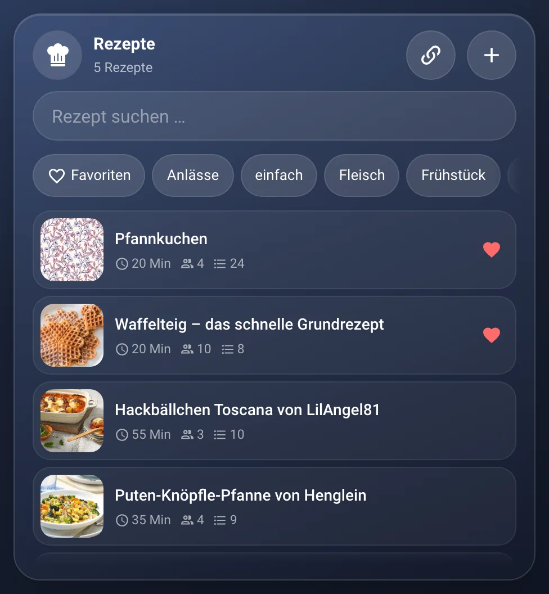
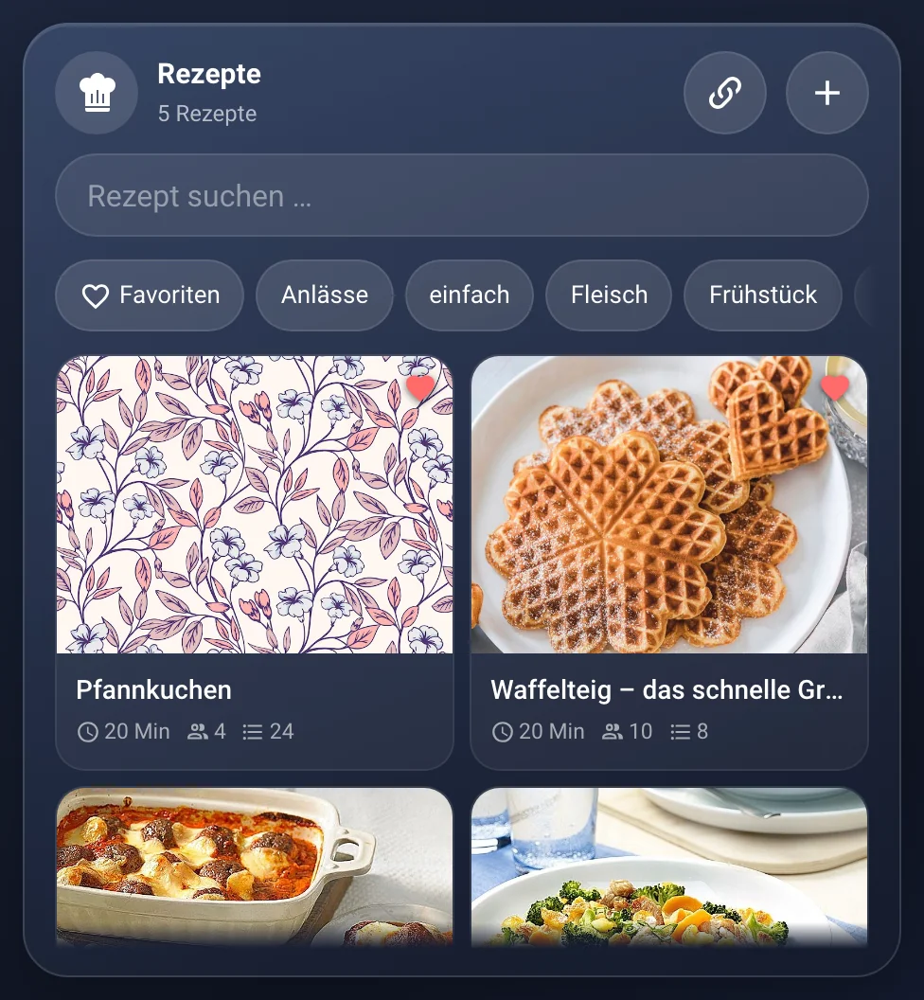
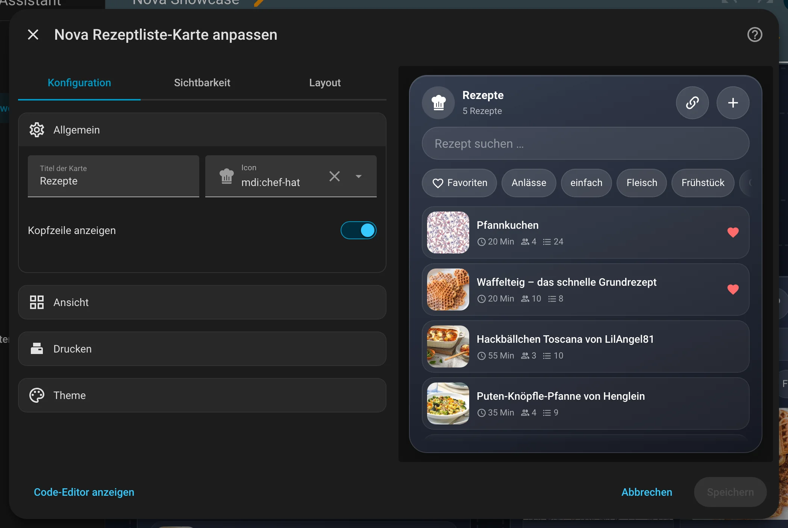

# Nova Rezeptliste

[← Alle Karten](README.md) · [Inhaltsverzeichnis](../../README.md)

## Was macht die Karte?

<p align="center"></p>

Deine Rezepte als kompakte Liste mit Suche und Favoriten. Ein Rezept zeigt Bild, Zutaten und Zubereitung. Portionen rechnest du mit Plus und Minus um. Zutaten setzt du mit einem Tipp auf die Einkaufsliste.

So kann sie aussehen:

<table>
<tr><td align="center" width="50%"><br><sub>Liste</sub></td><td align="center" width="50%"><br><sub>Kacheln</sub></td></tr>
</table>

## Wofür brauche ich sie?

- Du willst deine Rezepte an einem Ort sammeln.
- Du willst Rezepte von Webseiten wie Chefkoch übernehmen.

## Einrichten Schritt für Schritt

Wie du eine Karte grundsätzlich hinzufügst, steht in [Kapitel 3](../03-erste-schritte.md#4-erste-karte-hinzufügen). Kurz gesagt:

1. Öffne dein Dashboard und tippe oben rechts auf den **Stift** (Dashboard bearbeiten).
2. Tippe im Abschnitt auf **+**, wechsle zum Reiter **Nach Karte** und suche nach „Nova Rezeptliste“. Tippe die Karte an.
3. Die Karte braucht das Modul **Rezeptbuch** der Integration Nova Homeverse. Es ist von Anfang an an.
4. Unter **Ansicht** wählst du Liste oder Kacheln.
5. Rechts siehst du sofort, wie die Karte aussieht. Passt alles, tippe auf **Speichern**.

<p align="center"></p>

Im Editor findest du diese Bereiche: Allgemein · Ansicht · Drucken · Theme. Tipp einen Bereich an, um ihn aufzuklappen.

## Rezepte: Wenn du … willst, dann so

### Wenn du ein Rezept von einer Webseite übernehmen willst, dann so

Tipp oben in der Karte auf das Kettensymbol und füg den Link ein. Die Karte zeigt eine Vorschau. Mit **Übernehmen** wird das Rezept gespeichert.

## Häufige Fragen

**Sind das dieselben Rezepte wie im Rezeptbuch?**  
Ja. Rezeptliste und [Rezeptbuch](rezeptbuch.md) zeigen dieselben Rezepte.

Mehr Hilfe gibt es in [Kapitel 7](../07-hilfe.md).

## Alle Optionen (für Fortgeschrittene)

Alles hier kannst du auch im grafischen Editor einstellen. Wer lieber Text schreibt, tippt im Editor unten auf **Code-Editor anzeigen**. Dort steht die Karte als YAML (eine einfache Textform für Einstellungen). Der Kartentyp ist `custom:nova-recipe-card`.

Kompakte Rezeptliste, schnell durchsuchbar und auf allen Geräten gleich. Dieselben Rezepte zeigt das
[Nova Rezeptbuch](rezeptbuch.md) zum Blättern. Die Daten liegen in der
[Integration Nova Homeverse](../../../README.md) (Modul „Rezeptbuch“) – ohne sie zeigt die Karte nur einen Hinweis.

- **Liste:** Suche (Name, Schlagwort, Zutat), Schlagwörter und Favoriten als Filter-Chips, Favoriten stehen oben.
- **Rezept:** Bild, Zeit, Schlagwörter, Zutaten und Zubereitung. Mit + / – rechnest du die **Portionen** um, die Mengen
  ändern sich sofort. Checklisten in der Zubereitung lassen sich beim Kochen abhaken (das Rezept bleibt unverändert).
- **Auf die Einkaufsliste:** Zutaten an- oder abwählen und den Knopf darunter antippen – sie landen umgerechnet in der
  Nova Einkauf Card. Steht eine Zutat dort schon offen (gleiche Einheit), wird die Menge erhöht. Einheiten, die es beim
  Einkauf nicht gibt (TL, Prise, Bund …), kommen als 1 Stück auf die Liste.
- **Bearbeiten:** Stift oben rechts. Name, Portionen, Zeit, Schlagwörter, Bild (wird vor dem Speichern verkleinert),
  Zutaten (Menge, Einheit, Name) und die Zubereitung mit Formatierung. Gespeichert wird automatisch, sobald das Rezept
  einen Namen hat. Löschen: Mülleimer, zweimal tippen.
- **Rezept importieren** (Kettensymbol oben): Link einfügen, z. B. von Chefkoch. Die Integration Nova Homeverse liest die Seite
  (schema.org-Rezeptdaten) und füllt eine Vorschau mit Titel, Portionen, Zeit, Zutaten mit Menge und Einheit, Schritten
  und Bild. Alles lässt sich ändern; gespeichert wird erst mit „Übernehmen“, das Kreuz verwirft die Vorschau. Gibt es das
  Rezept schon (gleicher Link oder Titel), fragt die Karte: ersetzen oder trotzdem neu. Findet die Integration kein Rezept
  auf der Seite, bietet die Karte an, es selbst anzulegen. Unter importierten Rezepten steht die Quelle als Link.

### Beispiel in YAML

```yaml
type: custom:nova-recipe-card
view: grid
print_script: script.notiz_drucken
```

| Option | Standard | Bedeutung |
|---|---|---|
| `name`, `icon` | `Rezepte`, `mdi:chef-hat` | Kopfzeile |
| `show_header` | `true` | Kopfzeile mit Anzahl und Plus-Knopf |
| `view` | `list` | `list` = eine Zeile je Rezept · `grid` = Kacheln mit großem Bild |
| `show_search` | `true` | Suchfeld anzeigen |
| `height` | `420` | Mindesthöhe in px; im Raster füllt die Karte den Platz aus |
| `print_script` | – | Skript für den Druck-Knopf im geöffneten Rezept (leer = kein Knopf) |
| `print_field` | `text` | Feldname, unter dem das Skript das Rezept als Klartext bekommt |
| `print_label`, `print_icon` | `Drucken`, `mdi:printer-pos` | Titel und Icon des Knopfs |

### Drucken

Das Skript bekommt das Rezept als Klartext – mit den gerade eingestellten Portionen:

```
PFANNKUCHEN
4 Portionen · 20 Min

ZUTATEN
[ ] 500 g Mehl
[ ] 1000 ml Milch

ZUBEREITUNG
[ ] Mehl, Milch, Eier und Salz glatt rühren
```

Das Druck-Skript der [Notiz Card](notiz.md#drucken) passt unverändert.

---

[← Alle Karten](README.md) · [Inhaltsverzeichnis](../../README.md)
