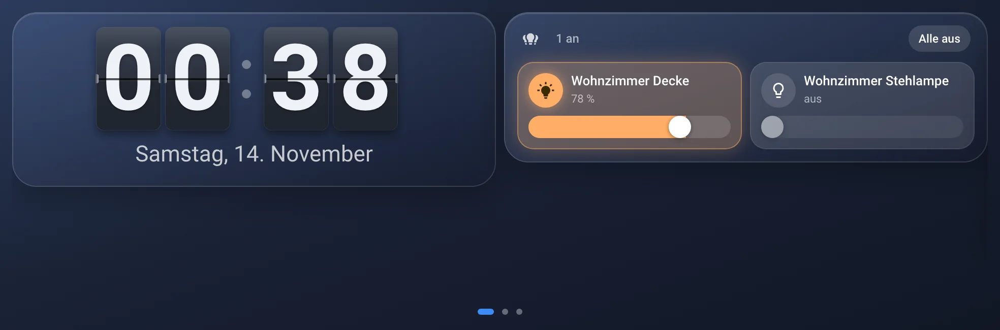
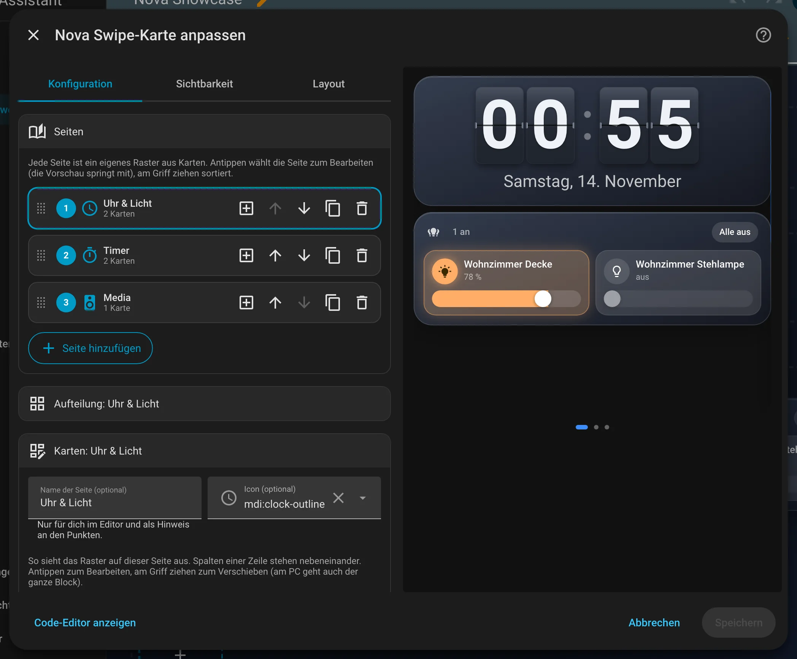

# Nova Swipe Card

[← Alle Karten](README.md) · [Inhaltsverzeichnis](../../README.md)

## Was macht die Karte?

<p align="center"></p>

Mehrere Seiten in einer Karte. Du wischst nach links und rechts, und auf jeder Seite liegen andere Karten. Kleine Punkte unten zeigen, wo du gerade bist.

## Wofür brauche ich sie?

- Du hast ein kleines Display (zum Beispiel einen Echo Show) und nicht genug Platz.
- Du willst ein Wandpanel, das man wie ein Handy bedient.

## Einrichten Schritt für Schritt

Wie du eine Karte grundsätzlich hinzufügst, steht in [Kapitel 3](../03-erste-schritte.md#4-erste-karte-hinzufügen). Kurz gesagt:

1. Öffne dein Dashboard und tippe oben rechts auf den **Stift** (Dashboard bearbeiten).
2. Tippe im Abschnitt auf **+**, wechsle zum Reiter **Nach Karte** und suche nach „Nova Swipe“. Tippe die Karte an.
3. Unter **Seiten** sind schon zwei leere Seiten da. Tipp eine an, um sie zu bearbeiten.
4. Unter **Aufteilung** wählst du eine Vorlage, zum Beispiel „Zwei nebeneinander“.
5. Unter **Karten** tippst du auf die leeren Plätze und wählst Karten aus.
6. Rechts siehst du sofort, wie die Karte aussieht. Passt alles, tippe auf **Speichern**.

<p align="center"></p>

Im Editor findest du diese Bereiche: Seiten · Aufteilung · Karten · Wischen und Anzeige · Theme. Tipp einen Bereich an, um ihn aufzuklappen.

## So bedienst du die Karte

| Was | Wie |
|---|---|
| Nächste / vorige Seite | Wischen nach links bzw. rechts |
| Direkt zu einer Seite | Punkt unten antippen (am PC auch Pfeiltasten auf den Punkten) |
| Schieberegler bedienen | Einfach ziehen – beginnt die Berührung auf einem Regler, wischt die Karte nicht mit |

## Rezepte: Wenn du … willst, dann so

### Wenn du zum ersten Mal Seiten zum Wischen willst, dann so

1. Dashboard bearbeiten → Karte hinzufügen → „Nova Swipe Card“. Es sind schon zwei leere Seiten da.
2. Im Editor unter **Seiten** eine Seite antippen. Die Vorschau springt mit.
3. Unter **Aufteilung** eine Vorlage wählen (z. B. „Zwei nebeneinander“) und unter **Karten** die leeren Plätze antippen –
   es öffnet sich die normale Kartenauswahl von Home Assistant.
4. Weitere Seiten mit „Seite hinzufügen“. Sortieren geht am Griff links oder mit den Pfeilen.

```yaml
type: custom:nova-swipe-card
pages:
  - name: Küche
    rows:
      - cells:
          - card:
              type: custom:nova-clock-card
          - card:
              type: custom:nova-light-card
  - name: Timer
    rows:
      - cells:
          - card:
              type: custom:nova-timer-card
              entity: timer.kuche_timer
```

### Wenn die Karte ein Wand-Display ganz ausfüllen soll, dann so

„Ganze Höhe ausfüllen“ (`fill: true`) macht die Karte so hoch wie ihren Platz, und die Karten einer Seite strecken sich auf
diese Höhe. Damit das klappt, braucht die Karte einen Platz mit fester Höhe – z. B. eine Ansicht vom Typ „Panel“ oder ein
Raster-Layout mit `height: 100dvh`. Passt der Inhalt einer Seite trotzdem nicht, scrollt nur diese Seite.

```yaml
type: custom:nova-swipe-card
fill: true
stack_below: 600
pages: …
```

### Wenn unten etwas abgeschnitten wird (z. B. Echo Show), dann so

Für ein Wand-Display reicht eine Ansicht vom Typ **„Panel“** und diese Karte – alles im grafischen Editor, ganz ohne YAML.
„Rand“ (`margin`, z. B. 8 px) gibt rundherum etwas Luft, damit die Karten nicht am Fensterrand kleben.

Manche Browser melden die Bildschirmhöhe falsch, dann ist „100vh“ höher als das, was man sieht. „Bis zum unteren
Bildschirmrand“ (`fit_screen: true`) misst das sichtbare Fenster direkt und lässt die Karte genau dort enden. Das schließt
„Ganze Höhe ausfüllen“ mit ein.

```yaml
type: custom:nova-swipe-card
fit_screen: true
margin: 8
pages: …
```

### Wenn das Display nach einer Weile wieder die erste Seite zeigen soll, dann so

„Zurück zu Seite 1 nach“ auf z. B. 120 Sekunden stellen. Jede Berührung startet die Zeit neu. 0 = aus (Standard).

```yaml
type: custom:nova-swipe-card
reset_after: 120
pages: …
```

## Häufige Fragen

**Kann ich in der Swipe Card einen Schieberegler bedienen, ohne dass sie wischt?**  
Ja. Beginnt die Berührung auf einem Regler, wischt die Karte nicht mit.

- Gewischt wird mit dem eingebauten Scrollen des Browsers. Das läuft auch auf schwachen Geräten (Echo Show, ältere Tablets) flüssig
  und braucht keinen Zeitgeber.
- Alle Seiten sind geladen, auch die gerade nicht sichtbaren. Viele Kamera-Streams auf versteckten Seiten kosten also trotzdem Leistung.

Mehr Hilfe gibt es in [Kapitel 7](../07-hilfe.md).

## Alle Optionen (für Fortgeschrittene)

Alles hier kannst du auch im grafischen Editor einstellen. Wer lieber Text schreibt, tippt im Editor unten auf **Code-Editor anzeigen**. Dort steht die Karte als YAML (eine einfache Textform für Einstellungen). Der Kartentyp ist `custom:nova-swipe-card`.

Mehrere Seiten in einer Karte – zum Wischen nach links und rechts. Auf jeder Seite liegen beliebige Karten (Nova Cards oder
Karten von Home Assistant) in Zeilen und Spalten, genau wie in der Pop-up Card. Unten zeigen kleine Punkte, auf welcher Seite
du bist; antippen springt direkt hin.

Gedacht für kleine Displays wie den Echo Show 5: statt alles auf eine Seite zu quetschen, verteilst du es auf zwei oder drei.

| Option | Standard | Bedeutung |
|---|---|---|
| `pages` | zwei leere Seiten | Liste der Seiten, jede mit `rows` (wie in der Pop-up Card), optional `name` und `icon` |
| `pages[].rows[].cells[]` | – | `card` (beliebige Karte) und optional `width`: `1/4`, `1/3`, `1/2`, `2/3`, `3/4`, `1` |
| `dots` | `true` | Seiten-Punkte unten (bei nur einer Seite immer aus) |
| `fill` | `false` | Ganze Höhe des Platzes ausfüllen, Karten einer Seite teilen sich die Höhe |
| `fit_screen` | `false` | Karte endet am unteren Rand des sichtbaren Fensters (für Wand-Displays, gegen Abschneiden) |
| `margin` | `0` | Rand rundherum in px, z. B. 8 in einer Panel-Ansicht |
| `reset_after` | `0` | Sekunden ohne Bedienung, danach zurück zu Seite 1. `0` = aus |
| `stack_below` | `500` | Schmaler als so viele Pixel → Karten einer Seite untereinander (z. B. am Handy). `0` = nie |
| `equal_height` | `false` | Karten einer Zeile gleich hoch |

Theme-Variable: `--nova-swipe-gap` – Abstand zwischen den Karten einer Seite (Standard 8px). Die Farbe des aktiven Punkts
kommt aus dem Theme (`--nova-active-color`, Standard Nova-Blau).

---

[← Alle Karten](README.md) · [Inhaltsverzeichnis](../../README.md)
