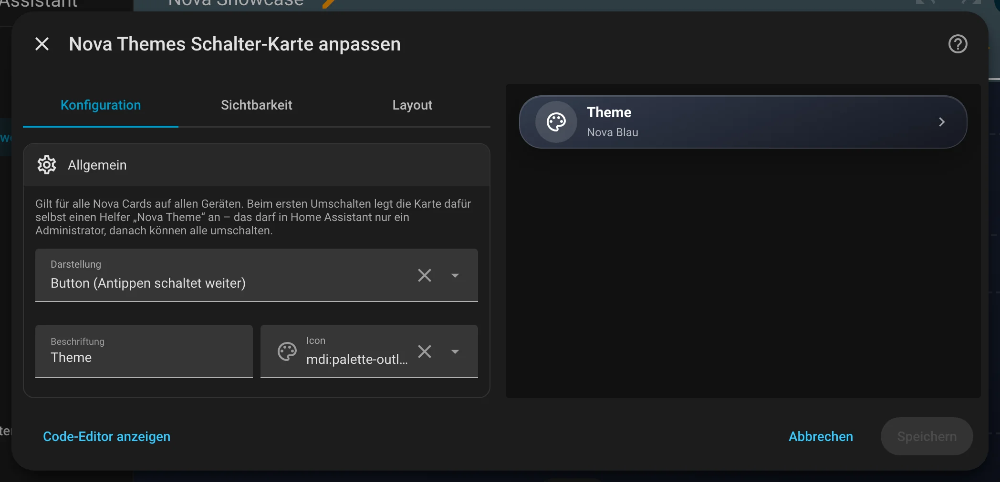

# Nova Themes Schalter

[← Alle Karten](README.md) · [Inhaltsverzeichnis](../../README.md)

## Was macht die Karte?

<p align="center"></p>

Ein Schalter für das Nova-Theme. Ein Tipp, und alle Nova Cards auf allen Geräten wechseln die Farben: Nova Blau, Nova Hell, Nova Midnight oder Nova Velvet. Es gibt ihn als Knopf, Chip oder Liste.

So kann sie aussehen:

<table>
<tr><td align="center" width="50%"><br><sub>Knopf</sub></td><td align="center" width="50%"><br><sub>Chip</sub></td></tr>
<tr><td align="center" width="50%"><br><sub>Liste</sub></td></tr>
</table>

## Wofür brauche ich sie?

- Du willst abends auf ein dunkleres Theme wechseln.
- Du willst das Theme wechseln, ohne ins Nova-Panel zu gehen.

## Einrichten Schritt für Schritt

Wie du eine Karte grundsätzlich hinzufügst, steht in [Kapitel 3](../03-erste-schritte.md#4-erste-karte-hinzufügen). Kurz gesagt:

1. Öffne dein Dashboard und tippe oben rechts auf den **Stift** (Dashboard bearbeiten).
2. Tippe im Abschnitt auf **+**, wechsle zum Reiter **Nach Karte** und suche nach „Nova Themes Schalter“. Tippe die Karte an.
3. Unter **Allgemein** wählst du die **Darstellung**: Knopf, Chip oder Liste.
4. Rechts siehst du sofort, wie die Karte aussieht. Passt alles, tippe auf **Speichern**.

<p align="center"></p>

Im Editor findest du diese Bereiche: Allgemein · Theme. Tipp einen Bereich an, um ihn aufzuklappen.

## Häufige Fragen

**Brauche ich die Karte überhaupt?**  
Nein. Das Theme kannst du auch im Nova-Panel wählen (siehe [Kapitel 3](../03-erste-schritte.md)). Die Karte ist nur bequemer.

Mehr Hilfe gibt es in [Kapitel 7](../07-hilfe.md).

## Alle Optionen (für Fortgeschrittene)

Alles hier kannst du auch im grafischen Editor einstellen. Wer lieber Text schreibt, tippt im Editor unten auf **Code-Editor anzeigen**. Dort steht die Karte als YAML (eine einfache Textform für Einstellungen). Der Kartentyp ist `custom:nova-theme-card`.

Wählt das Nova-Theme für **alle Nova Cards auf allen Geräten** – ein Fingertipp, kein Helfer, kein YAML, keine Theme-Variablen.
Themes: Nova Blau (Standard), Nova Hell, Nova Midnight und Nova Velvet.

### Anlegen

Dashboard bearbeiten → Karte hinzufügen → „Nova Themes Schalter“. Beim ersten Umschalten legt die Karte selbst einen Helfer
„Nova Theme“ (`input_select.nova_theme`) an, in dem das Theme gespeichert wird. Das darf in Home Assistant nur ein Administrator:
Ist noch nichts eingerichtet, zeigt die Karte Nicht-Admins „Einmal als Admin umschalten“. Danach können alle umschalten.

### Optionen

| Option | Bedeutung |
|---|---|
| `display` | `button` (Standard, Antippen schaltet zum nächsten Theme), `chip` (wie die Chips Card, Antippen schaltet weiter) oder `dropdown` (Liste) |
| `name` | Beschriftung, Standard „Theme“ |
| `icon` | Icon, Standard `mdi:palette-outline` |

### Theme je Karte und je Gerät

- **Je Karte:** In jedem Karteneditor gibt es unten den Bereich „Theme“: „Global“ (Standard) folgt dem Schalter, ein festes Theme gilt
  nur für diese Karte – bei Pop-up, Bereich und Swipe auch für die Karten darin.
- **Je Gerät:** Im HA-Theme des Geräts die Variable `nova-theme: hell` bzw. `nova-theme: midnight` setzen (z. B. Midnight für den Echo Show am Bett). Das schlägt das globale Theme,
  aber nicht das Theme einer Karte.

### Beispiel

```yaml
type: custom:nova-theme-card
display: dropdown
```

---

[← Alle Karten](README.md) · [Inhaltsverzeichnis](../../README.md)
