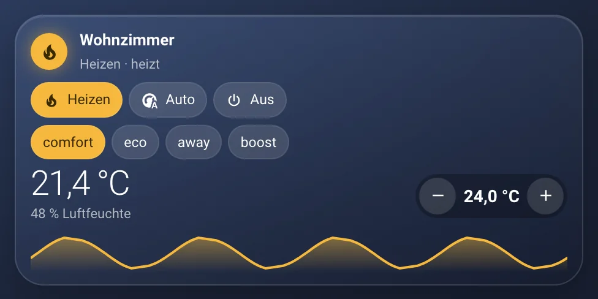
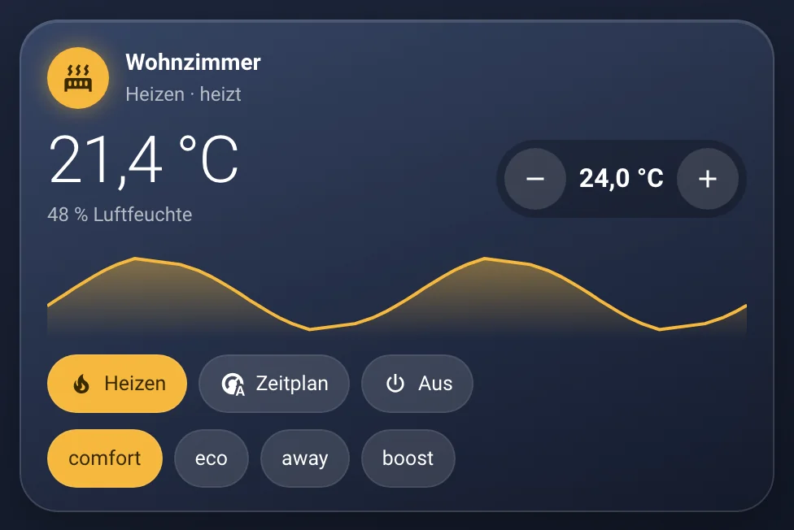
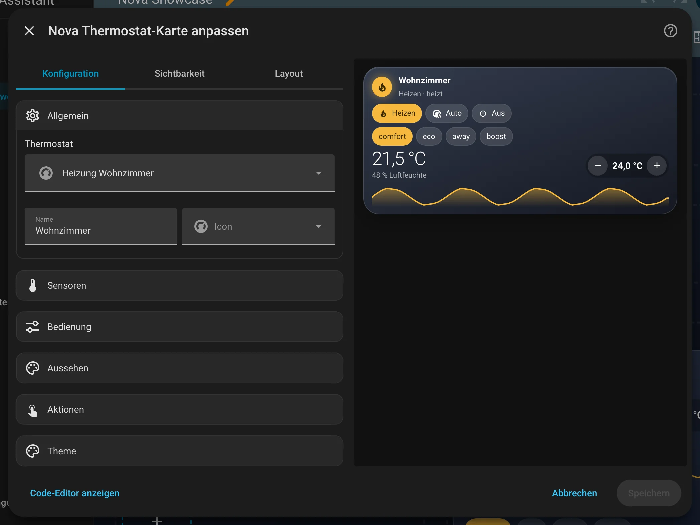
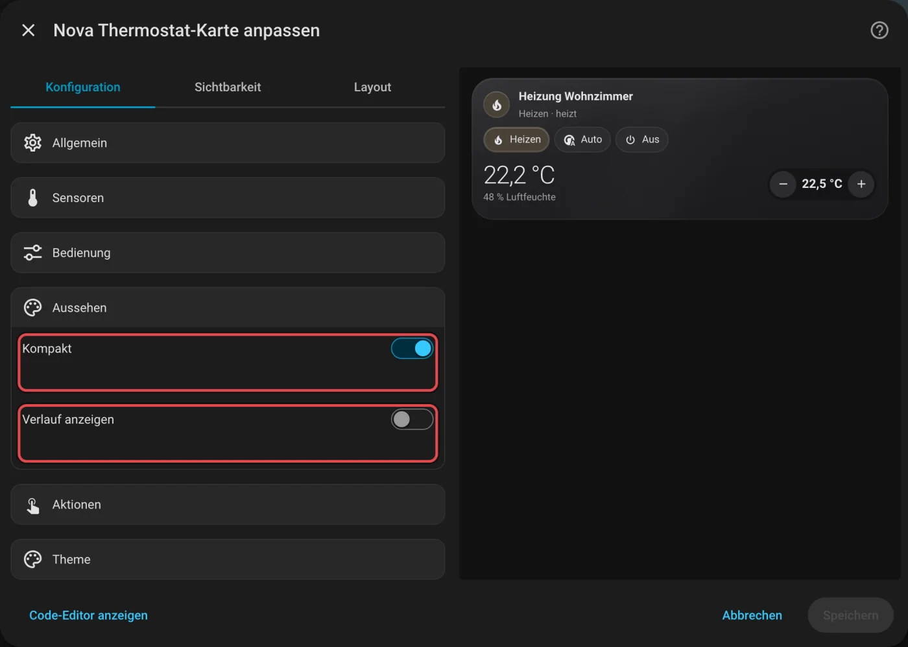
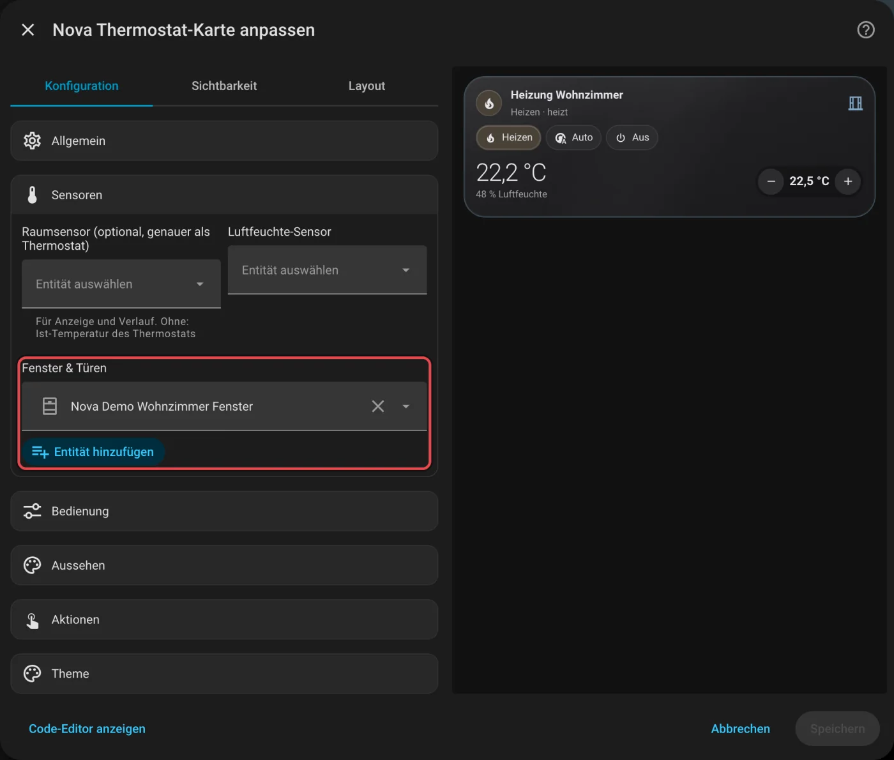

# Nova Thermostat Card

[← Alle Karten](README.md) · [Inhaltsverzeichnis](../../README.md)

## Was macht die Karte?

<p align="center"></p>

Zeigt die Temperatur im Raum und die Wunschtemperatur deiner Heizung. Mit Plus und Minus stellst du sie ein. Darunter siehst du auf Wunsch einen Verlauf der letzten Stunden und Knöpfe für die Modi wie Heizen oder Aus.

So kann sie aussehen:

<table>
<tr><td align="center" width="50%"><br><sub>Kompakt</sub></td><td align="center" width="50%"><br><sub>Groß</sub></td></tr>
</table>

## Wofür brauche ich sie?

- Du willst deine Heizung oder Klimaanlage direkt im Dashboard bedienen.
- Du willst sehen, wie warm es in den letzten Stunden war.

## Einrichten Schritt für Schritt

Wie du eine Karte grundsätzlich hinzufügst, steht in [Kapitel 3](../03-erste-schritte.md#4-erste-karte-hinzufügen). Kurz gesagt:

1. Öffne dein Dashboard und tippe oben rechts auf den **Stift** (Dashboard bearbeiten).
2. Tippe im Abschnitt auf **+**, wechsle zum Reiter **Nach Karte** und suche nach „Nova Thermostat“. Tippe die Karte an.
3. Unter **Allgemein** wählst du dein **Thermostat**. Das ist eine Entität, die mit `climate.` beginnt.
4. Hast du einen genaueren Temperatursensor im Raum? Dann trägst du ihn unter **Sensoren** ein. Die Karte zeigt dann seinen Wert.
5. Unter **Bedienung** legst du fest, welche Modi als Knöpfe erscheinen.
6. Rechts siehst du sofort, wie die Karte aussieht. Passt alles, tippe auf **Speichern**.

<p align="center"></p>

Im Editor findest du diese Bereiche: Allgemein · Sensoren · Bedienung · Aussehen · Aktionen · Theme. Tipp einen Bereich an, um ihn aufzuklappen.

## Rezepte: Wenn du … willst, dann so

Alle Rezepte gehen im grafischen Editor. Öffne dazu dein Dashboard, tippe oben rechts auf den **Stift** und dann auf die Karte.
Die rot umrahmten Felder im Bild sind die, um die es geht. Darunter steht jeweils dasselbe als YAML, falls du lieber Text schreibst.

### Wenn die Karte kleiner sein soll, dann so

1. Klapp **Aussehen** auf.
2. Schalte **Kompakt** ein und **Verlauf anzeigen** aus. Dann bleiben nur Temperatur und Plus/Minus übrig.
3. Tippe auf **Speichern**.

<p align="center"></p>

<details><summary>Für Fortgeschrittene: als YAML</summary>

```yaml
type: custom:nova-thermostat-card
entity: climate.wohnzimmer
compact: true
show_graph: false
```

</details>

### Wenn ein offenes Fenster angezeigt werden soll, dann so

1. Klapp **Sensoren** auf.
2. Trag bei **Fenster & Türen** deine Fenstersensoren ein. Ist eins offen, zeigt die Karte einen Hinweis.
3. Tippe auf **Speichern**.

<p align="center"></p>

<details><summary>Für Fortgeschrittene: als YAML</summary>

```yaml
type: custom:nova-thermostat-card
entity: climate.wohnzimmer
windows:
  - binary_sensor.wohnzimmer_fenster
```

</details>
## Häufige Fragen

**Ich finde mein Thermostat nicht in der Liste.**  
Die Karte braucht eine `climate.`-Entität. Ein reiner Temperatursensor reicht nicht. Prüf unter **Einstellungen → Geräte & Dienste**, ob dein Thermostat dort auftaucht.

**In welchen Schritten ändert Plus und Minus die Temperatur?**  
So, wie es dein Gerät vorgibt. Unter **Bedienung** kannst du die Schrittweite selbst festlegen.

Mehr Hilfe gibt es in [Kapitel 7](../07-hilfe.md).

## Alle Optionen (für Fortgeschrittene)

Alles hier kannst du auch im grafischen Editor einstellen. Wer lieber Text schreibt, tippt im Editor unten auf **Code-Editor anzeigen**. Dort steht die Karte als YAML (eine einfache Textform für Einstellungen). Der Kartentyp ist `custom:nova-thermostat-card`.

### Beispiel in YAML

```yaml
type: custom:nova-thermostat-card
entity: climate.wohnzimmer
sensor: sensor.wohnzimmer_temperatur
windows:
  - binary_sensor.wohnzimmer_fenster
show_graph: true
graph_hours: 24
modes: [heat, auto, off]
```

| Option | Standard | Bedeutung |
|---|---|---|
| `entity` | – | Thermostat (Pflicht) |
| `sensor` | – | Genauerer Raumsensor für Anzeige & Verlauf |
| `humidity` | – | Luftfeuchte-Sensor |
| `show_graph` / `graph_hours` | `true` / `24` | Verlauf |
| `show_modes` / `modes` | `true` / alle | Modus-Knöpfe |
| `show_presets` | `false` | Preset-Knöpfe |
| `compact` | `true` | Kompaktes Layout |
| `step` | vom Gerät | Schrittweite ± |

---

[← Alle Karten](README.md) · [Inhaltsverzeichnis](../../README.md)
