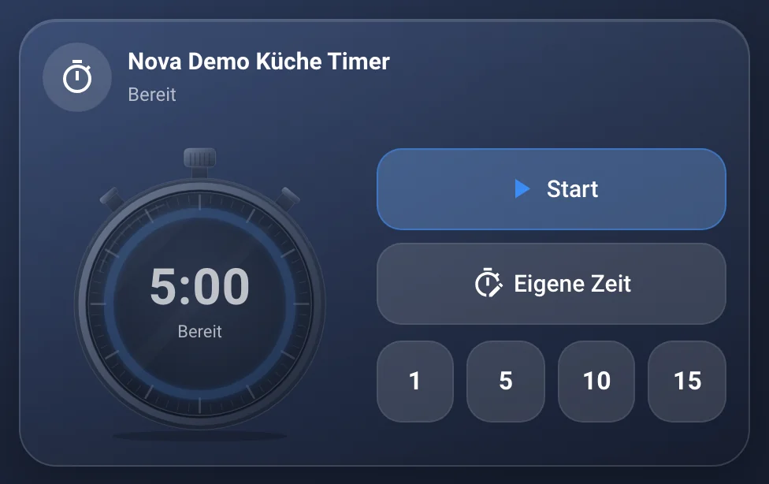
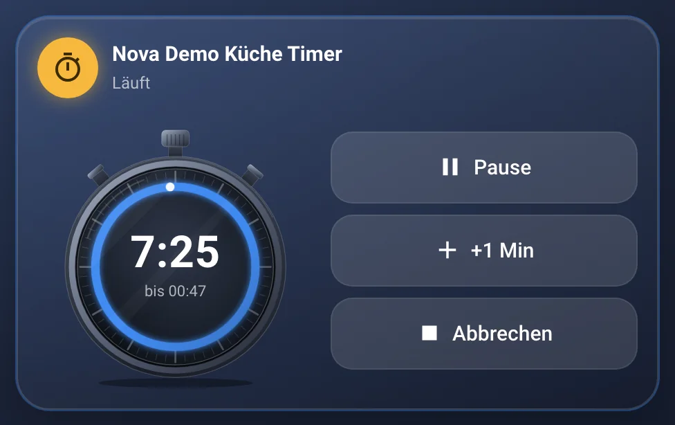
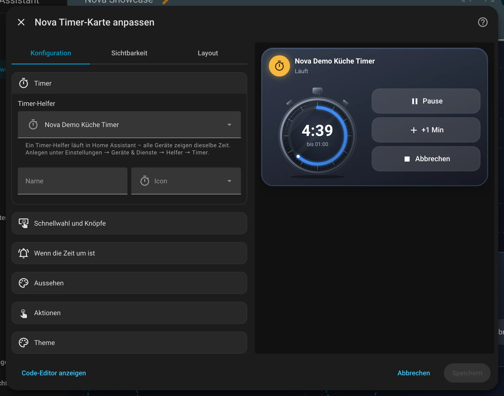
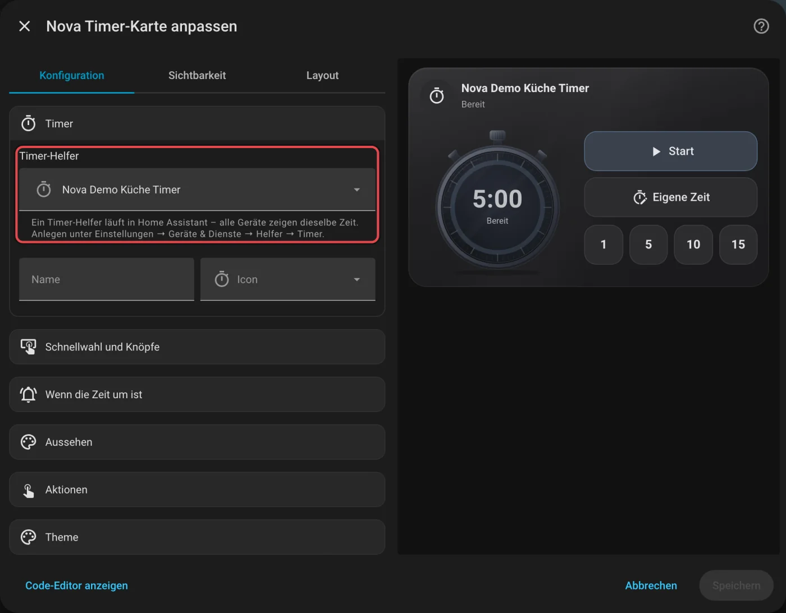
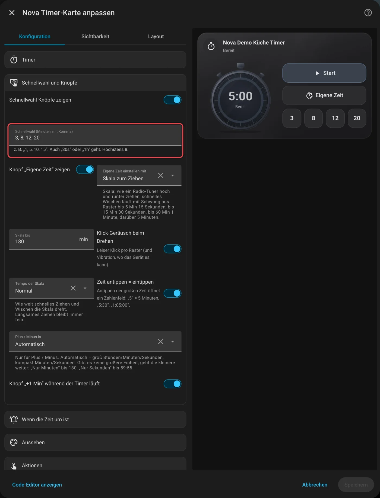
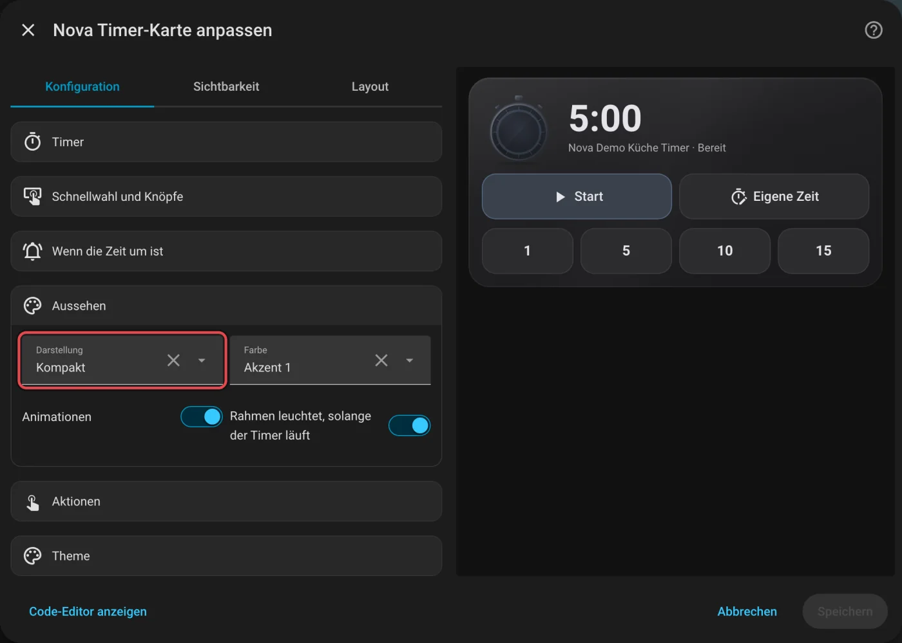

# Nova Timer Card

[← Alle Karten](README.md) · [Inhaltsverzeichnis](../../README.md)

## Was macht die Karte?

<p align="center"></p>

Ein Küchen-Timer als Stoppuhr. Antippen, Zeit wählen, läuft. Der leuchtende Ring zeigt die Restzeit. Ist die Zeit um, pulsiert die Karte, bis jemand „OK“ drückt.

So kann sie aussehen:

<table>
<tr><td align="center" width="50%"><br><sub>Bereit</sub></td><td align="center" width="50%"><br><sub>Läuft</sub></td></tr>
</table>

## Wofür brauche ich sie?

- Du willst einen Timer in der Küche, den alle Geräte gleich sehen.

## Einrichten Schritt für Schritt

Wie du eine Karte grundsätzlich hinzufügst, steht in [Kapitel 3](../03-erste-schritte.md#4-erste-karte-hinzufügen). Kurz gesagt:

1. Öffne dein Dashboard und tippe oben rechts auf den **Stift** (Dashboard bearbeiten).
2. Tippe im Abschnitt auf **+**, wechsle zum Reiter **Nach Karte** und suche nach „Nova Timer“. Tippe die Karte an.
3. Leg zuerst einen **Timer-Helfer** an: **Einstellungen → Geräte & Dienste → Helfer → Helfer erstellen → Timer**. Setz dort den Haken bei **Zustand wiederherstellen**.
4. Unter **Timer** wählst du diesen Helfer aus. Fertig.
5. Rechts siehst du sofort, wie die Karte aussieht. Passt alles, tippe auf **Speichern**.

<p align="center"></p>

Im Editor findest du diese Bereiche: Timer · Schnellwahl und Knöpfe · Wenn die Zeit um ist · Aussehen · Aktionen · Theme. Tipp einen Bereich an, um ihn aufzuklappen.

## So bedienst du die Karte

| Was | Wie |
|---|---|
| Starten mit eingestellter Dauer | „Start“ oder die Stoppuhr antippen |
| Starten mit anderer Zeit | Schnellwahl-Knopf, oder „Eigene Zeit“ → Skala hoch/runter ziehen wie bei einem Radio-Tuner (schnell wischen = mit Schwung, rastet ein, leiser Klick pro Raster) oder die große Zeit antippen und eintippen → „Übernehmen“ → „Start“. Die Auswahl beginnt mit der eingestellten Zeit |
| Pause / Weiter | „Pause“ bzw. „Weiter“, oder die Stoppuhr antippen |
| Eine Minute dazu | „1 Min“ (nur während der Timer läuft) |
| Abbrechen | „Abbrechen“ |
| Hinweis „Zeit ist um“ wegdrücken | „OK“ oder die Stoppuhr antippen. „Nochmal“ startet dieselbe Zeit neu |

„OK“ gilt nur für das Gerät, auf dem du es drückst. Andere Geräte hören nach der eingestellten Hinweisdauer von selbst auf.

## Rezepte: Wenn du … willst, dann so

Alle Rezepte gehen im grafischen Editor. Öffne dazu dein Dashboard, tippe oben rechts auf den **Stift** und dann auf die Karte.
Die rot umrahmten Felder im Bild sind die, um die es geht. Darunter steht jeweils dasselbe als YAML, falls du lieber Text schreibst.

### Wenn du zum ersten Mal einen Timer willst, dann so

Zuerst brauchst du einen Timer-Helfer: **Einstellungen → Geräte & Dienste → Helfer → Helfer erstellen → Timer**.
Name zum Beispiel „Küche Timer“, Dauer zum Beispiel 5 Minuten. Setz den Haken bei **Zustand wiederherstellen**, dann läuft der
Timer auch nach einem Neustart von Home Assistant weiter.

1. Füg im Dashboard die **Nova Timer Card** hinzu.
2. Klapp **Timer** auf und wähl bei **Timer-Helfer** deinen Timer.
3. Tippe auf **Speichern**.

<p align="center"></p>

<details><summary>Für Fortgeschrittene: als YAML</summary>

```yaml
type: custom:nova-timer-card
entity: timer.kuche_timer
```

</details>

### Wenn du andere Schnellwahl-Knöpfe willst, dann so

1. Klapp **Schnellwahl und Knöpfe** auf.
2. Trag bei **Schnellwahl (Minuten, mit Komma)** deine Zeiten ein, zum Beispiel `3, 8, 12, 20`. `30s` sind Sekunden, `1h` eine Stunde.
3. Tippe auf **Speichern**.

Volle Minuten stehen auf den Knöpfen nur als Zahl (`1`, `5`, `10` …), damit sie auch auf kleinen Displays passen.

<p align="center"></p>

<details><summary>Für Fortgeschrittene: als YAML</summary>

```yaml
type: custom:nova-timer-card
entity: timer.kuche_timer
presets: [3, 8, 12, 20]
```

</details>

### Wenn der Platz knapp ist (z. B. Echo Show), dann so

1. Klapp **Aussehen** auf.
2. Stell **Darstellung** auf **Kompakt**.
3. Tippe auf **Speichern**.

„Eigene Zeit“ hat dann Minuten (bis 180) und Sekunden nebeneinander und ersetzt solange Start und Schnellwahl. Die Karte wird dadurch nicht höher.

<p align="center"></p>

<details><summary>Für Fortgeschrittene: als YAML</summary>

```yaml
type: custom:nova-timer-card
entity: timer.kuche_timer
layout: compact
```

</details>
## Häufige Fragen

**Warum braucht die Karte einen Helfer?**  
Der Helfer zählt in Home Assistant. Darum zeigen alle Geräte dieselbe Zeit, und ein Neuladen der Seite stört nicht.

- „+1 Min“ nutzt den Dienst `timer.change`. Klappt das nicht (z. B. weil der Timer dann länger liefe als seine eingestellte
  Dauer), startet die Karte den Timer mit der neuen Restzeit neu.
- Läuft der Timer, tickt die Karte einmal pro Sekunde – aber nur, solange sie zu sehen ist. In der Kartenauswahl steht sie still.

Mehr Hilfe gibt es in [Kapitel 7](../07-hilfe.md).

## Für Fortgeschrittene

### Wenn es beim Ablauf auch klingeln oder eine Ansage geben soll, dann so

Die Karte zeigt den Ablauf nur an. Für Ton oder Ansage (Echo, Lautsprecher, Handy) legst du eine Automation an:
Auslöser **„Ereignis“** mit dem Ereignistyp `timer.finished` und den Ereignisdaten `entity_id: timer.kuche_timer`,
Aktion zum Beispiel eine Benachrichtigung oder Ansage. So kommt der Ton genau einmal, egal wie viele Geräte die Karte zeigen.

## Alle Optionen (für Fortgeschrittene)

Alles hier kannst du auch im grafischen Editor einstellen. Wer lieber Text schreibt, tippt im Editor unten auf **Code-Editor anzeigen**. Dort steht die Karte als YAML (eine einfache Textform für Einstellungen). Der Kartentyp ist `custom:nova-timer-card`.

Die Karte zählt nicht selbst, sondern steuert einen **Timer-Helfer** in Home Assistant. Darum zeigen alle Geräte
(Echo Show, Handy, Tablet) dieselbe Zeit, und ein Neuladen der Seite ändert nichts.

| Option | Standard | Bedeutung |
|---|---|---|
| `entity` | – | Timer-Helfer (`timer.*`), Pflicht |
| `name`, `icon` | Name/Icon des Helfers | Eigener Name und eigenes Icon |
| `show_presets` | `true` | Schnellwahl-Knöpfe zeigen |
| `presets` | `[1, 5, 10, 15]` | Schnellwahl in Minuten (`30s`, `1h` gehen auch), höchstens 8 |
| `show_custom` | `true` | Knopf „Eigene Zeit“ |
| `custom_picker` | `scale` | Eigene Zeit mit `scale` (senkrechte Skala zum Ziehen; Raster bis 5 Min 15 s, bis 15 Min 30 s, bis 60 Min 1 Min, darüber 5 Min) oder `buttons` (Plus/Minus je Einheit) |
| `scale_max` | `180` | Skala reicht bis so viele Minuten |
| `scale_speed` | `normal` | Tempo der Skala beim schnellen Ziehen/Wischen: `slow`, `normal`, `fast` |
| `click_sound` | `true` | Leiser Klick pro Raster, dazu Vibration, wo das Gerät es kann |
| `custom_input` | `true` | Große Zeit antippen öffnet ein Zahlenfeld („5“ = 5 Min, „5:30“, „1:05:00“) |
| `custom_units` | `auto` | Nur für Plus/Minus – Eigene Zeit in: `h`, `m`, `s` oder kombiniert `hm`, `ms`, `hms`. Fehlt die größere Einheit, geht die kleinere weiter (nur Minuten bis 180, nur Sekunden bis 59:55). `auto` = groß Std/Min/Sek, kompakt Min/Sek |
| `show_add` | `true` | Knopf „+1 Min“, solange der Timer läuft |
| `alarm_text` | „Zeit ist um!“ | Text beim Ablauf |
| `alarm_color` | `accent-2` | Farbrolle beim Ablauf (`neutral`, `accent-1` … `accent-4`) |
| `alarm_minutes` | `10` | So lange zeigt die Karte den Ablauf, wenn niemand „OK“ drückt. `0` = bis jemand bestätigt |
| `layout` | `full` | `full` (große Stoppuhr) oder `compact` |
| `color` | `accent-1` | Farbrolle für Ring und Knöpfe |
| `animation` | `true` | Aus = Standbild, nur die Zahlen ändern sich |
| `glow` | `true` | Kartenrahmen leuchtet, solange der Timer läuft |
| `tap_action`, `hold_action` | Details | Kopfzeile antippen bzw. lange drücken. Die Stoppuhr selbst startet/pausiert |

Theme-Variablen: `--nova-timer-size` (größte Breite der Stoppuhr, Standard 240px), `--nova-timer-button-height`
(Knopfhöhe, Standard 52px).

---

[← Alle Karten](README.md) · [Inhaltsverzeichnis](../../README.md)
