# Nova Uhr Card

[← Alle Karten](README.md) · [Inhaltsverzeichnis](../../README.md)

## Was macht die Karte?

<p align="center"></p>

Die Uhrzeit in fünf Stilen: schlicht digital, als Klappzahlen wie am Bahnhof, als Zifferblatt, als Leuchtziffern, die mit dem Tag die Farbe wechseln, oder als Radiowecker. Wochentag, Datum und Werte wie die Temperatur stehen auf Wunsch darunter.

So kann sie aussehen:

<table>
<tr><td align="center" width="50%"><br><sub>Digital</sub></td><td align="center" width="50%">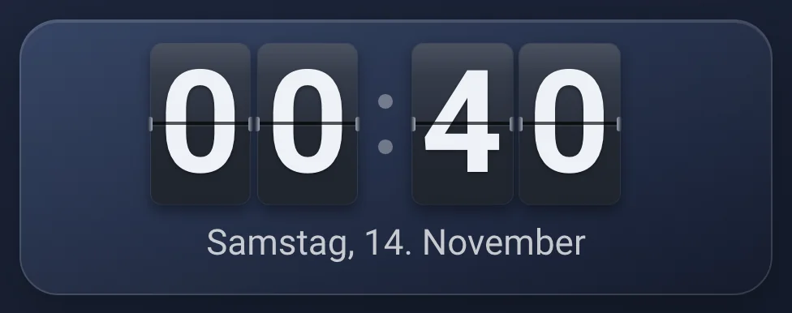<br><sub>Klappzahlen</sub></td></tr>
<tr><td align="center" width="50%">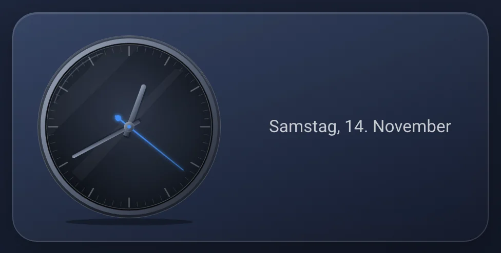<br><sub>Analog</sub></td><td align="center" width="50%">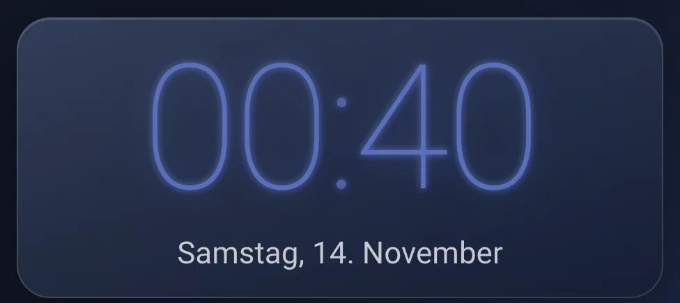<br><sub>Leuchtziffern</sub></td></tr>
</table>

## Wofür brauche ich sie?

- Du willst eine schöne Uhr auf dem Wandpanel oder am Nachttisch.

## Einrichten Schritt für Schritt

Wie du eine Karte grundsätzlich hinzufügst, steht in [Kapitel 3](../03-erste-schritte.md#4-erste-karte-hinzufügen). Kurz gesagt:

1. Öffne dein Dashboard und tippe oben rechts auf den **Stift** (Dashboard bearbeiten).
2. Tippe im Abschnitt auf **+**, wechsle zum Reiter **Nach Karte** und suche nach „Nova Uhr“. Tippe die Karte an.
3. Mehr braucht es nicht. Die Karte läuft ohne Einstellungen.
4. Unter **Uhr** wählst du den **Stil**.
5. Rechts siehst du sofort, wie die Karte aussieht. Passt alles, tippe auf **Speichern**.

<p align="center">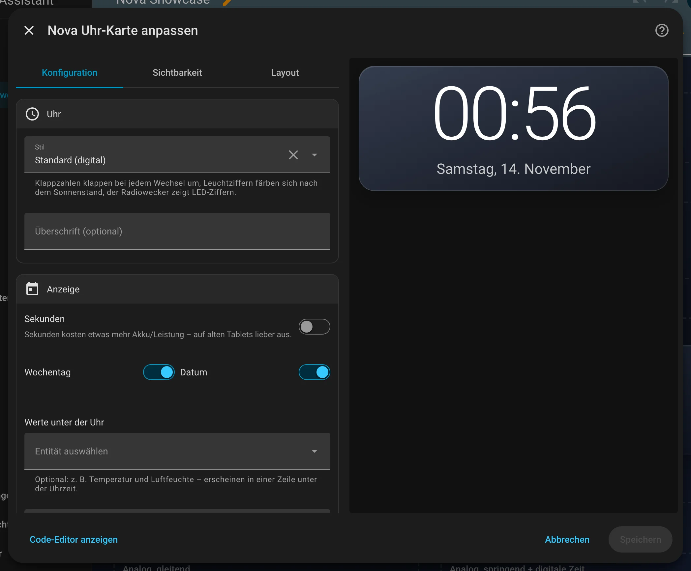</p>

Im Editor findest du diese Bereiche: Uhr · Anzeige · Aussehen · Aktionen · Theme. Tipp einen Bereich an, um ihn aufzuklappen.

## Rezepte: Wenn du … willst, dann so

Alle Rezepte gehen im grafischen Editor. Öffne dazu dein Dashboard, tippe oben rechts auf den **Stift** und dann auf die Karte.
Die rot umrahmten Felder im Bild sind die, um die es geht. Darunter steht jeweils dasselbe als YAML, falls du lieber Text schreibst.

### Wenn du einfach nur eine Uhr willst, dann so

1. Füg im Dashboard die **Nova Uhr Card** hinzu. Mehr braucht es nicht, es gibt nichts auszuwählen.
2. Tippe auf **Speichern**.

<p align="center">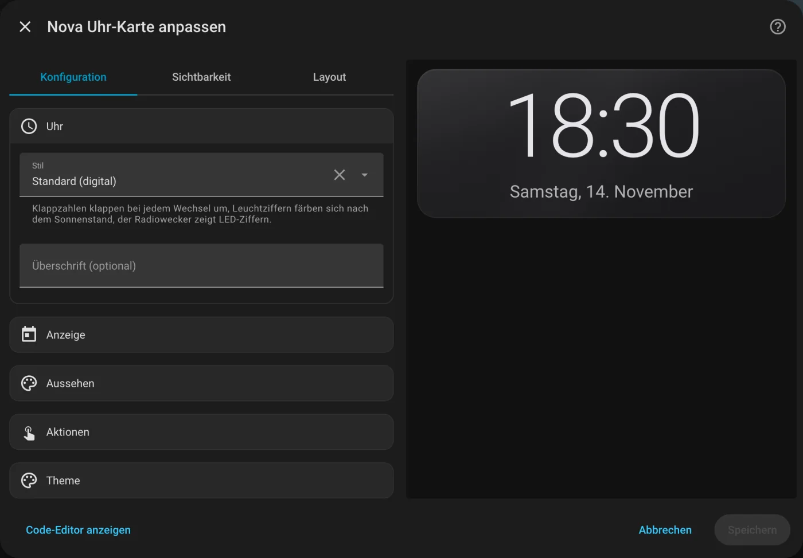</p>

<details><summary>Für Fortgeschrittene: als YAML</summary>

```yaml
type: custom:nova-clock-card
```

</details>

### Wenn du eine Klappzahl-Uhr wie am Bahnhof willst, dann so

1. Klapp **Uhr** auf.
2. Stell **Stil** auf **Klappzahlen**.
3. Tippe auf **Speichern**.

Bei jedem Wechsel klappt die obere Hälfte der Ziffern um, die sich ändern. Gezeigt werden Stunden und Minuten.

<p align="center">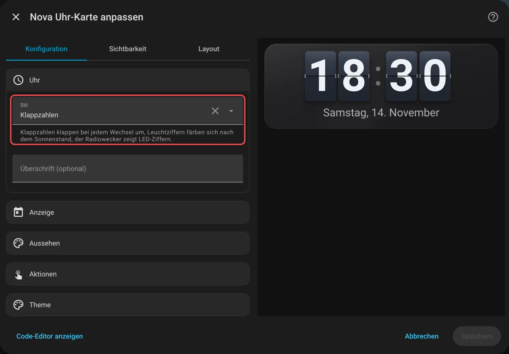</p>

<details><summary>Für Fortgeschrittene: als YAML</summary>

```yaml
type: custom:nova-clock-card
style: flip
```

</details>

### Wenn du ein Zifferblatt willst, dann so

1. Klapp **Uhr** auf.
2. Stell **Stil** auf **Analog (Zifferblatt)**.
3. Wähl beim **Sekundenzeiger**, wie er läuft: gleitend, springend oder gar nicht.
4. Tippe auf **Speichern**.

<p align="center">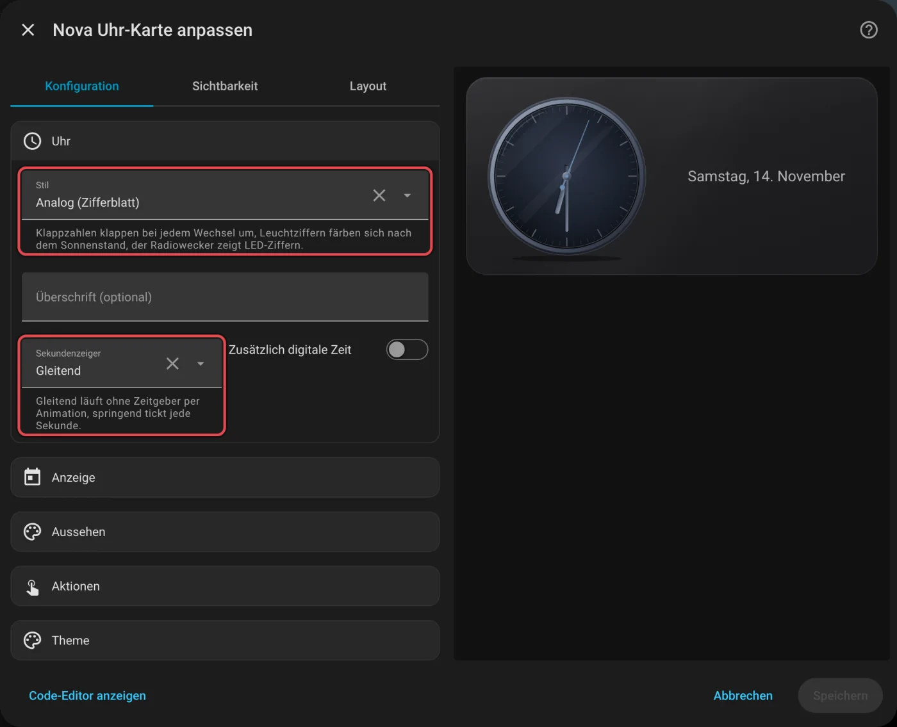</p>

<details><summary>Für Fortgeschrittene: als YAML</summary>

```yaml
type: custom:nova-clock-card
style: analog
second_hand: sweep   # tick = springt, none = kein Sekundenzeiger
```

</details>

### Wenn die Uhr mit dem Tag die Farbe wechseln soll, dann so

1. Klapp **Uhr** auf.
2. Stell **Stil** auf **Leuchtziffern**.
3. Tippe auf **Speichern**.

Die Farbe folgt dem Sonnenstand: vor Sonnenaufgang nachtblau, morgens warm, mittags weiß, abends tiefblau. Die Übergänge laufen fließend.

<p align="center">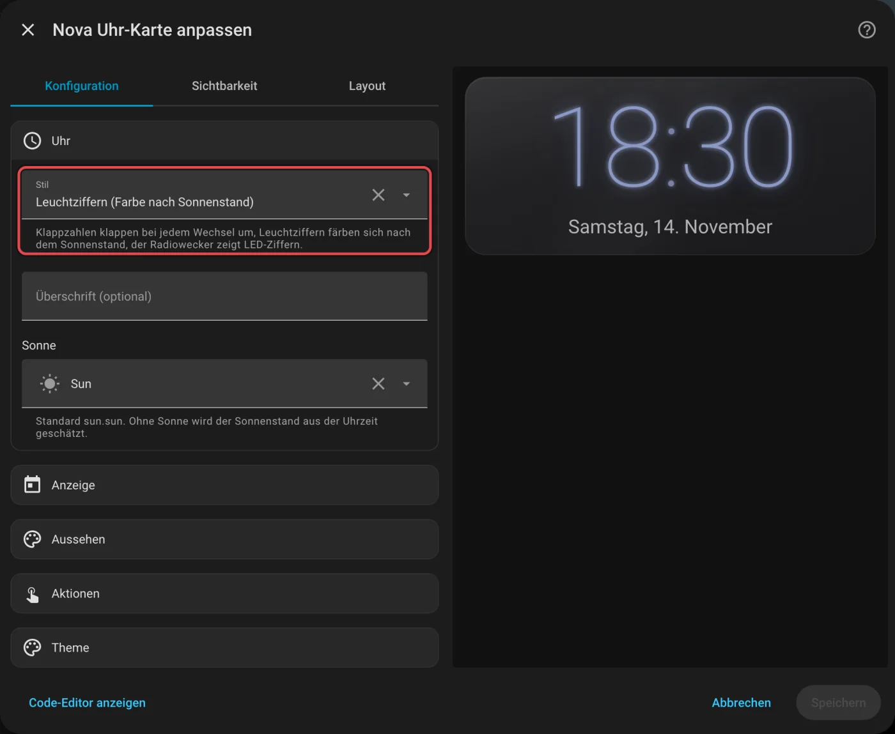</p>

<details><summary>Für Fortgeschrittene: als YAML</summary>

```yaml
type: custom:nova-clock-card
style: glow
```

</details>

### Wenn du einen Radiowecker willst, dann so

1. Klapp **Uhr** auf.
2. Stell **Stil** auf **Radiowecker**.
3. Wähl die Farbe der Ziffern: Rot, Grün, Blau oder Bernstein.
4. Tippe auf **Speichern**.

Die LED-Ziffern sehen aus wie beim alten Radiowecker, ausgeschaltete Segmente schimmern leicht durch und der Doppelpunkt blinkt.

<p align="center">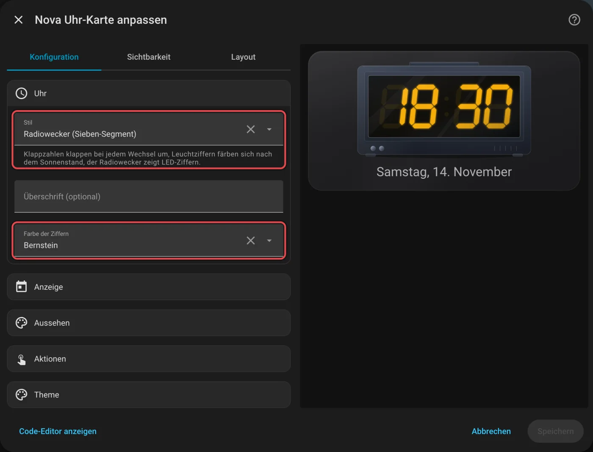</p>

<details><summary>Für Fortgeschrittene: als YAML</summary>

```yaml
type: custom:nova-clock-card
style: retro
retro_color: amber
```

</details>

### Wenn du nur die Uhrzeit ohne Datum willst, dann so

1. Klapp **Anzeige** auf.
2. Schalte **Wochentag** und **Datum** aus.
3. Tippe auf **Speichern**.

<p align="center">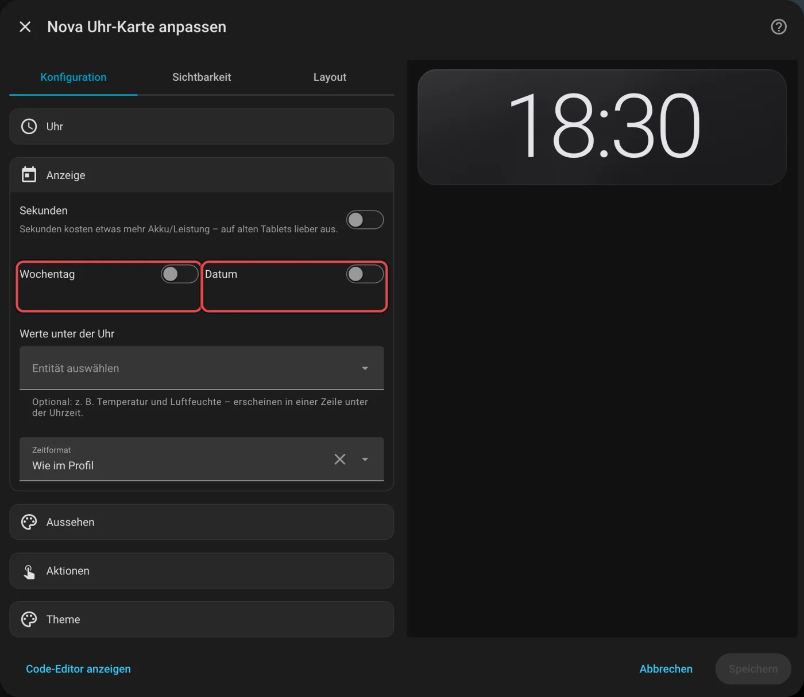</p>

<details><summary>Für Fortgeschrittene: als YAML</summary>

```yaml
type: custom:nova-clock-card
show_weekday: false
show_date: false
```

</details>

### Wenn Temperatur und Luftfeuchte klein unter der Uhr stehen sollen, dann so

1. Klapp **Anzeige** auf.
2. Wähl bei **Werte unter der Uhr** deine Sensoren. Sie erscheinen als dezente Zeile mit Icon.
3. Tippe auf **Speichern**.

<p align="center">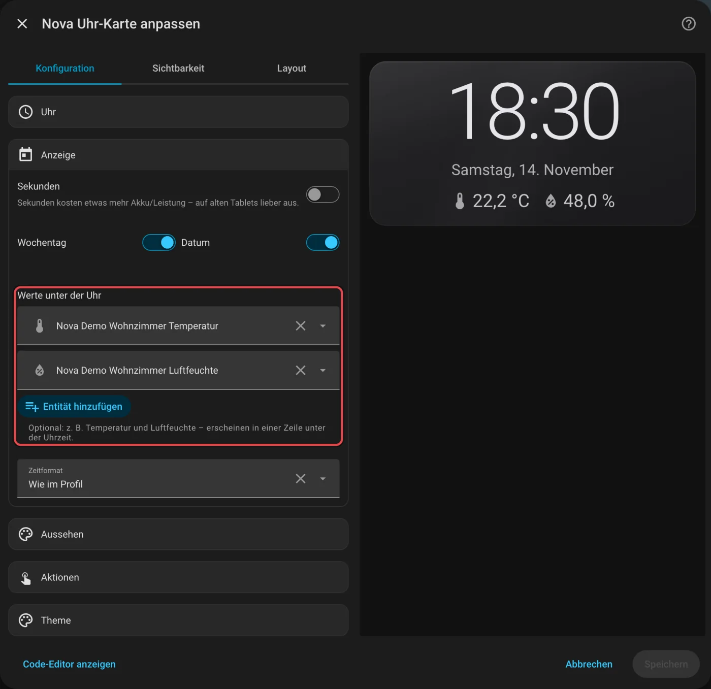</p>

<details><summary>Für Fortgeschrittene: als YAML</summary>

```yaml
type: custom:nova-clock-card
entities:
  - sensor.kuche_temperatur
  - sensor.kuche_luftfeuchtigkeit
```

</details>

### Wenn die Uhr kleiner oder größer sein soll, dann so

1. Klapp **Aussehen** auf.
2. Wähl bei **Größe** Klein, Mittel oder Groß. Wochentag, Datum und Werte wachsen mit.
3. Für eine ganz bestimmte Größe trägst du bei **Schriftgröße** einen festen Wert ein, zum Beispiel `48px` oder `3rem`. Der hat Vorrang.
4. Tippe auf **Speichern**.

Hat die Karte eine feste Höhe, passt sich die Uhr von selbst an und läuft nie über die Karte.

<p align="center">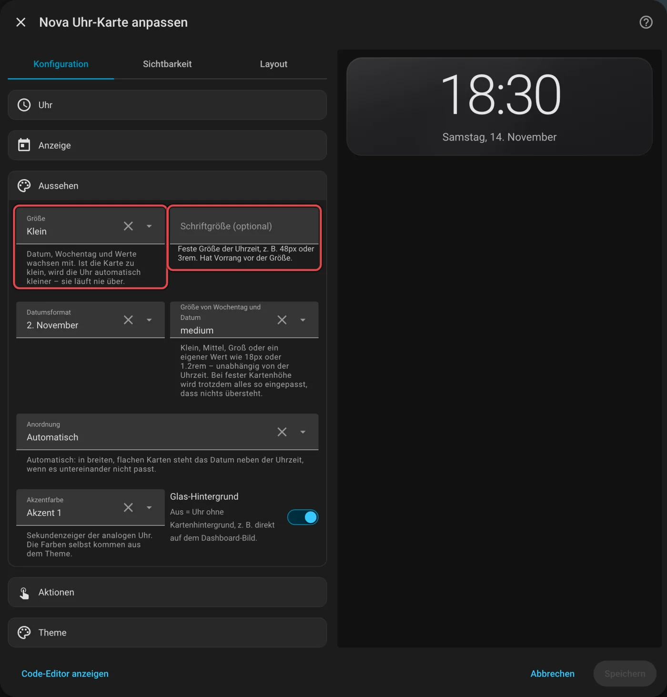</p>

<details><summary>Für Fortgeschrittene: als YAML</summary>

```yaml
type: custom:nova-clock-card
size: small
# oder ein fester Wert:
# font_size: 3rem
```

</details>

### Wenn Wochentag und Datum anders aussehen sollen, dann so

1. Klapp **Aussehen** auf.
2. Wähl bei **Datumsformat** zum Beispiel „8. November“ oder „8. November 2026“.
3. Bei **Größe von Wochentag und Datum** wählst du Klein, Mittel oder Groß, oder tippst einen eigenen Wert wie `18px` ein. Die Uhrzeit bleibt, wie sie ist.
4. Tippe auf **Speichern**.

<p align="center">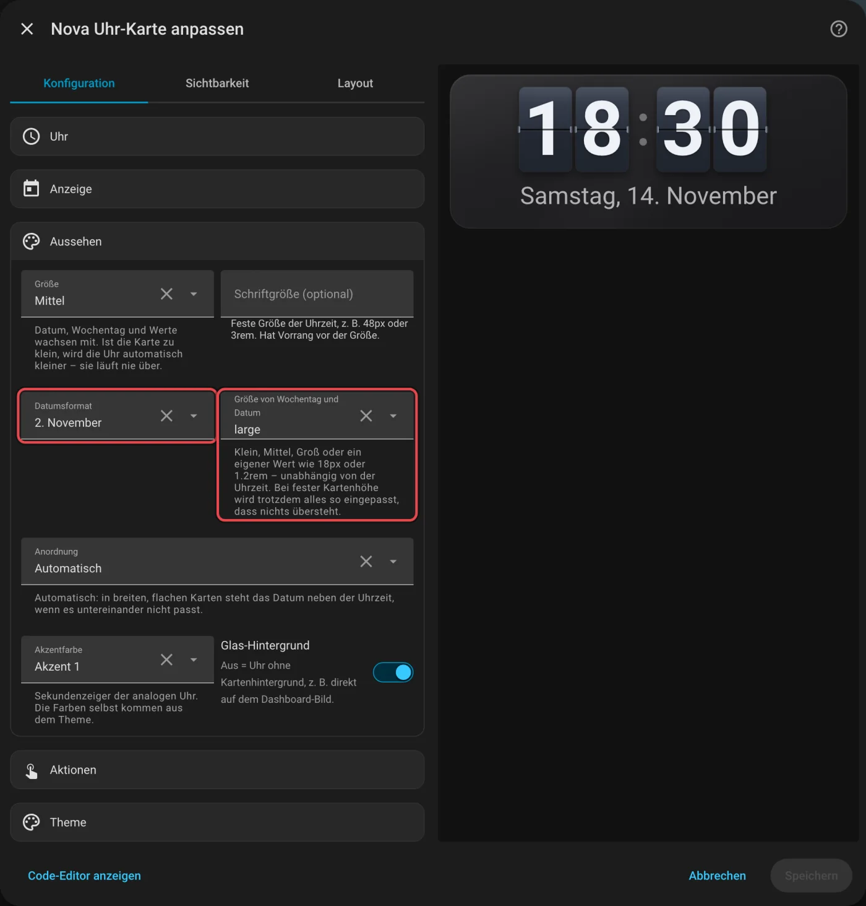</p>

<details><summary>Für Fortgeschrittene: als YAML</summary>

```yaml
type: custom:nova-clock-card
style: flip
date_size: large
date_format: long   # long_year = mit Jahr
```

</details>

### Wenn die Karte breit und flach ist, dann so

In einer breiten, flachen Karte stehen Uhrzeit und Datum von selbst nebeneinander, wenn untereinander nicht alles passt.

1. Klapp **Aussehen** auf.
2. Stell **Anordnung** auf **Nebeneinander**, wenn es immer so sein soll, oder auf **Untereinander** für das Gegenteil.
3. Tippe auf **Speichern**.

<p align="center">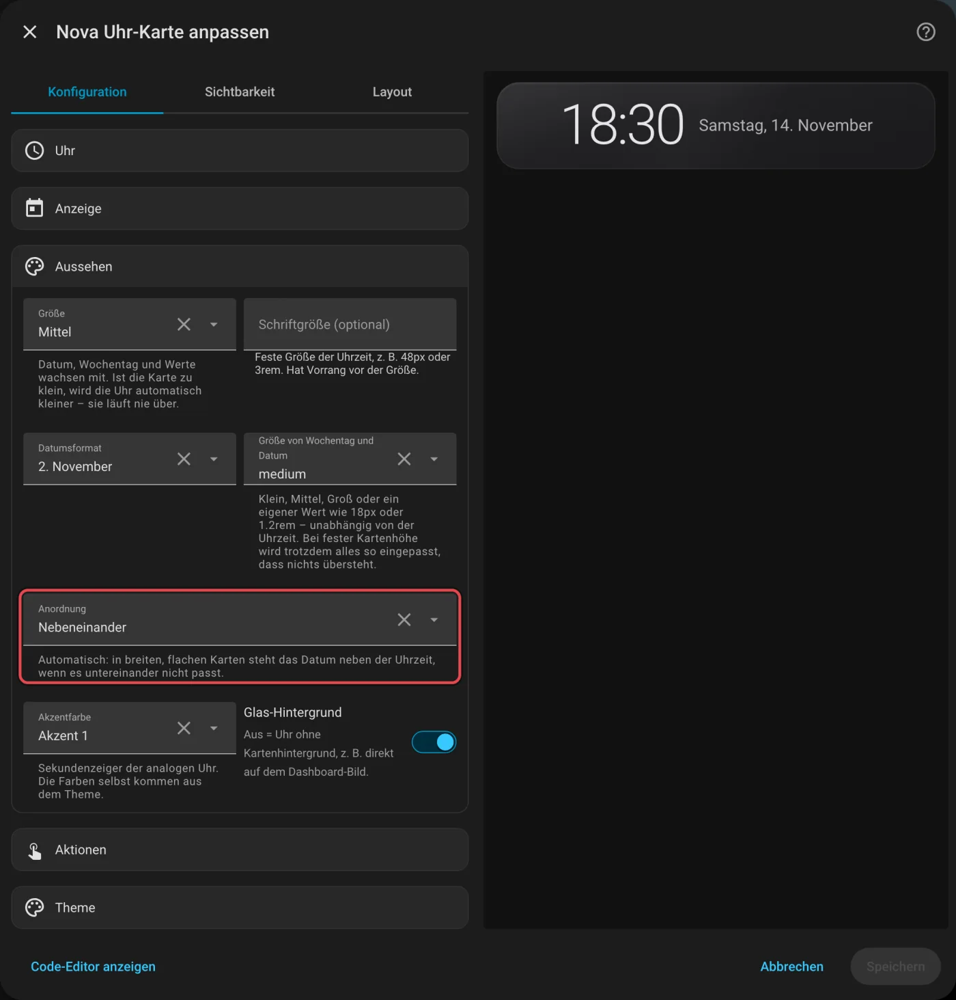</p>

<details><summary>Für Fortgeschrittene: als YAML</summary>

```yaml
type: custom:nova-clock-card
layout: row   # stacked = immer untereinander
grid_options:
  columns: 30
  rows: 2
```

</details>

### Wenn die Uhr ohne Kartenhintergrund auf dem Dashboard stehen soll, dann so

1. Klapp **Aussehen** auf.
2. Schalte **Glas-Hintergrund** aus.
3. Tippe auf **Speichern**.

<p align="center">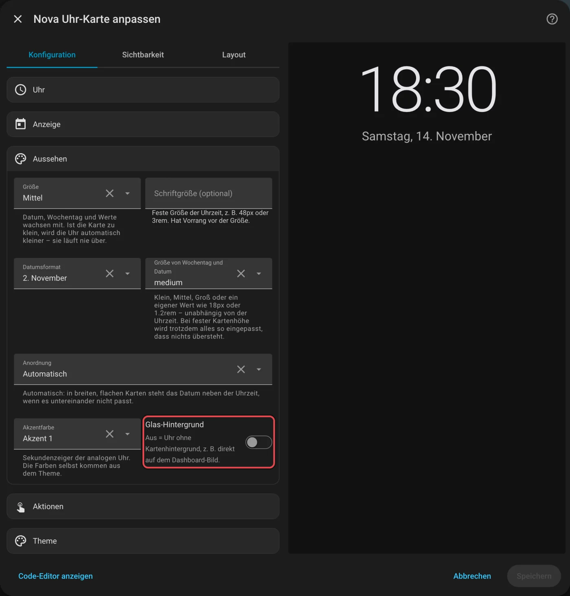</p>

<details><summary>Für Fortgeschrittene: als YAML</summary>

```yaml
type: custom:nova-clock-card
glass: false
```

</details>
## Häufige Fragen

**Woher kommt die Zeitzone?**  
Aus Home Assistant. Sprache und 12/24 Stunden kommen aus deinem Profil.

- Die Uhr hat genau einen Zeitgeber. Er feuert nur zum nächsten Minutenwechsel (mit Sekunden: Sekundenwechsel) und nur,
  solange die Karte zu sehen ist. Wird die Karte entfernt oder der Tab versteckt, läuft nichts weiter.
- Der gleitende Sekundenzeiger läuft als Animation ohne Zeitgeber. Ist „Bewegung reduzieren“ eingestellt, springt er stattdessen.
- Die Zeit kommt vom Gerät, auf dem das Dashboard läuft, angezeigt in der Zeitzone von Home Assistant. Geht die Uhr des Geräts falsch, geht auch die Karte falsch.

Mehr Hilfe gibt es in [Kapitel 7](../07-hilfe.md).

## Alle Optionen (für Fortgeschrittene)

Alles hier kannst du auch im grafischen Editor einstellen. Wer lieber Text schreibt, tippt im Editor unten auf **Code-Editor anzeigen**. Dort steht die Karte als YAML (eine einfache Textform für Einstellungen). Der Kartentyp ist `custom:nova-clock-card`.

Sprache und 12/24 Stunden kommen aus deinem Home-Assistant-Profil, die Zeitzone ist immer die von Home Assistant.

| Option | Standard | Bedeutung |
|---|---|---|
| `style` | `default` | `default` (digital), `flip` (Klappzahlen), `analog`, `glow` (Leuchtziffern), `retro` (Radiowecker) |
| `second_hand` | `sweep` | Nur `style: analog`: `sweep` (gleitend), `tick` (springend) oder `none` |
| `retro_color` | `red` | Nur `style: retro`: `red`, `green`, `blue` oder `amber` |
| `sun_entity` | `sun.sun` | Nur `style: glow`: Sonne für die Farbe. Fehlt sie, wird der Sonnenstand aus der Uhrzeit geschätzt |
| `mode` | `digital` | Alte Schreibweise: `mode: analog` entspricht `style: analog` mit Sekundenzeiger über `show_seconds` |
| `name` | – | Kleine Überschrift über der Uhr, z. B. „Küche“ |
| `show_seconds` | `false` | Sekunden anzeigen (digital und Radiowecker klein hinter der Zeit; nicht bei Klappzahlen) |
| `analog_digital` | `false` | Nur analog: zusätzlich die digitale Zeit neben dem Zifferblatt |
| `show_weekday` | `true` | Wochentag |
| `show_date` | `true` | Datum |
| `entities` | – | Werte unter der Uhr, z. B. Temperatur und Feuchte. Einträge als Entität oder `{entity, name, icon, unit, decimals}` |
| `date_format` | `long` | `long` (2. November), `long_year` (2. November 2026), `short` (2. Nov.) oder `numeric` (02.11.2026) |
| `time_format` | `auto` | `auto` (wie im Profil), `24` oder `12` |
| `color` | `accent-1` | Farbrolle für den Sekundenzeiger der analogen Uhr |
| `glass` | `true` | Glas-Hintergrund der Karte |
| `size` | `medium` | Größe der Uhr: `small`, `medium` oder `large`. Datum, Wochentag und Werte wachsen mit |
| `font_size` | – | Feste Schriftgröße der Uhrzeit, z. B. `48px` oder `3rem` (Zahl = px). Hat Vorrang vor `size` |
| `date_size` | `medium` | Größe von Wochentag und Datum, unabhängig von der Uhrzeit: `small`, `medium`, `large` oder ein Wert wie `18px` / `1.2rem` |
| `layout` | `auto` | `auto` (in flachen Karten nebeneinander, wenn untereinander nicht passt), `stacked` (untereinander) oder `row` (nebeneinander). Analog hat sein eigenes Layout |
| `tap_action`, `hold_action` | – | Aktion beim Antippen bzw. langen Drücken |

Theme-Variablen: `--nova-clock-morning`, `--nova-clock-noon`, `--nova-clock-night` – Farben der Leuchtziffern.
`--nova-led-red`, `--nova-led-green`, `--nova-led-blue`, `--nova-led-amber` – LED-Farben des Radioweckers. `--nova-clock-size` – Schriftgröße der digitalen Zeit bzw. größte Breite des Zifferblatts. `--nova-clock-info-size` – Schriftgröße der Werte-Zeile unter der Uhr (Standard passt sich der Kartenbreite an, 14–26 px).

---

[← Alle Karten](README.md) · [Inhaltsverzeichnis](../../README.md)
