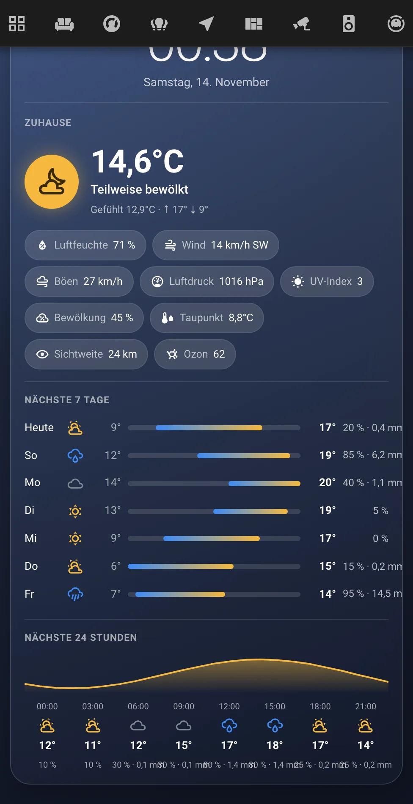
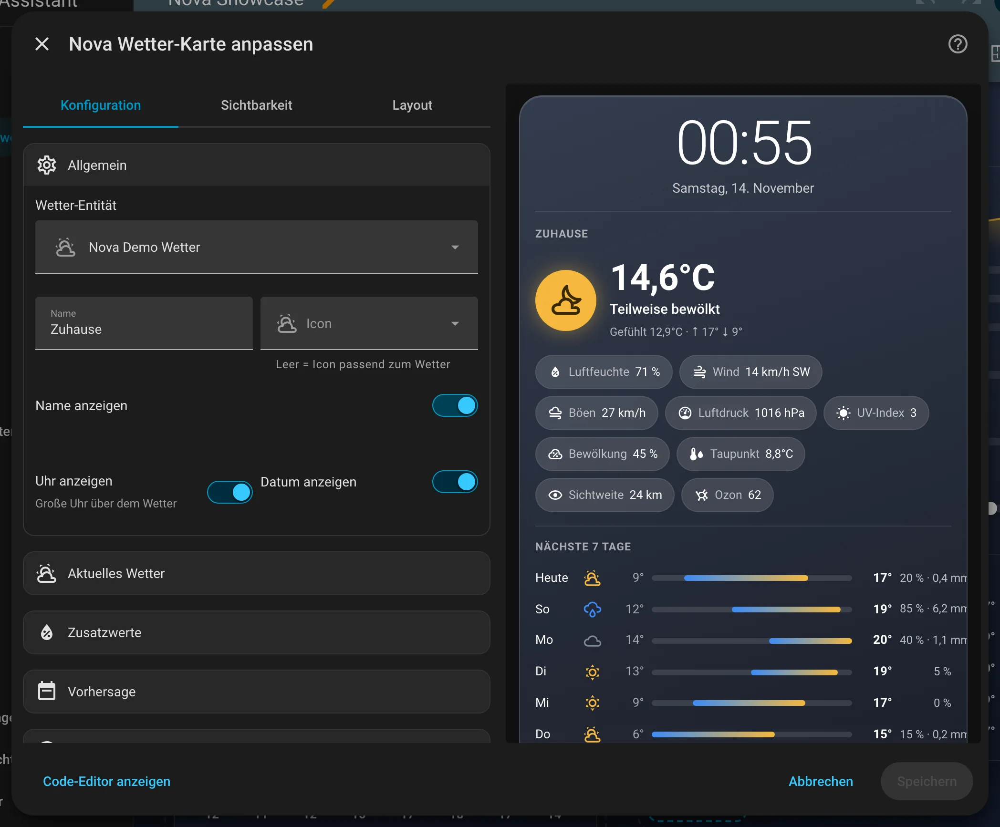

# Nova Wetter Card

[← Alle Karten](README.md) · [Inhaltsverzeichnis](../../README.md)

## Was macht die Karte?

<p align="center"></p>

Das aktuelle Wetter mit großem Icon und Temperatur. Darunter stehen Werte wie Luftfeuchte und Wind und eine Vorhersage für die nächsten Tage und Stunden.

So kann sie aussehen:

<table>
<tr><td align="center" width="50%"><br><sub>Standard</sub></td><td align="center" width="50%"><br><sub>Nur aktuelles Wetter</sub></td></tr>
</table>

## Wofür brauche ich sie?

- Du willst morgens sehen, ob du einen Schirm brauchst.
- Du willst eine schöne Wetteranzeige auf dem Wandpanel.

## Einrichten Schritt für Schritt

Wie du eine Karte grundsätzlich hinzufügst, steht in [Kapitel 3](../03-erste-schritte.md#4-erste-karte-hinzufügen). Kurz gesagt:

1. Öffne dein Dashboard und tippe oben rechts auf den **Stift** (Dashboard bearbeiten).
2. Tippe im Abschnitt auf **+**, wechsle zum Reiter **Nach Karte** und suche nach „Nova Wetter“. Tippe die Karte an.
3. Unter **Allgemein** wählst du deine Wetter-Entität. Sie beginnt mit `weather.`. Home Assistant bringt meist schon eine mit (Met.no).
4. Unter **Zusatzwerte** wählst du, welche Werte unter der Temperatur stehen.
5. Unter **Vorhersage** schaltest du Tages- und Stundenvorhersage an oder aus.
6. Rechts siehst du sofort, wie die Karte aussieht. Passt alles, tippe auf **Speichern**.

<p align="center"></p>

Im Editor findest du diese Bereiche: Allgemein · Aktuelles Wetter · Zusatzwerte · Vorhersage · Aussehen · Aktionen · Theme. Tipp einen Bereich an, um ihn aufzuklappen.

## Rezepte: Wenn du … willst, dann so

### Wenn du die Temperatur von deinem eigenen Außenfühler willst, dann so

Unter **Aktuelles Wetter** bei **Temperatur-Sensor (optional)** deinen Sensor wählen.

### Wenn nur das aktuelle Wetter ohne Vorhersage zu sehen sein soll, dann so

Unter **Vorhersage** beide Vorhersagen ausschalten.

## Häufige Fragen

**Ich habe keine Wetter-Entität.**  
Füg unter **Einstellungen → Geräte & Dienste → Integration hinzufügen** die Integration „Meteorologisk institutt (Met.no)“ hinzu. Sie ist kostenlos und braucht kein Konto.

Mehr Hilfe gibt es in [Kapitel 7](../07-hilfe.md).

## Alle Optionen (für Fortgeschrittene)

Alles hier kannst du auch im grafischen Editor einstellen. Wer lieber Text schreibt, tippt im Editor unten auf **Code-Editor anzeigen**. Dort steht die Karte als YAML (eine einfache Textform für Einstellungen). Der Kartentyp ist `custom:nova-weather-card`.

Aktuelles Wetter einer `weather.*`-Entität mit Tages- und Stundenvorhersage: Icon, Temperatur, Zustand, Max/Min, Regen und
Zusatzwerte wie Luftfeuchte, Wind und Luftdruck. Die Vorhersage kommt direkt von der Wetter-Entität.

### Beispiel in YAML

```yaml
type: custom:nova-weather-card
entity: weather.forecast_home
temperature_entity: sensor.balkon_temperatur
show_clock: true
show_date: true
details: [humidity, wind, pressure, uv_index]
show_hourly: true
hours: 24
hour_step: 3
```

| Option | Standard | Bedeutung |
|---|---|---|
| `entity` | – | Wetter-Entität (Pflicht) |
| `name`, `icon` | Name der Entität, Icon passend zum Wetter | Name und Icon |
| `show_name` | `true` | Name anzeigen |
| `show_clock`, `show_date` | `false` | Große Uhr bzw. Datum über dem Wetter |
| `temperature_entity` | – | Eigener Temperatursensor statt der Temperatur der Wetter-Entität |
| `show_feels_like` | `true` | Gefühlte Temperatur anzeigen |
| `feels_like_entity` | – | Sensor für die gefühlte Temperatur. Leer = Attribut `apparent_temperature`, falls vorhanden |
| `show_high_low` | `true` | Max/Min von heute (aus der Tagesvorhersage) |
| `decimals` | bis zu 1 | Nachkommastellen der Temperatur |
| `show_details` | `true` | Zusatzwerte als Chips anzeigen |
| `label_details` | `false` | Zusatzwerte beschriften |
| `details` | `humidity`, `wind`, `pressure` | Auswahl aus `humidity`, `wind`, `wind_gust`, `pressure`, `uv_index`, `cloud_coverage`, `dew_point`, `visibility`, `ozone`. Werte, die die Entität nicht liefert, fallen weg |
| `show_daily` | `true` | Tagesvorhersage anzeigen |
| `days` | `7` | Anzahl Tage (1–14) |
| `daily_bar` | `true` | Temperatur-Balken in der Tagesvorhersage |
| `show_hourly` | `false` | Stundenvorhersage anzeigen |
| `hourly_layout` | `columns` | `columns` (Spalten) oder `list` (Liste mit Balken) |
| `hourly_graph` | `true` | Temperaturkurve in der Stundenvorhersage |
| `hours` | `24` | Zeitraum in Stunden (1–72) |
| `hour_step` | `3` | Jede wievielte Stunde angezeigt wird |
| `show_probability` | `true` | Regenwahrscheinlichkeit, wenn die Vorhersage sie liefert |
| `show_precipitation` | `true` | Niederschlagsmenge |
| `show_titles` | `true` | Überschriften über den Vorhersagen |
| `hourly_first` | `false` | Stunden vor Tagen zeigen |
| `color` | `auto` | Farbrolle der Icons: `auto` (nach Wetter), `neutral`, `accent-1` … `accent-4` |
| `tap_action`, `hold_action` | Details der Wetter-Entität | Aktionen beim Antippen / langen Drücken |

---

[← Alle Karten](README.md) · [Inhaltsverzeichnis](../../README.md)
